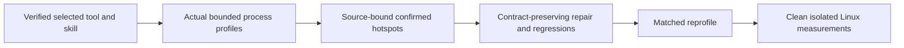

# .NET profiling and measured bottleneck repairs

This profiling contract supplements [BenchmarkComparisons](../BenchmarkComparisons.md), [Methodology](Methodology.md), ADR-122, and the native Orleans/ZoneTree/replicated-cluster and normal SIMD contracts.

Use [dotnet-diagnostics-mcp](https://github.com/pedrosakuma/dotnet-diagnostics) (installed with `dotnet tool install -g dotnet-diagnostics-mcp`) and the installed dotnet-diagnostics-profiling skill, which wraps its native APIs and includes a self-contained official MCP C# SDK helper. Project-scoped `.codex/config.toml` configures the stdio transport alongside Roslynk; global MCP configuration is unchanged. Application profiling is a separate gate from tool installation.

| Requirement | Acceptance | Evidence |
|---|---|---|
| REQ-PROFILE-001: install/verify the selected tool and create a discoverable skill from its actual native APIs. | AC-PROFILE-001: original installation/version receipt, valid skill frontmatter and actual MCP initialization/tool discovery. | Installation and version receipt, skill validation and official-SDK tool discovery; request retention, bounded timeout and a healthy follow-up discovery. |
| REQ-PROFILE-002: profile actual processes under bounded representative workloads. | AC-PROFILE-002: original CPU, allocations, GC, contention and ThreadPool captures or explicit native unavailable results; exact process/runtime/source/DLL/PDB/topology/workload/window/loss/overhead metadata. | Actual capture gate; installation/source review is insufficient. |
| REQ-PROFILE-003: repair confirmed hotspots without weakening contracts. | AC-PROFILE-003: retained causal evidence, reviewed owning-source repair, focused meaningful correctness/fault/resource regressions and successful required checks; ManagedCode repairs follow owning-repository publication policy. | Repair and regression gate. |
| REQ-PROFILE-004: verify changes with matched evidence. | AC-PROFILE-004: matched before/after profiles plus separate clean isolated Linux GitHub benchmark artifacts with equivalent hardware, source identity, topology, scale, operation counts, resources and durability. | Reprofile and performance gates; diagnostic overhead cannot become a speed claim. |
| REQ-PROFILE-005: use diagnostics regularly during development alongside Roslynk. | AC-PROFILE-005: root policy selects bounded profiling for runtime symptoms and regressions, requires source mapping and matched reprofile, and distinguishes compiler/documentation work. | Policy review and repository governance. This workflow criterion uses explicit policy review rather than an implementation-mirroring test. |

Profiling workflow: obtain the actual source-matched functional build and owned workload; confirm PID/runtime/DLL/PDB/topology; collect bounded native profiles and unavailable results; map evidence to the owning source; repair a confirmed issue with meaningful operation regressions; repeat matched profiles and qualify clean Linux measurements. ADR-122 and the native topology/ownership contracts are sufficient; no new product boundary or benchmark scenario is selected. Original quality/loss/overhead evidence is retained, and a symptom such as a ThreadPool-stall warning is not a measured hotspot: attach only to the actual source/DLL/PDB-bound functional runner and select no performance repair without that runtime capture. No speed claim follows from tooling or an idle-process capture.

The protocol smoke, captures, repair regressions and comparable Linux artifacts are the acceptance checks. Until a concrete contributor cohort is implemented and discovered, each runtime criterion has an explicit manual evidence exception: the task owner retains original native tool results and original GitHub run/job/artifact links. Missing, partial or unsupported observations remain explicit, never fabricated zero values or PASS. A collector smoke against a small client process verifies collector invocation and handle inspection only; it is neither a KeyLoad workload nor acceptance of AC-PROFILE-002.

Backend execution, storage, SDK/MCP contracts and the benchmark scenario inventory are unchanged. Frontend changes are N/A until qualified original measurements exist. Local functional diagnostics may explain behavior; KeyLoad benchmark-stage execution and published comparisons remain GitHub-only. Preserve real native Orleans membership, node-local ownership, persisted authorization, acknowledgement from every configured copy of the configured replica copies, admission, cancellation and joined shutdown. Keep original captures private and bounded; do not collect credentials or user payloads merely to profile a hot path.
