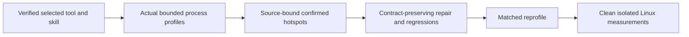

# KL-105: .NET profiling and measured bottleneck repairs

Owner direction2026-10-12 adds KL-105 to the existing plan without changing earlier task acceptance. This supplements [BenchmarkComparisons](../BenchmarkComparisons.md), [Methodology](Methodology.md), ADR-122, and the native Orleans/ZoneTree/RF3 and normal SIMD contracts.

Use [dotnet-diagnostics-mcp](https://github.com/pedrosakuma/dotnet-diagnostics) and [the installed dotnet-diagnostics-profiling skill](/Users/ksemenenko/.codex/skills/dotnet-diagnostics-profiling/SKILL.md). The selected installation command is `dotnet tool install -g dotnet-diagnostics-mcp`; the verified retry returned exit0 with version0.28.0 already installed. Its NuGet repository metadata identifies source commit `551dd045a87de0e49ffe3165103a6df6450d2adf`. The updated skill passes native validation, enables automatic discovery and includes a self-contained official MCP C# SDK helper. Project-scoped `.codex/config.toml` configures stdio alongside Roslynk; global MCP configuration is unchanged. Actual MCP initialization and discovery returned13 tools. A bounded client-timeout probe retained the original request and classified client failure, then a follow-up discovery succeeded. Application profiling is a separate gate.

| Requirement | Acceptance | Evidence |
|---|---|---|
| REQ-PROFILE-105-001: install/verify the selected tool and create a discoverable skill from its actual native APIs. | AC-PROFILE-105-001: original installation/version receipt, valid skill frontmatter and actual MCP initialization/tool discovery. | Verified installation0.28.0, skill validation and official-SDK discovery13; request retention, bounded timeout and healthy follow-up discovery passed. |
| REQ-PROFILE-105-002: profile actual processes under bounded representative workloads. | AC-PROFILE-105-002: original CPU, allocations, GC, contention and ThreadPool captures or explicit native unavailable results; exact process/runtime/source/DLL/PDB/topology/workload/window/loss/overhead metadata. | Actual capture gate open; installation/source review is insufficient. |
| REQ-PROFILE-105-003: repair confirmed hotspots without weakening contracts. | AC-PROFILE-105-003: retained causal evidence, reviewed owning-source repair, focused meaningful correctness/fault/resource regressions and successful required checks; ManagedCode repairs follow owning-repository publication policy. | Repair and regression gate open. |
| REQ-PROFILE-105-004: verify changes with matched evidence. | AC-PROFILE-105-004: matched before/after profiles plus separate clean isolated Linux GitHub benchmark artifacts with equivalent hardware, source identity, topology, scale, operation counts, resources and durability. | Reprofile and performance gates open; diagnostic overhead cannot become a speed claim. |
| REQ-PROFILE-105-005: use diagnostics regularly during development alongside Roslynk. | AC-PROFILE-105-005: root policy selects bounded profiling for runtime symptoms and regressions, requires source mapping and matched reprofile, and distinguishes compiler/documentation work. | Root policy updated; policy review and repository governance pass. This workflow criterion uses explicit policy review rather than an implementation-mirroring test. |

The current local prerequisite build of `tests/KeyLoad.UnitTests/KeyLoad.UnitTests.csproj` exited1 with31 Orleans errors, including inaccessible `AnnProjectionJobProtocol.Identity` (`ORLEANS0107`/`CS0122`), experimental Journaling opt-ins (`ORLEANSEXP005`) and runtime-options/analyzer findings. No current KeyLoad application process was discovered; the matching paths belonged to the diagnostics client. The build failure prevents a source-matched functional application profile. Retain the original log privately under `artifacts/profiling/kl105-development-20261012/`; the task stays in progress and no bottleneck or speed claim follows.

Execute the remaining scope in this order: obtain the actual source-matched functional build and owned workload; confirm PID/runtime/DLL/PDB/topology; collect bounded native profiles and unavailable results; map evidence to the owning source; repair a confirmed issue with meaningful operation regressions; repeat matched profiles and qualify clean Linux measurements. Existing ADR-122 and native topology/ownership contracts remain sufficient; no new product boundary or benchmark scenario is selected here. The root owns shared policy/configuration/status and final evidence. A read-only supporting agent reviewed the installed-version upstream schemas and collector interpretation; it owns no process, edits or qualification.

The actual protocol smoke, captures, repair regressions and comparable Linux artifacts are the acceptance checks. Until a concrete contributor cohort is implemented and discovered, each runtime criterion has an explicit manual evidence exception: the task owner must retain original native tool results and original GitHub run/job/artifact links, and acceptance stays open. Missing, partial or unsupported observations remain explicit, never fabricated zero values or PASS.

A separate3-second collector smoke targeted only the owned official MCP client on macOS arm64/.NET10.0.12. Native allocation, GC, ThreadPool, counters and contention calls returned handles; the CPU request returned `UnsupportedRuntime` after native classification as `NativeAot`, despite the helper's `PublishAot=false` and managed CoreLib allocation frames. Preserve that classification discrepancy as observed evidence without assuming a root cause. No GC suspension boundaries or contention events were observed; ThreadPool quality explicitly remained inconclusive. Sampling loss and target overhead were unmeasured. These captures verify collector invocation and handle inspection only; they are not a KeyLoad workload, hotspot finding, healthy-control result or acceptance of AC-PROFILE-105-002.

Backend execution, storage, SDK/MCP contracts and the benchmark scenario inventory are unchanged. Frontend changes are N/A until qualified original measurements exist. Local functional diagnostics may explain behavior; KeyLoad benchmark-stage execution and published comparisons remain GitHub-only. Preserve real native Orleans membership, node-local ownership, persisted authorization, RF3 acknowledgement, admission, cancellation and joined shutdown. Keep original captures private and bounded; do not collect credentials or user payloads merely to profile a hot path.
