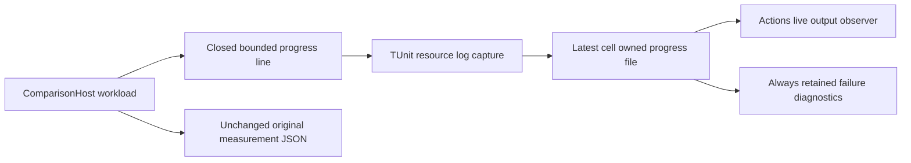

# Live benchmark progress

Parent: [BenchmarkComparisons](../BenchmarkComparisons.md).
Decision: [ADR-085](../../ADR/ADR-085-live-benchmark-progress.md).

Measurement jobs share one live database/topology across separate TUnit cases
([ADR-142](../../ADR/ADR-142-shared-live-benchmark-sessions.md),
[SessionExecution](SessionExecution.md)). A long workload must not look idle in
GitHub Actions: workload phase and attempt progress are visible while it runs, and a
cancelled job retains the latest workload phase. This feature owns benchmark
observability only, not the database execution implementation. The dataset,
operation-count, capability, correctness, privacy, cancellation, resource,
topology and provenance requirements stay mandatory; the seven document cases do not
complete the required vector, graph, queue, event, time-series or physical 100k-corpus
coverage, and exact-source Linux qualification is a separate gate.

| Requirement | Acceptance | Automated proof |
|---|---|---|
| REQ-BC-LIVE-001 visible real progress | AC-BC-LIVE-001 report oracle, initialization, warmup, mutation preparation, measurement and validation transitions; emit a bounded heartbeat at most every 30s while active. Measurement counts represent actually settled attempts, with failures separate; initialization totals may remain unavailable. No fabricated throughput, ETA or success from progress | real ComparisonRunner regression and live child/relay tests |
| REQ-BC-LIVE-002 privacy and resource bounds | AC-BC-LIVE-002 emit only a fixed marker, closed phase, nonnegative repetition/count/elapsed values; lines at most 512 characters, no credentials, document content, endpoint, error text or arbitrary target names. Capture removes only the pinned Aspire UTC timestamp prefix before validating the entire marker. Keep one latest snapshot, not an unbounded queue; logging exceptions cannot replace the original workload outcome | positive/negative parser and real file/process tests |
| REQ-BC-LIVE-003 cancellation evidence | AC-BC-LIVE-003 persist the latest accepted snapshot under the cell-owned failures directory while the test is running. Actions relays that file independently of TUnit/CLI buffering; always-upload teardown retains it after cancellation. Stop and join every progress observer, preserve AppHost exit and signal cancellation to owned process group | genuine process exit/cancellation regressions; delivered Linux cancellation artifact |
| REQ-BC-LIVE-004 unchanged measurement | AC-BC-LIVE-004 retain exact vector semantics, corpus, repetitions, concurrency, per-operation deadlines, real clients, Docker/Aspire topology and report/provenance contracts. Oracle preparation checks caller cancellation before each bounded operation. Progress must not become website performance evidence | existing corpus/selection/report checks, real runner cancellation test and source review |

Slice map: Comparisons owns observer and phase accounting; ComparisonHost owns live
log capture and the latest durable snapshot. Scripts relay bounded process output;
`benchmarks.yml` joins the measured workload and retains original artifacts.
Benchmark orchestration belongs to `benchmarks/KeyLoad.ComparisonHost/Orchestration`.
Build and Tests runs product TUnit suites independently.

Verification requires formatter/governance, a complete solution build, and original
delivered-source Linux benchmark artifacts. Real cluster recovery, endurance and scale
remain separate gates. A 4096-document, 50000-attempt control workload does not qualify
100000- or 1000000-record measurements. Original-job times are not request latency
metrics. A source checkpoint is not a passing build, runtime, replication or
performance qualification.
