# Comparable database benchmark methodology

This methodology is the shared live-session contract of
[ADR-142](../../ADR/ADR-142-shared-live-benchmark-sessions.md) and
[SessionExecution](SessionExecution.md): no per-scenario workers, warmup namespaces or
fresh repetition resets. one-node/three-node topology and the
fairness/correctness requirements of
[ADR-122](../../ADR/ADR-122-benchmark-methodology.md) apply. Implementation and
exact-source Linux qualification are separate acceptance gates. Original reports retain
their actual settings and are never relabelled.

## Execution unit and timing

Each database has two isolated Linux measurement jobs: one node and execution
three nodes. Different databases/topologies never share a runner, containers,
volumes or measurement session. One Aspire-owned deployment lives for the entire
job. Many separate real TUnit tests share its fixture; only one workload
test executes at a time, with the declared concurrent clients inside that test.
The common preparation builds the client runner once and resolves the latest public
released KeyLoad image to one digest. Each worker imports the same-run client
binaries/tools and deploys the pinned public image. Release and Build and Tests
remain separate; Benchmarks does not invoke them or publish a product image.

```mermaid
flowchart LR
    Ready[Aspire readiness and actual membership] --> Load[Measure initial million writes]
    Load --> Index[Measure index construction]
    Index --> Operations[Separate read search and query tests]
    Operations --> Mixed[Concurrent create delete update read search]
    Mixed --> Verify[Full final content and replica verification]
    Verify --> Models[Prepare model corpus then vector queue and event tests]
    Models --> Original[Original per-test reports samples and TRX]
    Original --> Aggregate[Authenticate all database and topology jobs]
```

The initial 1,000,000-record load is a measured test. Setup contains no
hidden corpus insertion. There is no warmup and no per-case reset, cleanup,
reseed or restart. The state of the runtime, cache, storage and indexes evolves
naturally during the declared operation order; this does not claim cold-cache
measurements. index construction and settlement have their own measured
result where the database exposes an equivalent operation. Intrinsic index
maintenance remains in measured writes. Missing capabilities are explicit
unavailable results with no numeric substitute.

Initial load, operation lanes and the wall time of a concurrent mixed test are
separate measurements. Readiness and full correctness/replica verification are
outside operation latency. Actual caller-acknowledgement defines write
completion. No extra read is silently included in a measured write. A execution
batch acknowledgement records its real batch size and duration; it cannot be
expanded into invented per-record latency samples.

## Shared live operation schedule

The deterministic corpus, seed, payload, key groups, query predicates, requested
counts and client limits are identical across applicable adapters. The initial
corpus has 1,000,000 records. The production session uses 16 bounded clients;
operation tests perform at least 100,000 original requests per applicable lane.
One client has one outstanding original call unless an explicitly equivalent
batching/pipelining contract is part of the shared case.

| Test | Measured work and correctness contract |
|---|---|
| Initial load | 1,000,000 distinct actual writes, followed by independent complete identity/body verification. |
| Index | Actual build/settlement on the retained corpus; unavailable when no equivalent lifecycle exists. |
| Sequential read | 100,000 stable-group keys in identity order, validating returned content. |
| Random read | 100,000 seed-bound stable-group keys in deterministic order, validating returned content. |
| Search/query | 100,000 equivalent predicates with bounded results and exact content oracles. Range/complex-query expansion remains separately tracked. |
| Mixed | Concurrent lanes: 100,000 creates, 100,000 deletes, 100,000 updates, 100,000 reads and 100,000 search requests. Each lane retains its actual outcomes and timestamps. |
| Final verification | Exactly 900,000 retained original keys plus 100,000 new keys; correct replacements and absence of deleted keys, with actual replica proofs. |
| Model setup | Separately timed native provisioning and acknowledged lazy corpus preparation, once per model namespace. |
| Exact vectors | 100,000 exact cosine top-k queries over 1,000,000 32-dimensional vectors; ordered IDs and complete JSON bodies checked against a bounded independent oracle. |
| Queue | 100,000 confirmed publish/receive/manual ACK cycles; complete bodies, unique delivery accounting and separate phase latency. The queue ends empty. |
| Events | Separate 100,000 append and read lanes, plus overlapping eight-client append/read streams; deterministic IDs, revision and complete persisted bodies. |

Delete, update and stable-read key groups are disjoint. Creates use new keys.
The mixed test starts admitted clients through a common barrier and proves
observed overlap from original timestamps; it does not serialize the lanes and
label them concurrent. The final cardinality remains 1,000,000. Count alone is
insufficient: complete bounded readback verifies identities, bodies and mutation
results. A million payload objects or 100,000 pending tasks must not be retained
merely to schedule the work.

## Other required families and functional load

The full product comparison still requires vectors/search accuracy,
graphs, queues, event streams, time series, ordered/range and complex queries,
plus ingestion at 1/10/500 clients. These run as additional real cases on the same
database/topology infrastructure. The thirteen-case session includes exact vectors, queues and events but does not qualify
the complete inventory. Unsupported functionality is distinguished from
an unimplemented adapter or failed prerequisite; implementation gaps must not be
reported as absence.

Every family uses the same canonical scenario, corpus/seed, operation order,
counts, metric/filter, accuracy target, resource limits and effective durability
contract across applicable databases. Vector indexes retain exact/HNSW/IVFFlat,
filtered/concurrent-update and recall requirements where supported.
batching, index build and accuracy are declared explicitly. Closed-loop
request timings do not prove scheduled-arrival/open-loop or endurance behavior.

Benchmarks takes every database, KeyLoad included, from its Docker image and
compiles no KeyLoad server, so the source-built functional cluster million-record
ingestion tests (`HeavyDocumentLoadClusterTests`) are not part of Benchmarks or of
numerical publication; the KeyLoad 1-node and 3-node session cells are the KeyLoad
ingestion measurement. Wherever those functional tests are selected, heavy-load
admission still requires explicit enabled settings, the exact class filter,
one-test parallelism and disabled coverage; missing/false/broad/duplicate filters,
coverage or wrong parallelism fail before resources are acquired. Normal functional
concurrency and all process-recovery/cluster gates are unchanged.

## Original results, resources and failure

Retain attempted, completed, successful, failed, cancelled and unfinished counts,
actual timestamps, useful completed throughput and per-operation p50/p95/p99.
Counts and latency distributions must be reproducible from bounded original
full-count samples, including failures; do not average percentiles or choose a
best repetition. The mixed wall time is not the sum of concurrent lane times.
Client CPU/allocations/working set and server per-node CPU/RAM observations stay
separate. Missing instrumentation is explicit and cannot become a zero result.

Record exact source/run/attempt/job/artifact identities, Linux/runtime/CPU,
DLL/PDB hashes, images, observed membership/data copies, resource limits,
filesystem, transport, read consistency, index settings and effective ACK/durability.
A node count alone does not establish equivalent guarantees. A KeyLoad write is
acknowledged by every configured copy (three of three in the three-node topology). The
one-node KeyLoad arm has a single copy. Unequal contracts prohibit a
performance-winner claim.

Cancellation stops admission, cancels and joins original calls, then disposes
clients and the Aspire deployment. Preserve the primary and shutdown
failures and completed original reports. A failed load poisons dependent tests;
they retain real failed prerequisite outcomes rather than invented measurements.
No automatic measurement retry repairs the statistics. No skipped, missing,
corrupt or mixed-cohort original is accepted as a complete session.

Aggregation authenticates all 32 database/topology jobs, their exact planned
cases, original reports and TRX, pinned released images, compiled-runtime
identity/import receipts and statistics. Actual failed cases retain null metrics
and original provenance. Website independently qualifies its source, archives,
real browser and coverage before rendering these results; content-only publication
contains no fabricated measurements when no eligible cohort exists.

## Acceptance and evidence

REQ/AC-BSESSION-001..008 in [SessionExecution](SessionExecution.md) own matrix,
fixture, measured load, mixed work, shared build, no warmup/reset, authenticated
accounting and exact-source Linux completion. Authored source, controlled
rejection inputs, an upstream benchmark or a local build closes none of the
performance gates. All benchmark-stage builds, checks, tests and workloads run
in Linux GitHub Actions. Full model-family completion, actual execution,
fault/endurance, resource fairness and website qualification remain open until
their original evidence exists. No power-loss or production-readiness claim
follows from process-kill tests or this redesign.
