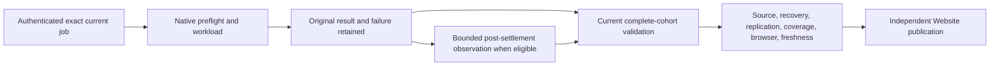
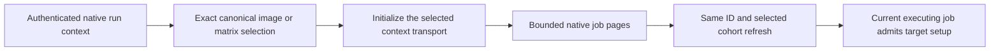
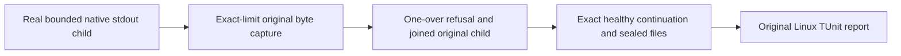
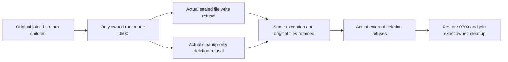

# BenchmarkComparisons native gate repair

[ADR-068](../../ADR/ADR-068-native-benchmark-gate-repair.md) owns the native gate
contracts. The publication contract is defined by
[ADR-076](../../ADR/ADR-076-current-cohort-publication.md),
[ADR-080](../../ADR/ADR-080-benchmark-failure-isolation.md),
[ADR-112](../../ADR/ADR-112-independent-website-publication.md), and the
[BenchmarkComparisons feature](../BenchmarkComparisons.md). Exact-source Linux
qualification of the cohort, the complete native failure paths and provider publication
are separate acceptance gates.

| Requirement | Acceptance contract and evidence |
|---|---|
| REQ-NGR-001: authenticate the exact executing job | AC-NGR-001 requires bounded authenticated discovery and revalidation of the same own-repository workflow, source, attempt, and job. Only strict `in_progress` with a null result admits native setup; queued, terminal, unknown, mismatched, exhausted, cancelled, transport-failed, or malformed state rejects before allocation or timing. The initial request is bounded to 120,000 ms. Only after an exact queued response may one 60,000 ms stale-response window run at a cancellation-aware 1,000 ms cadence, with no more than 61 total captures. Preserve exact request, body, and header behavior, including the current-job-only `Cache-Control: no-cache, max-age=0` refresh. No reselection, stale fallback, or workload retry. Real current-job authority cases and exact-source GitHub execution are required. |
| REQ-NGR-002: preserve native Kurrent events | AC-NGR-002 requires exact original/custom/system metadata equality, a complete 55,378-item owned-stream oracle, foreign-resource noninterference, and owned cleanup across genuine one- and three-node cases. Empty tracing remains uncharacterized; tests must not assume an empty result. Genuine pinned-SDK and native Aspire evidence is required. |
| REQ-NGR-003: prove native leader routing | AC-NGR-003 requires pinned SDK and advertised-endpoint validation, genuine leader/follower routing, and observed membership, copies, and acknowledgements. No guessed leader, standalone substitute, or measured write retry is allowed. Native preflight and complete workload results are separate evidence. |
| REQ-NGR-003D: retain bounded private setup diagnostics | AC-NGR-003D preserves and rethrows the original failure. Emit at most one failure-only line of 4,096 bytes, with at most three causes, eight frames per cause, and 64-character identifiers. Include only a closed phase, exception type, and bounded type/method metadata. Exclude messages, stacks, paths, endpoints, credentials, and payloads. Diagnostics do not establish workload success. |
| REQ-NGR-004: qualify the complete current publication | AC-NGR-004 requires exact source/run/attempt/job and archive provenance for every planned worker and input file of the current plan, plus the separately authenticated document family. Validate exact paths, sizes, hashes, original archive bytes, and source identities. Each slot is a measured result, an authenticated unsupported-topology disposition, or an authenticated terminal workload failure with its fixed safe reason and null report. Failed, cancelled, skipped, missing, mixed, or unavailable evidence is never numeric success. Full source, normal, scalar, recovery, replicated-cluster, native preflight, coverage, browser, freshness, and provider gates remain separate required predicates. The intensive TimeSeries family has its own ADR-050/059 plan and is not folded into this cohort. |
| REQ-NGR-005: observe settled resource failures without changing results | AC-NGR-005 preserves the original case, timing, and samples. Only after an eligible exact `ResourceExhausted` case and its session settle may one authenticated outbox-status read inspect at most 64 consumer heads, outside the measured clock. Unknown or unavailable observations remain unavailable. No quota, purge, retention, or retry change follows from the observation. Native one- and three-node failure-path and cancellation/settlement proof remains required. |

## Verification and ownership

The owning slice is `BenchmarkComparisons`: current-job and diagnostic tooling in
`scripts/Features/BenchmarkComparisons/`, real Node and unit regressions in
`tests/KeyLoad.ComparisonTests/BenchmarkComparisons/UnitContracts/`, native Kurrent
cases in `tests/KeyLoad.ComparisonTests/BenchmarkComparisons/`, and the benchmark
adapter/host and AppHost-owned topology. Tests exercise production context and real
native fixtures; source-name checks and fake executor or target behavior are not
evidence.

Qualification requires the canonical Release build, formatter and governance checks,
the complete ordinary and scalar suites, process recovery, the replicated-cluster SDK
and MCP suites, all native preflights and workloads, source/input immutability, current
coverage/browser thresholds, final freshness checks, and actual provider receipts on
the exact Linux source. A partial run, local development result, source review, or
bounded diagnostic does not satisfy these gates. ADR-068 stays Accepted until its
exact-source criteria pass. The retained original job artifacts and sealed originals
are the source of truth for any past run; their bytes are never rewritten.

## SurrealDB version oracle

The native SurrealDB readback flow asserts the exact pinned server version
(`surrealdb-3.2.4+20260803.93ab219`) through an independent bounded actual HTTP
version assertion. The expected reply derives from the
[native version handler](https://github.com/surrealdb/surrealdb/blob/93ab219d69f09d8f999851b0359c80ebe6726102/surrealdb/server/src/ntw/version.rs),
the [package version construction](https://github.com/surrealdb/surrealdb/blob/93ab219d69f09d8f999851b0359c80ebe6726102/surrealdb/server/src/cnf/mod.rs)
and the SHA-verified Linux-amd64 binary metadata of the pinned image (OCI index
`sha256:51baed8709f57f67dcf04b30e3177db846803fa9342dae2be58c6fa5f8d59843`, embedded
binary SHA256 `8f0471ee2018384e2aaeb4028d5fea670f28bf86a2df3d9b04da00364ea7aff8`).
Strict exact equality and rejection are kept: no alternate-version acceptance or
compatibility fallback. The negative TimeSeries CellId fixture supplies a different
cell than its actual three-node cell. The derivation is an inference until the original
GitHub actual HTTP assertion passes.

## Selected profile transport ownership

REQ-NGR-SELECTED-001: initialize the native GitHub transport on the exact context returned by `selectCurrentJob`; that same object owns all discovery and current-job refresh calls, the selected cohort and the retained request sequence. Image selection retains its original context. Every admitted matrix selection retains its exact canonical profile and native source/run/attempt identity. Do not initialize an unused pre-selection copy, share transport through unrelated global state, relax any provenance guard, or retry a workload to conceal failed setup.

AC-NGR-SELECTED-001 maps to REQ-NGR-SELECTED-001 and AC-NGR-001: the real production-selection positive/negative TUnit cases (`IsolatedGitHubCurrentJobTests`) remain required. Exact-source Linux image and matrix preflight/worker execution must retain native authenticated request headers/bodies, the same actual current job and selected cohort, and append only that current identity before allocating or timing a target. Include an intensive control/preflight and a vector profile from the same original run/attempt; malformed, missing, wrong source/profile/job or terminal state still refuses before workload effects. The image-only native TUnit case does not independently prove matrix-context transport propagation. Genuine matrix entry points and their original capture artifacts are the regression gate; source text comparisons and fabricated HTTP providers are insufficient.

The current-job tooling in `scripts/Features/BenchmarkComparisons/` joins the context selector, native transport, page discovery and same-ID refresh. No target adapter, topology, workload, profile, API/format, resource bound or measurement inventory changes.

## Large genuine native stream regression

REQ-NGR-LARGE-STREAM-001: the bounded native stream API must retain every original binary byte from genuine Node children at 219,259 bytes, 1 MiB and 8 MiB, for natural asynchronous stdout and synchronous fd1 writers. Admit the exact byte limit and independently validate original expected length/hash/full file content; reject one byte over the same limit, join every original child, seal each capture and permit a literal healthy subsequent capture. Retain the small-payload, timeout, archive digest/size, symlink, exclusive-path and ZIP inventory cases.

AC-NGR-LARGE-STREAM-001 maps to REQ-NGR-LARGE-STREAM-001 and AC-ISO-007: six native TUnit cases in IsolatedGitHubFileTests.AcIso007LargeNativeStreamRetainsOriginalBytesRefusesOneOverAndJoinsHealthyContinuation invoke the production streamToFile/validateDownloadedArchive through real bounded Node process ownership. Each covers exact-limit acceptance, one-over refusal, original child exit, immutable file mode, original byte/hash equality, healthy continuation and unchanged process signal-listener counts. The outer native owner retains its original deadline/cancellation/joined cleanup. The cases run only in the Linux Benchmarks contract lane.

Owning map: `IsolatedGitHubFileTests.cs` and `IsolatedGitHubFileProgram.cs` under `tests/KeyLoad.ComparisonTests/BenchmarkComparisons/UnitContracts/`. The regression does not alter transport code or provide an HTTP provider response.

## Large-stream failure evidence ownership

REQ-NGR-LARGE-CLEANUP-001: retain the initiating native stream, runner, cancellation or assertion failure and its owned partial byte evidence. Directory disposal must not delete that failed fixture evidence or replace its original failure. Successful fixtures retain their normal disposal and visible cleanup-only failures.

AC-NGR-LARGE-CLEANUP-001 maps to REQ-NGR-LARGE-CLEANUP-001 and the six AC-ISO-007 cases: retain the joined IsolatedAggregateNodeProcess owner and all six original length/writer cases; an initiating body failure marks only its own ImageBundleTestDirectory for retention and rethrows the original exception. A successful body still deletes that directory normally. This is a test artifact ownership rule; the stream transport and error classifications are unchanged.

AC-NGR-LARGE-CLEANUP-002 maps to REQ-NGR-LARGE-CLEANUP-001: an initiating body failure followed by a directory-deletion failure preserves the original exception identity and the retained original fixture bytes, and a successful body with a deletion failure reports that cleanup failure. The automated mapping is LargeStreamCleanupPermissionTests.ActualLinuxPermissionFaultPreservesInitiatingEvidenceAndSurfacesCleanupOnlyFailure, Arguments(true) and Arguments(false). The cases need retained original Linux fault evidence before qualification. Source/native patch receipts alone do not satisfy either criterion.

Owning map: `ImageBundleTestDirectory.cs` and `IsolatedGitHubFileTests.cs` under the feature's native runner and artifact ownership. The existing bounded joins and explicit deferred-release failure ledgers remain authoritative; the retention marker does not prove that every exceptional process join has completed. Other fixture users keep their successful cleanup behavior.

## Native Linux disposal permission fault control

REQ-NGR-LARGE-CLEANUP-001 → AC-NGR-LARGE-CLEANUP-002 maps to LargeStreamCleanupPermissionTests with Arguments(true) and Arguments(false). The actual LargeSource 219259/async control completes and joins its exact-limit, one-over and healthy children before the fault is armed. This is a native artifact control, not a performance cell; the six length/writer cases and the process cancellation/inclusion contracts are unchanged.

Only the exact owned fixture root changes from 0700 to 0500. Its native sealed 0400 healthy capture then rejects actual FileAccess.Write with UnauthorizedAccessException; the retained case marks the original fixture and rethrows the same initiating exception. Successful body disposal must independently surface its real directory-deletion UnauthorizedAccessException. Both cases require an actual external recursive-delete refusal and complete original fixture bytes/modes equality before finally restoring 0700 and joining deletion of that exact root. Permission-bypass environments fail the refusal assertion, never skip, normalize or synthesize a fault. Unexpected pre-fault native operation failures remain initiating errors; restoration/deletion failures follow them in the ordered observer ledger.

The exact baseline inventory consists only of complete.bin/complete.pid, one-over.bin/one-over.pid and healthy.bin/healthy.pid, as produced by the original LargeSource. Capture refuses any other entry, directory or symlink and requires nonempty healthy capture data before arming the fault. Compiler and original Linux native comparison executions with fault evidence are required to close AC-NGR-LARGE-CLEANUP-002; no local execution or effective-UID assumption qualifies them.
