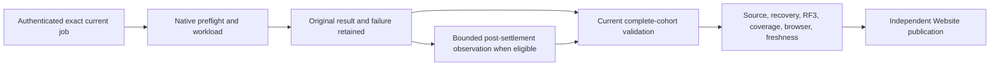
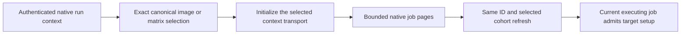
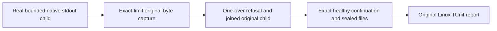

# BenchmarkComparisons native gate repair

Status: Accepted. Source repairs are present; exact-source Linux qualification of
the current cohort, complete native failure paths, and provider publication remain
pending. [ADR-068](../../ADR/ADR-068-native-benchmark-gate-repair.md) owns the
native gate contracts. The current publication contract is defined by
[ADR-076](../../ADR/ADR-076-current-cohort-publication.md),
[ADR-080](../../ADR/ADR-080-benchmark-failure-isolation.md),
[ADR-112](../../ADR/ADR-112-independent-website-publication.md), and the
[BenchmarkComparisons feature](../BenchmarkComparisons.md).

| Requirement | Acceptance contract and evidence |
|---|---|
| REQ-NGR-001: authenticate the exact executing job | AC-NGR-001 requires bounded authenticated discovery and revalidation of the same own-repository workflow, source, attempt, and job. Only strict `in_progress` with a null result admits native setup; queued, terminal, unknown, mismatched, exhausted, cancelled, transport-failed, or malformed state rejects before allocation or timing. The initial request is bounded to 120,000 ms. Only after an exact queued response may one 60,000 ms stale-response window run at a cancellation-aware 1,000 ms cadence, with no more than 61 total captures. Preserve exact request, body, and header behavior, including the current-job-only `Cache-Control: no-cache, max-age=0` refresh. No reselection, stale fallback, or workload retry. Real current-job authority cases and exact-source GitHub execution are required. |
| REQ-NGR-002: preserve native Kurrent events | AC-NGR-002 requires exact original/custom/system metadata equality, a complete 55,378-item owned-stream oracle, foreign-resource noninterference, and owned cleanup across genuine one- and three-node cases. Empty tracing remains uncharacterized; tests must not assume an empty result. Genuine pinned-SDK and native Aspire evidence is required. |
| REQ-NGR-003: prove native leader routing | AC-NGR-003 requires pinned SDK and advertised-endpoint validation, genuine leader/follower routing, and observed membership, copies, and acknowledgements. No guessed leader, standalone substitute, or measured write retry is allowed. Native preflight and complete workload results are separate evidence. |
| REQ-NGR-003D: retain bounded private setup diagnostics | AC-NGR-003D preserves and rethrows the original failure. Emit at most one failure-only line of 4,096 bytes, with at most three causes, eight frames per cause, and 64-character identifiers. Include only a closed phase, exception type, and bounded type/method metadata. Exclude messages, stacks, paths, endpoints, credentials, and payloads. Diagnostics do not establish workload success. |
| REQ-NGR-004: qualify the complete current publication | AC-NGR-004 requires exact source/run/attempt/job and archive provenance for the current plan: 924 workers (220 controls, 176 scaled CRUD, 528 vector) and 1,716 unique regular-file inputs (1,656 suite files and 60 provider files), plus the separately authenticated 418-cell document family. Validate exact paths, sizes, hashes, original archive bytes, and source identities. Each slot is a measured result, an authenticated unsupported-topology disposition, or an authenticated terminal workload failure with its fixed safe reason and null report. Failed, cancelled, skipped, missing, mixed, or unavailable evidence is never numeric success. Full source, normal, scalar, recovery, RF3, native preflight, coverage, browser, freshness, and provider gates remain separate required predicates. The intensive TimeSeries family has its own ADR-050/059 plan and is not folded into this cohort. |
| REQ-NGR-005: observe settled resource failures without changing results | AC-NGR-005 preserves the original case, timing, and samples. Only after an eligible exact `ResourceExhausted` case and its session settle may one authenticated outbox-status read inspect at most 64 consumer heads, outside the measured clock. Unknown or unavailable observations remain unavailable. No quota, purge, retention, or retry change follows from the observation. Native one- and three-node failure-path and cancellation/settlement proof remains required. |

## Verification and ownership

The owning slice is `BenchmarkComparisons`: current-job and diagnostic tooling in
`scripts/Features/BenchmarkComparisons/`, real Node and unit regressions in
`tests/KeyLoad.ComparisonTests/Features/BenchmarkComparisons/UnitContracts/`, native Kurrent cases in
`tests/KeyLoad.ComparisonTests/Features/BenchmarkComparisons/`, and the existing
benchmark adapter/host and AppHost-owned topology. Root owns the workflow, shared
source and evidence inventories, schema, documentation, final integration, and
qualification joins. Tests must exercise production context and real native
fixtures; source-name checks and fake executor or target behavior are not evidence.

Qualification requires the canonical Release build, formatter and governance
checks, the complete ordinary and scalar suites, process recovery, RF3, all native
preflights and workloads, source/input immutability, current coverage/browser
thresholds, final freshness checks, and actual provider receipts on the exact
Linux source. A previously successful partial run, local development result,
source review, or bounded diagnostic does not satisfy these gates. Keep ADR-068
Accepted until its exact-source criteria pass.

## Original evidence references

These references identify retained original records. They describe their own
source/run only; they do not establish qualification of the current source or
current cohort.

| Original reference | Evidence retained |
|---|---|
| Source `dbd01269`, Benchmarks run `37120639751`, attempt 1 | Original RabbitMQ startup and Kurrent setup/post-run metadata failures. |
| Original `ca22` CI and `f403` Kurrent preflight receipts | Policy-record and selected native one/two/three-node preflight records; the selected passes do not qualify later refresh, routing, full-cohort, or publication criteria. |
| Original `ca7` CI/failure receipts and `3ae` CI receipt | Retained normal/scalar/recovery/RF3 outcomes and original failed/null workload evidence. Benchmarks run `37129421599` was cancelled before execution and supplies no measurements. |
| Benchmarks run `37130907091`, attempt 1, job `111227060126`, source `7d9852` | Original Kurrent three-node setup failure; sealed source/run/upload/report/worker evidence SHA-256 `c50787a2279f9a8525df8794aaafa786e5a2cb2f7dd37bac623e36f524dd0a54`; verification receipt SHA-256 `f12f7c4f4e4fd068e6b78fb4c6d13aa77d0f12976f7c6fedc525a157a2d6f1cb`. |
| Read-only K2R source analysis | Review SHA-256 `da2be25c51d66e5b242554ced508c58715732a94fc7ae74888b4439c8ed741de`; it found no proven routing cause or justified repair. |
| Original `7d1196` Kurrent preflight and KeyLoad failures | Retained successor setup failure and native resource/ownership/fault observations. The KeyLoad source is `fabff69193f41c784f0b36b85c1f34d82fa9903d`; Benchmarks run `37166698745`; the OpenSearch VectorExact job is `111334162158`, with failed artifact `11291956733` (SHA-256 `1823f7fc876ad3b3a385056a8f75ab6bcd1de2cdb53bbef977a9e2d4313f5088`) and original qualification `11291373059` (SHA-256 `070fd453c92cf373666c3e993990f9e06bac07d111eac0795ebcdc03ed86d4d2`). The n1 delete observation retained 100,000 outbox entries and 192,581,709 bytes. These original observations do not prove a new passing cohort or website refresh. |
| Original analysis records | [Pinned SDK source review](../../implementation/kurrent-sdk-routing-source-review.md); [exact delete source accounting](../../implementation/keyload-outbox-benchmark-source-review.md). These are explanatory source reviews, not workload or qualification evidence. |

The external job artifacts and sealed originals remain the source of truth for
these records. Do not rewrite their bytes or treat their historical plan labels as
current acceptance criteria.

## Connection-execution comparison preparation, 2026-10-09

Original old-runtime source `6af5938696c1af61051040bd2d515bc140d773a4`,
Benchmarks run37986409035 attempt2, failed before any measurement. Authenticated
native document archive11645560990 contains22 cases,11 failed SurrealDB cases;
its full readback case reports `SurrealDbServerVersionMismatch`. The raw native
version response was not retained. Contract archive11645251789 contains1305
cases,1304 passed and one failed: the negative TimeSeries CellId fixture supplied
its actual three-node cell instead of a different cell. No numeric result or
aggregate qualifies that source.

Checkpoint `f1d1b0905bd41035b1d0634eb44bc8a9866a1be3` repairs only the exact
pinned SurrealDB version oracle and that negative fixture, with an independent
bounded actual HTTP version assertion in the unchanged native readback flow.
The immutable old RequestGrain source is byte-identical; canonical workloads,
image pins, inventories, topology, resource/durability and main-only provenance
are unchanged. Full original Benchmarks run37990964853 attempt1 is the prepared
BEFORE cohort; all performance qualification remains pending.

Attempt1 image job114025123180 failed before native version/workload execution
while pulling the pinned `registry:3.1.2` image: Docker Hub returned its
unauthenticated pull-rate limit. Normal benchmark contracts passed; scalar
contracts failed and require their original bounded failure evidence before any
diagnosis. No performance cell ran. One complete same-source retry, attempt2,
started at21:41:22Z on fresh Linux jobs. This infrastructure retry does not
relable either original failure as success or provide a measurement.

The expected `surrealdb-3.2.4+20260803.93ab219` reply is derived from the
[immutable native version handler](https://github.com/surrealdb/surrealdb/blob/93ab219d69f09d8f999851b0359c80ebe6726102/surrealdb/server/src/ntw/version.rs),
[package version construction](https://github.com/surrealdb/surrealdb/blob/93ab219d69f09d8f999851b0359c80ebe6726102/surrealdb/server/src/cnf/mod.rs)
and SHA-verified Linux-amd64 image binary metadata. Selected OCI index is
`sha256:51baed8709f57f67dcf04b30e3177db846803fa9342dae2be58c6fa5f8d59843`;
embedded binary SHA256 is `8f0471ee2018384e2aaeb4028d5fea670f28bf86a2df3d9b04da00364ea7aff8`.
This is source/artifact inference until the original GitHub actual HTTP assertion
passes; the missing old raw body is not reconstructed as runtime evidence.
Strict exact equality and rejection remain; no alternate-version acceptance or
compatibility fallback is introduced. Current native operations and whole
cohort are still required before claiming the repair qualified.

## Selected profile transport ownership, 2026-10-12

REQ-NGR-SELECTED-001: initialize the native GitHub transport on the exact context returned by `selectCurrentJob`; that same object owns all discovery and current-job refresh calls, the selected cohort and the retained request sequence. Image selection retains its original context. Every admitted matrix selection retains its exact canonical profile and native source/run/attempt identity. Do not initialize an unused pre-selection copy, share transport through unrelated global state, relax any provenance guard, or retry a workload to conceal failed setup.

AC-NGR-SELECTED-001 maps to REQ-NGR-SELECTED-001 and existing AC-NGR-001: existing real production-selection positive/negative TUnit cases remain required. Exact-source Linux image and matrix preflight/worker execution must retain native authenticated request headers/bodies, the same actual current job and selected cohort, and append only that current identity before allocating or timing a target. Include an intensive control/preflight and a vector profile from the same original run/attempt; malformed, missing, wrong source/profile/job or terminal state still refuses before workload effects. The existing image-only native TUnit case does not independently prove matrix-context transport propagation. Genuine matrix entry points and their original capture artifacts are the regression gate; source text comparisons and fabricated HTTP providers are insufficient.

The original `bab8d9b07c5574f9552273ccaefc3d80929c8f34`, Benchmarks run `38223377551` attempt 1, failed RabbitMQ job `114732100886` and KeyLoad vector job `114732117792` before native workload execution. Their retained artifacts `11736461262` (SHA-256 `74d91b5f944a136895aa61fc9a6b92273a3a28471c1f0e76da190e19c29148d4`) and `11736258456` (SHA-256 `3cddc6bde9df1488dd5f4673ddfce5e3b47970fc20b6c995051340a1e1e26dbb`) contain successful native gh help captures and no HTTP request capture. Exact source selects a copied profile context before initializing transport only on the original context; native request admission then rejects the selected context's missing transport. This verified source failure explains those pre-HTTP refusals; it does not explain separate ingestion ResourceExhausted or Website truncated-response failures.

Owning map: `scripts/Features/BenchmarkComparisons/isolated-github-job.mjs` joins the existing context selector, native transport, page discovery and same-ID refresh. Existing `CurrentGitHubJobSelectionTests` and `IsolatedGitHubCurrentJobTests` remain unchanged; exact-source matrix execution supplies the missing native profile path. No target adapter, topology, workload, profile, API/format, resource bound or measurement inventory changes. Source apply, compiler/repository checks and new original Linux runtime captures remain OPEN.

## Open-loop collector transport ownership, 2026-10-12

REQ-NGR-OPENLOOP-TRANSPORT-001: initialize the bounded native GitHub transport on the exact context passed to open-loop archive downloads before the first request. Its request/header/body captures, native gh help output and ZIP inventories belong to a newly created `output/github` directory inside the owned intake tree. The supplied authenticated capture remains read-only; retain all source/run/attempt/profile, archive digest/size, terminal and complete-cohort checks.

AC-NGR-OPENLOOP-TRANSPORT-001 maps to REQ-NGR-OPENLOOP-TRANSPORT-001: the real Benchmarks `collect-open-loop` entry must retain its bounded authenticated downloads and native ZIP inventory under the owned output, preserve the original metadata bytes, and validate every selected job and terminal against the exact source/run/attempt/profile. Wrong, incomplete, oversized, mismatched or malformed evidence still refuses; no workload retry or historical fallback. Existing genuine native transport/collector TUnit coverage and exact-source Linux intake are required. Source review and a check-only patch do not qualify actual GitHub intake.

The current collector creates a fresh context but never initialized its transport before calling `downloadArtifact`; `requestNative` rejects that missing transport before launching an HTTP request. The original `bab8d9b` run stopped earlier at matrix job admission, so this confirmed source defect is a later prerequisite and is not claimed as its observed failure. Other reviewed collector profile copies use cohort-only validation or initialize their actual network context before requests. Owning map: `scripts/Features/BenchmarkComparisons/open-loop-github-collect.mjs`, existing native transport/ZIP helpers and the real Benchmarks collection step. Archive/capture immutability, bounds, cancellation, cohort and publication guards remain mandatory; exact-source runtime and full qualification remain OPEN.

## Large genuine native stream regression, 2026-10-12

REQ-NGR-LARGE-STREAM-001: the existing bounded native stream API must retain every original binary byte from genuine Node children at 219,259 bytes, 1 MiB and 8 MiB, for natural asynchronous stdout and synchronous fd1 writers. Admit the exact byte limit and independently validate original expected length/hash/full file content; reject one byte over the same limit, join every original child, seal each capture and permit a literal healthy subsequent capture. Retain the existing small-payload, timeout, archive digest/size, symlink, exclusive-path and ZIP inventory cases.

AC-NGR-LARGE-STREAM-001 maps to REQ-NGR-LARGE-STREAM-001 and AC-ISO-007: six native TUnit cases in IsolatedGitHubFileTests.AcIso007LargeNativeStreamRetainsOriginalBytesRefusesOneOverAndJoinsHealthyContinuation invoke the production streamToFile/validateDownloadedArchive through real bounded Node process ownership. Each covers exact-limit acceptance, one-over refusal, original child exit, immutable file mode, original byte/hash equality, healthy continuation and unchanged process signal-listener counts. The outer native owner retains its original deadline/cancellation/joined cleanup. Execute only in the Linux Benchmarks contract lane; no local benchmark execution.

Owning map: existing ComparisonTests/Features/BenchmarkComparisons/UnitContracts/Cases/IsolatedGitHubFileTests.cs and Processes/IsolatedGitHubFileProgram.cs. This additive binary-stream regression does not alter transport code, provide an HTTP provider response or explain the original malformed Website body. Actual authenticated Website capture and Linux runtime are independent required evidence; all new test outcomes remain OPEN.

## Large-stream failure evidence ownership, 2026-10-12

REQ-NGR-LARGE-CLEANUP-001: retain the initiating native stream, runner, cancellation or assertion failure and its owned partial byte evidence. Directory disposal must not delete that failed fixture evidence or replace its original failure. Successful fixtures retain their normal disposal and visible cleanup-only failures.

AC-NGR-LARGE-CLEANUP-001 maps to REQ-NGR-LARGE-CLEANUP-001 and the six existing AC-ISO-007 cases: retain the existing joined IsolatedAggregateNodeProcess owner and all six original length/writer cases; an initiating body failure marks only its own ImageBundleTestDirectory for retention and rethrows the original exception. A successful body still deletes that original directory normally. This is a test artifact ownership repair; the stream transport and error classifications are unchanged. Original Linux Benchmarks execution remains required and OPEN.

AC-NGR-LARGE-CLEANUP-002 maps to REQ-NGR-LARGE-CLEANUP-001: inject an initiating body failure with a subsequent directory-deletion failure and verify original exception identity plus retained original fixture bytes; separately verify a successful body with deletion failure reports that cleanup failure. Explicit manual verification exception: these adverse disposal flows are not yet automated or executed, remain OPEN, and require retained original Linux fault evidence before qualification. Source/native patch receipts alone do not satisfy either acceptance criterion.

Owning map: existing ComparisonTests/Features/BenchmarkComparisons/UnitContracts/Helpers/ImageBundleTestDirectory.cs and Cases/IsolatedGitHubFileTests.cs, under this feature's existing native runner and artifact ownership. Existing bounded joins and explicit deferred-release failure ledgers remain authoritative; this retention marker does not prove that every exceptional process join has completed. Other fixture users keep their current successful cleanup behavior.
