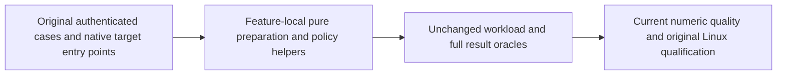

# Native benchmark responsibility limits

Canonical slice: BenchmarkComparisons. This specification refines [CodeQuality REQ-CQ-006 / AC-CQ-008](../CodeQuality.md), [BenchmarkComparisons](../BenchmarkComparisons.md) and [ADR-033](../../ADR/ADR-033-code-quality.md).

## Requirements and acceptance

REQ-BC-COHESIVE-EXTRACTION-001: Site producer selection, operational-policy evidence, deterministic corpus generation, Neo4j request construction and Qdrant collection requests must have cohesive feature-local owners. Preserve method 64, aggregate type 200, file 400 and nesting 3 limits, multiline executable style, public APIs and original cases. Partial declarations must be counted as one type.

AC-BC-COHESIVE-EXTRACTION-001: Current native quality must clear all six assigned numeric findings with unchanged limits. Existing Site producer cases retain their authenticated run, attempt, source and workflow checks and all eight ordered rejection cells. Original Comparison option, corpus and target regressions remain required. Source counts are estimates until the current analyzer runs.

REQ-BC-COHESIVE-EXTRACTION-002: Preserve exact operational defaults, validation order and failure contracts, evidence keys/value formatting/order, deterministic corpus seed and generator arithmetic, native query and payload shapes, batching, readback and accuracy oracles, topology, acknowledgement/durability, resource limits and producer provenance. Preserve native I/O, measurement and joined cleanup ownership in existing targets.

AC-BC-COHESIVE-EXTRACTION-002: Review complete before/post source and existing whole-operation regressions. Linux-only isolated qualification must continue to use the canonical matched workload suite and authentic source/run/attempt/target-bound reports. No new test mirrors the extraction; no local measurement or source review qualifies performance.

## Responsibility map

| Existing entry point | Feature-local responsibility |
| --- | --- |
| SiteBenchmarkProducerSelectionTests | SiteBenchmarkProducerRejectionFlow: same eight producer rejection operations; Case retains the scope and cancellation token |
| NativeComparisonExecutionOptions | NativeComparisonOperationalPolicy: original operational validation, default constants, bound options wrapper and ordered evidence; adapter-specific private validation/evidence stays in the existing type |
| BenchmarkDataset | BenchmarkDocumentFactory: exact existing deterministic document/vector generator; public corpus API and caches remain original |
| Neo4jTarget | Neo4jQueryRequests: pure native Cypher text and payload construction; target/session retains every await, measurement, client and cleanup |
| QdrantVectorOperations | QdrantCollectionRequests: pure original collection-create payload; original ingestion receipt, batches and replica proof remain owned by IngestAsync |

Product SQL, storage, authorization and transport behavior are unchanged. Frontend UI, AppHost topology changes and new public database APIs are N/A: this scope only reorganizes existing Site test and comparison implementation responsibilities. No new library is introduced. Compiler, original suite and Linux runtime qualification are separate gates whose actual results must be retained.
