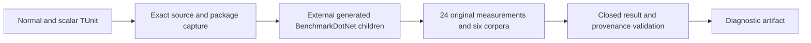

# Native serialization diagnostic acceptance

Goal: obtain authentic CPU/latency/allocation evidence for common native serialization
paths before selecting bounded optimization across all operations. Actors: the
development executor and the generated BenchmarkDotNet child. No new database/API
capability, persisted format or authorization policy. Frontend N/A: artifacts are
diagnostics; published metrics retain their complete matrix gates.

| ID | Measurable contract | Test/evidence |
|---|---|---|
| AC-IS-PERF-001 | Three genuine public/unsealed fixtures use DocumentResult, CommandRequest and StorageMutation[]; two sizes 1024/16384; four actual typed NativeEncode/NativeDecode/JsonEncode/JsonDecode methods produce 24 distinct cases. Exact Unicode JSON, polymorphic mutation fields, vectors, raw bytes/empty/tombstone and optionals roundtrip identically. No fabricated engine, JSON fallback or ignored native fields in comparator. | TUnit metadata and all six corpus/size roundtrips, decoded byte ownership; actual full BDN JSON/corpus hashes. |
| AC-IS-PERF-002 | The embedded generated-Dry test exercises exactly PointRead/CompositeKey/ExactCosine. Separate native generated-Dry evidence proves external consumer execution; Dry never counts as measurement. | Original assertions with a narrowed fixture filter; separate real-child TUnit case and raw logs. |
| AC-IS-PERF-003 | Actual external BDN children run with MemoryDiagnoser, 2 launches, 3 warmups and 6 result iterations at a 200ms target. Original JSON/CSV/logs, generated build files, environment, exact source, corpus and assembly/package/source hashes are retained. Every one of the 24 cases has positive genuine Workload/Result operations/time, finite positive statistics, finite nonnegative allocation data and expected settings. Missing/failing/skipped/mixed results reject evidence. These runs are development evidence with explicit source/machine/settings and never refresh website performance evidence. | Validator regressions plus the retained raw artifacts of the development run. |
| AC-IS-PERF-004 | The diagnostics are never jobs, dispatch modes or dependencies of benchmarks.yml, which is reserved for end-to-end database comparisons. When another diagnostic mode is declared, conflicting selections fail before measurement and each lane excludes the other. Diagnostic mode cannot publish website/release evidence, and BDN rows never enter the database cluster aggregate. | Workflow source TUnit guards and the aggregate/native identity tests. |

REQ-IS-PERF-001..004 map one-to-one above; REQ-IS-010/AC-IS-010 in
InternalSerialization link this complete diagnostic contract. ADR060 extends ADR047
public generated-consumer ownership. Local development TUnit/BDN experiments carry
explicit source/machine/settings; required Linux GitHub qualification and website
provenance stay mandatory. JSON is a typed codec diagnostic with a different native
envelope and validation contract; no general engine/security/replication equivalence
is claimed. Warm metadata and steady-state results remain distinct from cold
initialization. The genuine Dry child has a 15-minute execution deadline. Cleanup
kills its process tree, cancels and closes owned pipes when their 15-second
observation threshold expires, and observes both capture tasks and every failure
before releasing files. Kernel file-I/O settlement has no BCL hard completion
guarantee; the final owned join is explicit, and the executor's job timeout is the
final bound. No numeric speed claim or regression threshold exists without a baseline;
further optimization requires that evidence and all normal/scalar/recovery/replicated
cluster guards. Unsupported formats, cancellation, byte budgets and trust boundaries
remain exactly the native contract. Removing the additive fixtures rolls back this
diagnostic without touching user data.

## Allocation and variance contract

REQ/AC-IS-PERF005..007 (ADR060, NSP006) define the exact terminal-allocation/admission
and prospective quantitative/variance contract. The runtime fast-returns existing
closed nongeneric terminal types after one unchanged Normalize call; the complete
fallback and persisted/native corpus bytes are unchanged. Test matrix: new
NativeWireSupportedScalarTests/Fixtures prove the frozen allowed terminals and
generic-owner/open closures; ScalarAllocationTests prove a measured 0B auxiliary delta
and nullable Normalize equality; ScalarDepthTests prove the 264/265 boundaries. All
native roundtrip/fault/resource tests are retained. AC-IS-PERF007 uses a manual
evidence exception: actual authenticated before/after originals, corpus/cohort checks,
exact interval/ratio/launch arithmetic and independent review. Per-operation
allocations do not establish total RAM usage or global maximum speed, and latency
qualification stays open until that evidence exists.
