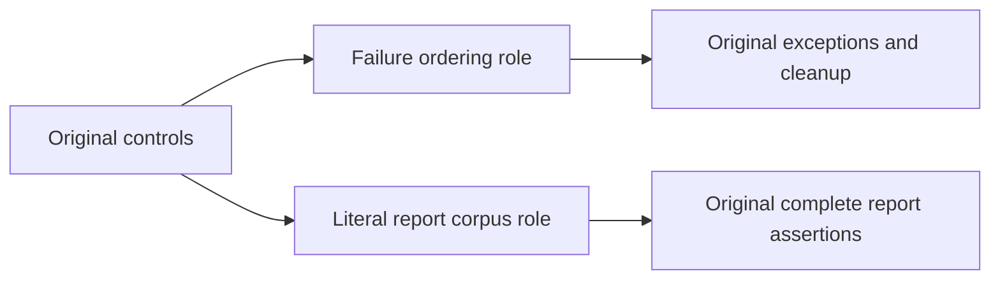

# Numeric control responsibilities

Parent: [BenchmarkComparisons](../BenchmarkComparisons.md). Applicable quality contract: [CodeQuality](../CodeQuality.md).

REQ-COMPARISON-NUMERIC-001: split oversized control types into feature-local responsibilities while preserving every original Test/Args, report corpus, CSV/JSON golden, cancellation observation, producer task, cleanup ledger and exception identity/order.

AC-COMPARISON-NUMERIC-001: existing control types and new helpers remain within the unchanged 200-line type/64-line method limits and use multiline executable blocks. No suppression, limit increase, new deadline, benchmark scale or execution change is permitted.

AC-COMPARISON-NUMERIC-002: the original failure-order routine preserves fatal-first ordering, reference deduplication, original exception dispatch and aggregate construction. The report-write cleanup role preserves all original cancel/dispose/task-settlement/deletion observations and their failure ledger. The exact report corpus is moved without changing any literal record, sample, encoding or serializer option.

Ownership: tests/KeyLoad.ComparisonTests/BenchmarkComparisons/Helpers and UnitContracts/Helpers. Public API, production storage, UI, new libraries and topology: N/A; this change restructures existing compilation controls only. Main owns combined build and verification. Benchmark execution and performance qualification remain Linux GitHub Actions only; source review is not runtime or performance qualification.
