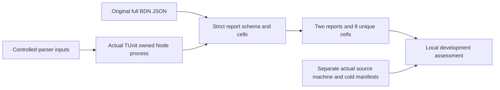

# Local scaled report validation

Canonical slice: BenchmarkComparisons. This is the pure-report stage of
[ScaledWorkloads](ScaledWorkloads.md), AC-SCALE-005/006, under
[Accepted ADR-069](../../ADR/ADR-069-representative-scaled-workloads.md).
The parent feature owns the binary inputs, resources, BDN job and complete
8-cell ZoneTree profile. Each selected-count report has four cells: two payload sizes
by two read methods. This document owns only the strict local full-JSON validator.
It does not authenticate a provider or produce measurements.

## Scope and decision

Use a separate Node built-in-only pure module instead of relaxing the original
4096-record raw-control validator. Inputs are parsed original BDN JSON or clearly
identified controlled parser-test data. Source/machine/cold-manifest production,
file hashing, process ownership and actual measurements remain the parent
feature's separate gates. Do not implement them by synthesizing report fields.
Backend, public API, frontend, persisted data and workflow surfaces are N/A:
this stage changes local diagnostic validation and its real TUnit/Node tests.
No package, tool, public website figure or internal Benchmarks job is added.

## Requirements and measurable acceptance

|Requirement|Acceptance|Pass and fail contract|
|---|---|---|
|REQ-SCALE-RPT-001|AC-SCALE-RPT-001|Accept one complete four-cell selected-engine/selected-count report with the parent's exact job, operation, duration and retained-sample contract; reject a tiny, mixed, incomplete or failed report|
|REQ-SCALE-RPT-002|AC-SCALE-RPT-002|Accept exactly two complete ZoneTree/count reports forming the parent's 8-cell matrix; reject missing, duplicate, extra or mismatched entries and host metadata|
|REQ-SCALE-RPT-003|AC-SCALE-RPT-003|Validate without mutation, I/O, child launch or network; errors name fixed schema fields and do not echo supplied values|
|REQ-SCALE-RPT-004|AC-SCALE-RPT-004|Exercise the real module in bounded actual Node processes through TUnit; controlled vectors never become or provider proof|

The module path is `scripts/Features/BenchmarkComparisons/scaled-storage-report.mjs`;
its implementation and execution are open acceptance gates. It exports:

- `validateScaledReport(report, engine, recordCount)` returns `undefined` only
  after validation; otherwise throws an `Error` with a fixed field diagnostic.
- `validateScaledCohort(entries)` accepts an array of `{ engine, recordCount,
  report }`, returns `undefined` only after the complete validation, otherwise
  throws the same kind of bounded diagnostic. Neither function mutates inputs.

### AC-SCALE-RPT-001: exact original report shape

`HostEnvironmentInfo` must be an object with pinned BDN0.15.8 (optional normal
build metadata), a syntactically valid .NET10 runtime version, RELEASE
configuration, no attached debugger, nonempty OS/processor/architecture/CLI
metadata and positive integer physical-processor/core/logical-core counts.
Hardware descriptors are observations, not proof of identical physical machines.

`Benchmarks` contains exactly the parent's two methods by two payload sizes.
Namespace and type are exactly
`KeyLoad.BenchmarkScenarios.Features.BenchmarkComparisons` and
`ScaledStorageReadBenchmarks`. Parameters contain exactly three unique names,
`Engine`, `RecordCount`, `PayloadBytes`, in any order; compare canonical decimal
counts/sizes and exact lowercase engine values. Reject duplicates, extra names,
aliases, unsupported selectors and partial or null rows. Caller selectors are
the sole supported engine `zonetree` and exactly two qualification counts,100000
and1000000, in the parent feature.

Require the human `DisplayInfo` job tuple to corroborate the parent's .NET10,
launch, invocation, unroll, warmup and iteration settings without duplicate or
conflicting tuple fields. Do not mistake this text for a typed job/source receipt.

For Workload measurements require eight Warmup rows, ten Actual rows and the
statistics' retained Result row count. All relevant rows use original launch
index1, unique positive iteration indices, exactly1M operations and positive
finite total nanoseconds. Warmup indices are1..8; Actual indices are1..10;
Result indices are unique within1..10. Every Actual row must last at least100ms.
Overhead/Jitting metadata does not count toward any of these workload totals.
Raw Actual rows and retained results remain separate; never demand ten retained
samples when BDN legitimately removes outliers.

Statistics require N8..10, exactly N positive finite OriginalValues, and positive
finite Mean/Median. The ordered OriginalValues must equal each corresponding
Workload/Result row's nanoseconds divided by operations within four machine
epsilons times max(1, absolute expected value). This checks normalized units;
it does not invent or replace statistics. Memory must contain nonnegative finite
bytes allocated per operation, nonnegative integer Gen0/1/2 collections and
TotalOperations exactly1M. Managed allocation metadata is not heap/RSS.
Missing, failed, short, control, duplicate or extra cells fail the report.

### AC-SCALE-RPT-002: complete cohort

Validate exactly two entries, one for each ZoneTree/count pair (100000 and1000000),
using the same report validator. Each report contains both payload sizes and both
read methods. Reject duplicate, missing or extra pairs.
All reports must agree on the original host's OS, processor, architecture,
physical/logical/core counts, runtime, CLI, BDN version and configuration. This
only detects metadata drift in the local development cohort; actual hardware,
resource, durability, topology and original-file provenance gates remain open
until separately retained observations establish them. A report array does not
authenticate GitHub, select a database winner or authorize publication.

### AC-SCALE-RPT-003/004: bounded pure behavior and actual tests

Invalid objects, selectors, report rows, statistics, memory, workload operations,
durations, stages, launches, iteration identities and cohort entries throw a
fixed `Invalid scaled-storage report: <field>.` message of at most128 ASCII
characters. No supplied sentinel/string/value appears in errors. Preserve the
full input on success and rejection, including nonfinite controlled Node values.
Do not open files, use a clock, launch children or fetch network data inside the
module. TUnit owns the actual Node child through existing bounded
IsolatedAggregateNodeProcess; test requests are capped at1MiB before launch.
Check the serialized UTF8 byte length before creating a child. Transport these
bytes through redirected standard input, close the original input pipe after
the write, and parse its bounded bytes once in the real child. Arguments contain
only the bounded probe program and module path; no request bytes, base64 chunks,
temporary input file or second process owner. A valid controlled request over
256KiB must execute through the actual child; a request over1MiB must reject
before launch. The existing lifetime owner takes one optional input
task, sharing its run/cancellation deadline. That original task participates in
success, failure, cleanup and deferred release with the exit/output/error tasks;
do not dispose its process or pipe before all originals settle.
The child's real exit/stdout/stderr, input preservation and every case assertion
must be checked. No fake HTTP/provider, fake process or skipped case.

## Test mapping and ordered execution

|Acceptance|Automated scenarios and assertions|Exception and required evidence|
|---|---|---|
|001|ZoneTree at both record counts, N8/N10, both runtime forms; wrong selectors/job/shape; missing/duplicate/extra cells; wrong or missing rows/operations/durations/launches/statistics/memory; normalized-unit mismatch|Actual generated BDN originals and cold values/resources remain parent gates|
|002|Complete two-entry matrix; missing/extra/duplicate/unsupported pairs; mixed host/runtime; nested invalid report|Equality of supplied host descriptors alone is not actual hardware/provenance proof|
|003|Success and every rejection preserve input; nonfinite values; sentinel diagnostics stay bounded and safe|Pure parsing cannot authenticate a provider or measured source|
|004|Real TUnit launches owned Node, verifies exit/stdout/stderr/exact case set; bounded stdin request over256KiB succeeds and oversize request rejects before launch; cancellation/input failure uses the same original-task owner|Coverage collector/baseline is unavailable; no numeric coverage claim|

Use TUnit/Microsoft.Testing.Platform and .NET 10, never VSTest filters. The real
focused `/*/*/*ScaledRawStorageReport*/*` filter runs after a fresh Release build,
followed by the related/full gates and formatter. Local results are development
evidence; delivered-source CI remains mandatory, and originals are preserved.
Implementers cannot invent fields, alter workload/profile/settings, change
controls or publish values. Rollback removes only this parser and its tests together;
no product/persisted migration is involved. The tests, module and execution are open
acceptance gates.
