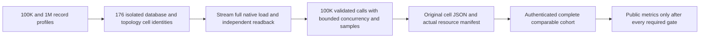
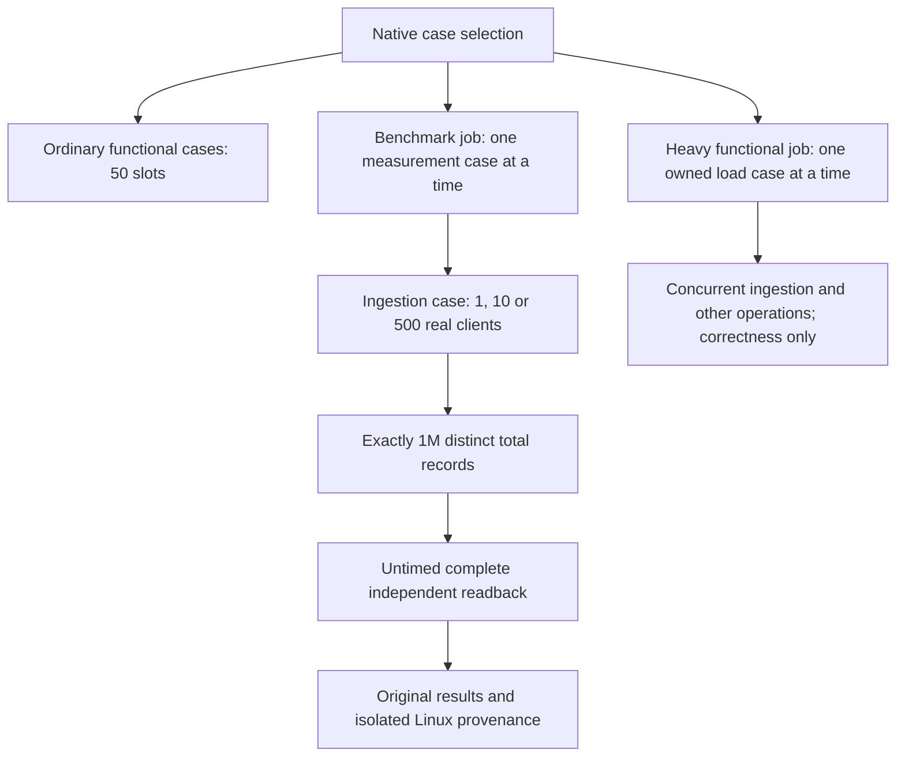

# Scaling qualification and fair deployment arms

## Current execution contract

[ADR-142](../../ADR/ADR-142-shared-live-benchmark-sessions.md) and
[SessionExecution](SessionExecution.md) define the measurement shape: current
measurement jobs share one live native database/topology across separate TUnit
cases, measure the initial load, and perform no per-case reset or reseeding. The
dataset, operation-count, native capability, correctness, privacy, cancellation,
resource, topology and provenance requirements below are mandatory. The seven
document cases do not complete the required vector, graph, queue, event,
time-series or physical 100k-corpus coverage; family integration and exact-source
native Linux qualification are separate gates. Warmup and repetition values in the closed profile identities below do not apply to session measurement, which uses no warmup and no per-case reset.

Only 100k and 1m records are active scales for every database and workload. The
active inventory has 11 engines, and the closed-loop CRUD family has 176 identities.
[ADR-109](../../ADR/ADR-109-native-vector-comparisons.md) governs the vector/site
extension.

Canonical slice: BenchmarkComparisons. Requirements: REQ-SCALE-009..013, 016, 017
and 024..029. Acceptance: the matching AC-SCALE criteria. Implementation contract:
ADR-103.

## Scaled closed-loop profiles

The `intensive-1k-c16` workload is a separate control with native one-node and
three-node identities. This feature adds a distinct actual-scale steady-state cohort
through the existing `ComparisonRunner`, target adapters, isolated per-database GitHub
job groups and native topology resources. It does not add a parallel harness or allow
local measurements into website publication.

Two exact profiles are admitted:

| Profile | Actual corpus records | Measured operations per cell | Payload | Warmup / repetitions / concurrency |
|---|---:|---:|---:|---|
| `scaled-100k-c16` | 100,000 | 100,000 | 1,024 bytes | 256 / 1 / 16 |
| `scaled-1m-c16` | 1,000,000 | 100,000 | 1,024 bytes | 256 / 1 / 16 |

Seed is fixed at 1729. Applicable common scenarios are exactly `PointRead`, `DocumentWrite`, `DocumentUpdate`, and `DocumentDelete`. `PointRead` is reported as the existing public point lookup operation; this stage does not claim SQL range-query or complex-query scale where an equivalent adapter is absent. All new cells are steady-state closed-loop. Existing actual topology counts `[1,3]` and target native adapters are reused. KeyLoad uses a genuinely configured native member count (one or three silos with one or three copies) for each cell, with independent native endpoint/status and ACK validation. An external target is eligible only when that exact native member count and write ACK mode are supported; unsupported cells remain explicit. A single PostgreSQL process is never described as distributed.

The complete planned cohort identity is target × actual node count × profile × applicable scenario (11 × 2 × 2 × 4 = 176 identities, preserving explicit unsupported topology dispositions). Every eligible cell is one isolated Linux GitHub runner/job, uses exact source/run/attempt/job and target image receipts, seeds and verifies all N records, then performs exactly100,000 caller operations. A missing, failed, unsupported-but-required, duplicated, timed-out or mismatched cell invalidates cohort completeness; no partial result is publishable.

## Bounded dataset and runner behavior

Do not substitute the materialized corpus for the lazy scaled corpus. The existing `BenchmarkDataset` builds per-record JSON and float vectors, and the current measurer builds arrays of all operation inputs, outputs and samples; this would retain multiple gigabytes in the client before target storage.

The scaled runner path uses the existing profile/target/topology/report ownership but generates deterministic records by integer identity on demand. It retains no per-record JSON/vector object table and no duplicate payload corpus. Full target initialization writes all N actual records from the generator and independently verifies all N identities, exact payloads and a full native readback digest before measurement. Operation inputs are generated on demand by a fixed deterministic sequence. Update/delete preparation also streams through the generator.

During the measured stage the runner caps concurrent calls at 16, validates each caller result against the independently regenerated expected identity/content, and discards output immediately. It maintains exact total attempts, successful useful operations, failures, deadline timeouts, explicit rejections and unfinished calls, plus a fixed-size deterministic latency reservoir/sample with its algorithm and size recorded. It does not keep all inputs, output documents or operation tasks in memory. Every run uses an original caller cancellation token and finite per-operation deadline; shutdown joins actual in-flight operations. A later failure cannot be hidden by reducing the declared operation count.

## Fairness and provenance admission

The exact public library corpus/settings/readback/report seam and deterministic digest and latency-sample rules are frozen in [ADR-103](../../ADR/ADR-103-scaled-fair-comparisons.md#accepted-bounded-corpus-and-report-seam). The materialized `ComparisonOptions` cap stays unchanged; only the closed typed scale profile represents the independently bounded lazy corpus. A scale report carries that exact profile and null control options, and is never eligible for the original control-only publication admission. Actual native ordered readback is a bounded `IAsyncEnumerable<FoundDocument>` setup operation, independent of generated expectations.

Every report binds exact profile/scenario, N, payload/schema/seed, corpus digest, requested and completed operations, operation-mix identity, target/version/image, requested and observed native node count, target read contract and ACK/durability, source SHA, workflow/run/attempt/job/artifact identity, Linux runner image, an ephemeral runner-instance identifier for provenance, and a stable actual hardware-class fingerprint.

It records actual host CPU model/family/count and memory, effective cgroup CPU quota and memory limit, every database resource's configured and observed CPU/memory envelope, persistent-storage class/capacity, and total per-cell process/container CPU/RSS peaks. Cells must match on stable hardware-class fingerprint and effective resource limits, not ephemeral runner-instance ID or observed peak values. Observed peaks remain measurements and must be finite and within their declared effective envelopes; providers need not consume identical CPU or memory to be compared. The scaled-profile shard-key distribution is fixed `uniform-v1`; query fanout is explicitly `not-applicable` to this point-read/CRUD matrix; recovery is `not-run/unsupported`. Missing or changed required equality fields fail closed; no unknown field is treated as a match. The full 176-cell cohort must have a complete independently verified artifact set before provider comparison or website aggregation. Workflow, AppHost, resource, provenance and aggregation joins are part of acceptance; authored source and parser fixtures are not measurement evidence.

Existing matrix grouping stays one named GitHub job group per database and each database/scenario/topology/scale cell stays isolated on its own runner. KeyLoad never shares a runner or native stores with a comparison database. Single-node PostgreSQL is not a distributed comparator. Community-only unsupported clustering is retained as an exact explicit disposition and is excluded from unsupported comparative claims, not converted to a fallback.

## Requirements and acceptance

| Requirement | Acceptance and test evidence |
|---|---|
| REQ-SCALE-009: exact real-scale profiles | AC-SCALE-009: strict profile reader accepts only the two exact profile/count pairs, fixed seed/payload and 100K operation count; profile count mismatch, unsupported scenario, extra profile, wrong node count and non-Linux execution reject before native acquisition. Literal vectors in `ScaledComparisonProfileTests`; actual acquisition proof in isolated provider jobs. |
| REQ-SCALE-010: bounded deterministic data and measurement | AC-SCALE-010: lazy generator matches independent literal values/IDs/digest at boundary and random positions without retaining all records; real measured path writes/verifies exact N, performs exact100K calls, caps concurrency, retains only declared sample and exact counters, validates results, and settles all calls on cancellation. `ScaledComparisonDatasetTests`, `ScaledComparisonRunnerTests`; real native corpus required for each profile. |
| REQ-SCALE-011: actual topology and equivalent provider contract | AC-SCALE-011: each provider proves exact native1/3 membership, node-local stores and ACK/durability per cell; target reports are rejected for unexpected membership, target mismatch, single-node mislabeled distributed, or unsupported topology fallback. `ScaledTopologyAssertions` plus existing genuine target/container qualification. |
| REQ-SCALE-012: complete hardware/resource/workload manifest | AC-SCALE-012: independent validator rejects every missing or changed hardware-class/cgroup/resource/storage/durability/corpus/operation-mix/distribution/fanout-applicability field; equality applies to stable hardware class and effective limits, not ephemeral runner IDs or requested YAML alone. Observed peaks are finite and within limit, and remain actual per-cell output values. Exact cohort test proves all176 identities required and preserves failure/unsupported/missing states. `ScaledFairnessManifestTests` and real GitHub originals. |
| REQ-SCALE-013: publication and downstream scope | AC-SCALE-013: current control workload remains unchanged; ADR-109 extends inventory and projection; scaled cohort cannot publish until authenticated complete originals and root-owned aggregation verify exact source/run/attempt/job/artifact hashes and equality. Report explicitly marks the closed-loop profile, with open-loop, shard-skew, fanout-stress, recovery, endurance and power-loss qualification open/unsupported. `ScaledPublicationEligibilityTests`; actual aggregation source/CI provenance required. |

## Out-of-scope stages

Per-cell scale routing, per-cell 176-identity accounting and the fixed-rate
open-loop stage with its cancellation proof, central options, matrix transport and
cohort delivery are outside the current design. The native test selection rejects the `ScaleProfile`, `VectorProfile`,
`OpenLoopRate` and `OpenLoopCancellationProof` selectors
(`RetiredBenchmarkSelectionTests`), and [SessionExecution](SessionExecution.md) defines
the active planning: 22 workers across 11 databases and native one/three nodes. A
fixed-arrival open-loop stage would need its own acceptance contract with an exact
arrival schedule, drain horizon, queue/rejection/unfinished denominators and
tail-latency treatment.

## Explicit limits

This first stage is closed-loop, steady-state, CRUD plus the current point-read query only. It does not prove offered-load behavior or overload recovery. A later open-loop stage needs an exact arrival schedule, drain horizon, queue/rejection/unfinished denominators and tail-latency treatment. Shard-skew/fanout and replica recovery require actual native workloads/fault harnesses and their own measured phases. They cannot be marked passed using descriptive metadata. Full SQL query comparisons and all cross-model Q1 workloads require a separate semantically equivalent target matrix. None of these omissions changes the existing benchmark or website claims.

Backend product API: N/A. Frontend: the scale/vector projection is governed by ADR-109 and VectorQualification; only authenticated evidence can populate it. Internal scale worker credentials remain external; no new package or database dependency is introduced.

## Server resource evidence (REQ/AC-SCALE-016)

Only the two scaled profiles use the resource sidecar. Control reports and the
website aggregate schema are unchanged.

For external databases, one AppHost-owned collector observes the exact selected native target ContainerResources and lifecycle, never the load generator. KeyLoad uses native project processes, so this collector does not measure its Azurite dependency as a server. Matched native-process resource qualification remains open; successful workload measurements do not close it. It writes server-resource-evidence.v1 in a separate server-resource-evidence.json beside the original worker.json only after runner settlement; it binds exact source/run/attempt/job/target/nodeCount/scenario/profile and SHA256 of original worker bytes. AppHost/test teardown must await this original collector before reports are copied and app ownership is released. Failed/unavailable observation never changes workload timing/results or invents successful qualification.

Observe actual Linux kernel/architecture, CPU vendor/family/model/stepping and physical/logical CPU membership, memory, AppHost effective cgroup envelope, actual target container full IDs/image IDs/start identity/state and cgroup CPU/memory limits/counters, and actual writable data mount filesystem type/capacity. Never substitute requested limits, client sampler counters, host processor count alone, unknown VM class or Docker cache-adjusted working set for server RSS. For exact sampled aggregate process RSS, read bounded cgroup.procs plus /proc/<pid>/status and start identity, verify each PID belongs to the exact current container/cgroup, and reject PID reuse/identity ambiguity. Name measurements maxObservedRssBytes and observedCpuUsage, not an unsampled true peak. Missing permissions/remote daemon/unavailable cgroup or storage is explicit unqualified evidence.

Bounds: one collector, at most three actual external-database containers, five-second cadence, at most 1,680 samples per resource and 140 minutes admitted observation work; retain online aggregates only. Per sample metadata at most 256 KiB, each regular proc/cgroup read at most 4 KiB except explicit hardware enumeration aggregate bounded 256 KiB; at most 128 admitted native PIDs and eight data mounts per container. Sidecar at most 64 KiB. Native Docker commands use closed argv, byte bounds, authenticated owned model identities, application stopping cancellation, TERM then one-second KILL and original exit/readers join. Thirty-second cleanup is an escalation/failure threshold, not detached settlement. Caps, truncation or absent samples force unqualified with existing safe missingEvidence categories; never fabricate zero/default counters.

Consumers retain the exact sidecar and authenticate its original artifact/provider/source binding and worker hash separately. No sidecar is manufactured for controls. Compare hardware identity, effective server CPU/memory envelope and storage class/capacity across each profile/nodeCount/scenario cohort, verifying each target's own image manifest separately. Container/PID identities and measured counters are provenance/output, not hardware-equivalence values. Reject mixed cohorts, mismatched actual envelopes, missing/corrupt/duplicate artifacts; no older fallback. Unsupported native cells retain their original explicit capability disposition and do not claim server samples.

### Native cgroup and counter parsing

The native cgroup-v2 walk honors the actual hierarchy root: `cpu.max` and `memory.max`
are defined only on non-root cgroups. Walk every admitted non-root ancestor and retain
its minimum effective limits; stop at the verified real hierarchy root without
inventing missing root limit files. Observe the actual effective cpuset and supported
hierarchy/controller identity. An unreadable, malformed or missing required non-root
observation makes evidence unqualified and is never silently replaced by `max`. The
independent native Linux oracle uses the same documented root semantics without copying
the production parser, and a supported Linux envelope test asserts its actual value
instead of conditionally omitting a null result. The sidecar schema, workload, bounds
and qualification requirements are unchanged.

Native newline-terminated `cpu.max` keeps its real limit: only leading and trailing
file whitespace is normalized before the existing two-space-separated-field grammar and
positive quota/period validation, and unlimited/root handling, ancestor minima and
bounded reads are unchanged. The same normalization applies to `memory.current` at
ScaleServerProcessMetrics before the sampler consumes the counter: nonnegative Int64
bytes, including zero, are preserved without scaling, clamping or invented values;
signs, overflow, interior whitespace and malformed numbers are rejected with the
existing sample invalidation, original cgroup/PID identity, byte bounds, cadence and
schema. Native-format controls assert newline/outer whitespace, zero, Int64 maximum,
malformed rejection and a healthy follow-up. Linux's
[cgroup read_u64 output](https://github.com/torvalds/linux/blob/master/kernel/cgroup/cgroup.c)
emits a newline for the
[memory current counter](https://github.com/torvalds/linux/blob/master/mm/memcontrol.c);
the [CPU quota/period output](https://github.com/torvalds/linux/blob/master/kernel/sched/core.c)
also ends with a newline. These parser controls supplement the real Linux envelope and
complete genuine server-resource evidence gates.

When the hardware-available/envelope-null guard of the native cgroup case fails, it
retains its original InvalidOperationException and invokes the existing independent
`ScaleServerCgroupOracle.ReadCurrent` under the unchanged 4KiB / 64-ancestor limits
through the canonical failure observer. The oracle's actual exception joins the
original failure ledger, the outer diagnostic includes the ledger exception messages
while every original exception stays inside the aggregate, no raw host inputs are
captured, and the case can never become a pass, skip or fallback.

### Native probe settlement

Each original stdout, stderr and exit task is observed independently: either pipe
fault immediately enters owned termination and joined settlement, even when the other
redirected pipe has not reached EOF. Successfully completed pipe tasks are removed
from observation so EOF cannot cause a busy loop; a successful exit still requires both
original readers to finish. The first operation failure and every distinct cleanup
failure are preserved, along with the existing byte grants, cancellation, TERM/KILL
bounds and provenance rules. ComparisonTests owns real Linux stdout/stderr overflow
controls that use the validated cleanup threshold as a test cancellation bound, assert
the exact bound failures and finish with a healthy native follow-up after each original
operation settles. A private bounded readiness marker identifies the actual child PID
and start time before an owned gate permits `exec yes`, and the same child is
independently asserted to have exited after the bound failure. On every
assertion/error path the original operations are joined, any remaining same-identity
child is stopped and the owned marker/gate directory is removed, retaining original and
cleanup failures together.

The native cancellation case is a complete real probe flow. It observes a bounded
operation-owned readiness marker and the actual child PID before cancelling the
original token, awaits the original probe and its redirected readers, asserts a
cancellation with the original token (`TaskCanceledException` is a valid derived
`OperationCanceledException`) and independently verifies that the child has exited. A
healthy native follow-up through the same production process contract then verifies its
output and settled state. The case uses the existing validated execution options and
owned fixture cleanup, without mocks, source-text checks, new production APIs, raised
limits or detached cleanup.

## Original teardown settlement (REQ/AC-SCALE-017)

REQ-SCALE-017 requires the actual isolated AppHost owner to settle every original
collector, capture, report-write, application-stop and disposal operation before
releasing its dependencies or deleting its owned data. This applies to controls
and scaled runs; successful workload results and control report schemas are
unchanged. The existing 30-second teardown limit is a recorded failure threshold,
not permission to detach the task with a continuation. After that threshold,
request cancellation or escalation through the original owner's supported API
where available, retain the threshold failure, and ultimately await that same
original task. Do not start a replacement operation, use an uncancellable shadow
task, or dispose an owner while its observation/writer still uses it.
The resource collector memoizes one original completion task. Concurrent or
repeated completion calls await that same task, including its failure; a boolean
set before cancellation/join is not completed settlement. Retain any native stop
cancellation-callback failure and still join the original observation before
disposing the CTS or writing/copying evidence. A failed evidence write remains
the same failed completion on a later teardown call.

AC-SCALE-017 requires genuine native lifecycle regressions to prove that cleanup
does not pass an unfinished original operation, and that cancellation and failure
paths settle the original process/readers/capture before directory deletion.
Retain the actual workload primary exception and each actual cleanup exception
object, including nested aggregates and original cancellation tokens; do not
flatten, replace them with a category string, or suppress them when a primary
failure exists. Cleanup continues through all safely reachable stages. At final
propagation, one original failure retains its stack, multiple failures retain
ordered primary then cleanup objects, and native ManagedCode fatal classification
remains visible and takes priority. The receipt contains only the existing safe
stage categories and primary-presence flag, never exception text or payloads.

The genuine cancellation plus native copy-conflict flow is required. Fatal-priority
propagation is part of this contract; source review of that path does not qualify a
native runtime-fatal regression, which remains open evidence. No change to provider
topology, measurement timing, ACK/durability, source provenance or publication
eligibility is authorized, and a detached original task never counts as settlement.

## Functional scheduling and ingestion

Native TUnit scheduling is scoped by
[NativeTUnitEntry](../TestInfrastructure/NativeTUnitEntry.md) and
[ADR-117](../../ADR/ADR-117-native-tunit-ci-entry.md); isolation and ordered
implementation joins are owned by
[ADR-056](../../ADR/ADR-056-isolated-linux-comparison-cells.md).
The ingestion and heavy mixed-load cases below are specified requirements whose
implementation and qualification are separate acceptance gates. They change no c16
profile, cell identity, workload count, matrix, artifact schema or publication
eligibility.

Native TUnit scheduling and workload client concurrency are independent settings.
Ordinary independent functional cases use the 50 native slots selected for functional
tests. Benchmark measurements execute exactly one TUnit case/scenario at a time per
job. Parallel benchmark jobs require separate Linux runners and separate native
servers, clients, containers, volumes and cleanup. The c16 workload has 16 concurrent
operation sessions inside its one measurement case.

| Requirement | Acceptance and automated evidence required before closure |
| --- | --- |
| REQ-SCALE-024: separate test scheduling from measured client concurrency | AC-SCALE-024: native selection starts comparison execution with exactly one slot and rejects explicit conflicting overrides before resource startup; inherited state cannot override the admitted native command. Ordinary cases retain the functional default. Original native reports demonstrate no overlapping measurement cases in a job; actual client/session observations separately identify workload concurrency. Selector regressions execute the real native selection operation; authenticated Linux reports establish runtime isolation. |
| REQ-SCALE-025: million-record ingestion baseline and concurrent clients | AC-SCALE-025: three separately selected cases use exactly 1, 10 and 500 actual clients. Each inserts exactly 1,000,000 distinct total records, divided deterministically across those clients, rather than one million per client. Preserve native Orleans membership, ReplicaCount copies, persisted authorization, one connection grain per connected client and genuine .NET SDK operations; official MCP SDK interoperability remains required. A start barrier admits the selected clients together, with at most one original in-flight write per client and no unbounded task/record materialization. Record planned, admitted, peak observed and completed client concurrency separately from TUnit slots; reject unknown counts, duplicate identities and inconsistent accounting. Real Aspire-owned Linux ingestion cases are required; c16 steady-state reports do not satisfy this criterion. |
| REQ-SCALE-026: complete correctness outside ingestion timing | AC-SCALE-026: every acknowledged write has its genuine native receipt validated. Timing excludes setup, warmup and full readback. After writes settle, an independent real-client readback validates every expected identity and complete value plus actual stored cardinality, rejects extras/missing/duplicate records and mismatched acknowledgements, and compares a deterministic full-content digest. Sampled reads or generated expected counts alone cannot establish a million stored records. Retain real SDK and official MCP success/negative flows; a failed write or readback stays failed. |
| REQ-SCALE-027: bounded ingestion admission and original settlement | AC-SCALE-027: validate centrally owned typed operational limits before acquiring clients; bound startup, admission, per-call cancellation and drain. On cancellation or failure, stop admitting work, cancel through the original owners, await all original started calls, dispose each original client, settle collector/AppHost shutdown, then remove only owned resources. Preserve original failure objects, native exit codes and unacknowledged/unfinished accounting. A cancellation during actual writes followed by a healthy persisted read and disposal-failure flows must prove settlement; detached continuations, retries or timeout-only success are forbidden. This extends REQ/AC-TUNIT-ENTRY-013/014 in [NativeTUnitEntry](../TestInfrastructure/NativeTUnitEntry.md) without changing their completion and cleanup guarantees. |
| REQ-SCALE-028: exclusive heavy functional mixed load | AC-SCALE-028: separately selected KeyLoad functional cases concurrently ingest distinct records while other real SDK/official MCP database operations run under bounded load on their own Aspire-owned cluster resources. Verify acknowledged writes, exact final stored data, operation-specific read-cut/result oracles and healthy follow-up. These cases overlap neither ordinary cases nor another heavy case on the same runner; independent isolated jobs may run concurrently. Original native discovery/reports must prove selection completeness and cleanup. These correctness cases contribute neither performance measurements nor functional coverage totals. Existing six-transition read-cut coverage does not establish sustained mixed load. |
| REQ-SCALE-029: one canonical scenario set for every comparison database | AC-SCALE-029: every native target adapter executes the same versioned scenario inventory, including the new 1/10/500-client ingestion cases, with identical actual record counts, corpus/seed/payload, operation schedule/count, concurrency, timing boundaries and correctness oracles, plus equivalent effective resource/acknowledgement/durability contracts. The planner and aggregate validate each target against that common inventory and reject missing, substituted or incomparable cells before publishing measurements. Native unsupported capability/topology is an explicit unavailable cell with no invented result. Real isolated Linux execution of the complete shared inventory is required; a target-specific easier workload cannot qualify performance comparison. |

The active dataset inventory is exactly 100,000 and 1,000,000 records;
`scaled-100k-c16` and `scaled-1m-c16` keep every setting and identity. The ingestion
requirement is three cases at the 1,000,000-record size and does not replace the full
comparison matrix. No published figure, performance claim or qualification result
follows from this document.

## Methodology contract

[Methodology](Methodology.md) and ADR-122 govern REQ/AC-METH-001..005: native one-node
and three-node arms only, a separate 418-cell document-v1 common pure/mixed/ingestion
family and one million total records at 1/10/500 actual clients. Current code and
evidence status is tracked in status.json; original Linux workload qualification
remains mandatory.
