# Shared live Benchmarks session

The benchmark pipeline runs each database topology as one live session: the same
database serves every TUnit workload test of its job. The architectural decision is
[ADR-142](../../ADR/ADR-142-shared-live-benchmark-sessions.md). The pipeline has no
per-cell planners, report schemas or readers beyond this session shape. Reusable execution
adapters, genuine operations, bounded provider transport and immutable result files
are kept, and there is no runtime fallback to another producer. Linux qualification of
the session path is a separate acceptance gate.

## Unit of execution

There are exactly **two measurement jobs per database**: one for a single node and one
for three nodes. Both run the same set of TUnit tests, parameterized by database and
nodeCount. The initial database contains 1,000,000 records; the set then contains
separate operation tests and mixed workloads in groups of 100,000. **The load time of
the initial million is a separate measurement result.** Operation type and operation
count do not create jobs.

The 16 databases give **32 measurement jobs**. One shared preparation, one aggregation
and a separate Website dispatch give **35 jobs in the comparison flow**. Benchmarks
compiles no KeyLoad server and runs no source-built KeyLoad job: every database cell,
KeyLoad included, starts its Docker image through the same procedure, and the KeyLoad
1-node and 3-node session cells are the KeyLoad ingestion measurement. Real execution
topologies, separate Linux runners between databases/topologies and their resource
contracts are kept. An unavailable topology gets an explicit unavailable result.

One live database runs for the whole job. Aspire starts it, and genuine C# clients run
the different TUnit tests through one shared session fixture. The mixed tests contain
parallel operation streams. The database is not restarted or restored from the initial
corpus between tests. A long job is not split automatically into new
scenario/profile/scale jobs. Physical runner isolation exists between databases and
topologies; one job holds several TUnit tests on one shared infrastructure: the
measured load of the million, operation tests and mixed workloads with parallel
streams of 100,000 operations.

```mermaid
flowchart LR
    Prepare[One build and harness checks] --> Packages[32 jobs: database and 1 or 3 nodes]
    Packages --> LoadMillion[Load the base million]
    LoadMillion --> Reads[Separate read search index and query tests]
    Reads --> Mixed[Concurrent add delete update read and search tests]
    Mixed --> Verify[Verify final records and results]
    Verify --> Results[Save results and finish the job]
    Results --> Aggregate[Complete accounting and evidence check]
    Aggregate --> Dispatch[Separate Website dispatch]
```

## Shared infrastructure and separate TUnit tests

The session fixture starts the database topology once through Aspire and gives every
workload test of the job access to the same database. It does not load the million
silently in setup: the first TUnit test performs and measures the load. The
following tests have explicit prerequisites and a defined order of access to the state.
One workload test runs at a time on a runner; the parallel clients inside a mixed test
are part of the measured load.

Separate tests give separate outcomes and measurement reports: initial load,
index construction, sequential/random reads, search/range/complex queries, updates,
mixed create/delete/read/search and final-state verification. The supported operation
inventory is the same for all adapters; an unavailable capability is marked
explicitly. Several tests in a job do not mean several databases or infrastructure
fixtures.

## Shared execution plan

1. Start the selected topology and wait for its readiness.
2. Load the base 1,000,000 records and verify the actual data. Measure the load time
   and throughput. Measure the construction of the required indexes separately.
   Every database loads through the same client procedure: 16 clients send bounded
   batches of consecutive new records through the database's own bulk API, sized by
   the vendor's recommendation (`IDocumentComparisonTarget.IngestionBatchRecords`,
   for example 256 mutations per KeyLoad command, where the server sets no
   mutation-count ceiling, and 1,000 rows per Neo4j `UNWIND`). A batch keeps the single
   create's guarantees: create-only conflicts, the same acknowledgement or replica
   wait, and checks of every record in the response. Each record keeps its own sample
   and is acknowledged when its batch is, so load latency percentiles describe batch
   acknowledgement times. Mixed creates, updates, deletes, reads and queries stay one
   record per request.
   OpenSearch uses 500-record requests so coordinating and replica work from all
   sixteen clients fit the selected small-heap topology. Redis retains 10,000-command
   pipelines and verifies local and replica fsync receipts on each original write
   connection; its command timeout allows the configured server receipt wait to finish.
3. Run separate TUnit operation tests on the loaded database. In the mixed test, a
   shared start launches parallel bounded client streams: add 100,000 new records,
   delete 100,000 selected base records, update 100,000 other records, and run reads
   and search/queries on the same live database. Reads, search, ranges and complex
   queries have the same declared sets and counts for all databases; at least 100,000
   measured operations per applicable workload are kept. The mixed test genuinely
   overlaps create/delete/read/search in time; separate operation tests remain
   separate outcomes.
4. Wait for the original completions and verify ACKs, the actual records, the changed
   fields, the absence of deleted records and the correctness of search/query results.
5. Record separate indicators for load, indexing, create, delete, update, read,
   search/query and the whole mixed scenario, then finish the job.

A group of 100,000 operations defines the amount of work of a stream. The number of
simultaneous requests is bounded by the shared client-concurrency contract; all
100,000 requests are not materialized as an unbounded set of simultaneous tasks.
batching has the same explicit contract for the compared adapters.

The shared deterministic plan splits keys into groups, for example: 100,000 base
records for delete, another 100,000 for update and 800,000 stable base records. Create
uses a separate 100,000 new keys. After successful create/delete exactly 1,000,000
records remain: 900,000 base and 100,000 new. The keys and values themselves are
verified, not only the total count.

The corpus/seed, payload, key groups, queries, counts, concurrency and initial
conditions are the same for all databases. An impossible exact wall-clock completion
order between streams is not fixed: they genuinely run at the same time. Reads with a
deterministic oracle use the stable group; checks of mutated keys and of the search
index respect the declared consistency/read-cut contracts and verify the final
state after ACK. Wrong results are not masked by endless polling or hidden retries.

For each operation type the report contains the actual attempted/completed/error
counts, elapsed time, throughput, p50/p95/p99 and the observed CPU/RAM/allocations
where they are actually measured. The total duration of the mixed scenario is not the
sum of the durations of the parallel streams; read/search results are explicitly marked
as obtained under concurrent create/delete/update load.

**There is no separate warmup:** no warmup requests, warmup namespaces or skipped first
series. All operations of the selected measured scenario count from the first one. The
natural state of runtime, indexes and caches changes together with the live database
and the same mixed load; this flow is not declared a cold-cache measurement.

**There are no separate cleanup phases between scenarios and no cleanup jobs.** The
environment lives within the GitHub job and ends with it. The normal shutdown of the
TUnit/Aspire resources stays part of process completion. Cleanup creates no additional
matrix, restarts or separate benchmark scenario.

## Shared preparation and measurement

- The preparation job restores and builds only the comparison harness
  (`benchmarks/KeyLoad.ComparisonHost` and its project references, in Release), never
  the whole solution, and runs no format gate: the solution build, analyzers and
  formatting belong to Build and Tests. The harness still compiles the KeyLoad server
  project transitively, because `build/KeyLoad.AppHost`, whose test-hosting helpers the
  harness uses, references it; the KeyLoad cells never run that build. The exact-source
  test runner, both AppHosts and workload client are built
  once. The immutable runtime bundle retains source, DLL/PDB, package assets and
  Aspire tool identities; workers validate and import it without a repeated
  solution restore/build. The same preparation job resolves the Release-published
  `ghcr.io/managedcode/keyload:latest` image to one digest; both KeyLoad workers
  pull that digest and run their nodes as containers, and the other databases use
  their pinned images. Benchmarks never builds or publishes a KeyLoad or
  workload-client container.
- Contract tests, the actual matrix-to-C# selection and startup verification
  run before the fan-out. Inside a package readiness belongs to Aspire; setup is not
  part of operation latency.
  Preparation also runs the real external adapter cases in `NativeDatabaseTests`:
  OpenSearch/MongoDB at one/three nodes, three-node Redis and one-node HelixDB/ClickHouse, with sixteen
  independently owned clients, complete body readback and healthy continuation.
  These bounded checks retain original TRX files and do not qualify public figures.
  They resolve actual container IDs through Aspire notifications after readiness and
  verify their actual writable-mount mappings. Linux additionally
  requires the original CPU/RSS and complete resource qualification; desktop checks
  cannot substitute for that Linux gate.
  OpenSearch controls cover one million actual documents per topology. The HelixDB
  and ClickHouse controls also load one million documents and build the session indexes before
  mutations and complete readback. InfluxDB's million-record control verifies its
  native JSONL readback, an update, sixteen concurrent point readers, cancellation
  during streaming and healthy
  continuation. The eight-control run has a 40-minute timeout;
  each operation keeps its 30-second deadline and document cleanup keeps its
  20-minute deadline. All native
  clients and resource observation wait for the same Aspire health and bootstrap
  completion contract used by the full workload client.
  Manual `mode=contracts` runs the same native and harness controls, retaining test
  diagnostics. Workload fan-out, session measurements
  and Website dispatch belong to `mode=full` and push runs.
  Manual `mode=influxdb-readback` runs only the existing InfluxDB million-record
  native case and terminal diagnostic control, with a five-minute bound on that
  native case. It retains original Linux resource and test evidence without the
  other databases, workload fan-out or public figures. This focused check does not
  qualify the full eight-control gate or complete session suite; those gates stay
  unchanged for `mode=contracts`, `mode=full` and push runs.
  All modes share one branch concurrency group. A manual dispatch cancels the
  superseded run, including when changing between manual modes and full runs.
  Automatic push runs preserve the active cohort and queue the newest pending
  revision, so another change cannot discard hours of unfinished measurements.
  Intentional replacement after a repair cancels the obsolete run first.
  Workers retain partial original reports and logs on cancellation; those artifacts
  remain incomplete evidence and cannot authorize publication.
- Ingestion at 1/10/500 clients, the minimum measured operation counts, recall,
  replicated acknowledgement, resource bounds and all required workload families are
  kept. The number of jobs is not the number of measured scenarios.
- Unavailable capabilities/topologies have explicit unavailable results with a
  verified reason. A failure makes the scenario result failed/null; missing or
  corrupt evidence cannot be replaced by unavailable.

The primary `KeyLoad.AppHost` serves development and functional tests with execution
server project processes with in-memory RapidMembership. `KeyLoad.LoadTests.AppHost` owns only the
selected load infrastructure. It awaits readiness, exposes discovered endpoints to
`KeyLoad.ComparisonHost`, and joins cleanup after the client-owned workload. The
client remains outside the resource graph. Only run-owned Docker resources are
removed; image user defaults and anonymous session volumes own every database's
files, KeyLoad included. The manual Release workflow alone publishes the KeyLoad
server image with SDK `PublishContainer`.

The Redis topology probe removes its transient key before document readback.
OpenSearch uses a 1 GiB JVM heap per node, matching the pinned server's default.
This setting applies to both topologies within the recorded host
resource envelope; the 500-document request bound, sixteen clients, persisted-copy
acknowledgements and full workload remain unchanged. OpenSearch documents its
[default heap and memory sizing](https://docs.opensearch.org/latest/install-and-configure/install-opensearch/index/).

The HelixDB document target owns its HTTP clients within one dedicated Aspire
session. That session owns the private server and its anonymous writable volume.
After the complete workload and final-state oracle, the target closes its clients;
Aspire joins server shutdown and removes the session storage. Native controls use
the same joined lifecycle and validate anonymous-volume ownership before removing
their host data directory. Original resource identities and logs remain available.
Measured document deletes still use the real native mutation path.

After the workload, resource observers and captured logs settle, the fixture owns
and awaits the original Aspire testing application's `DisposeAsync` task. The
testing factory owns host shutdown, session containers and anonymous volumes.
Its configured `HostOptions.ShutdownTimeout` remains unchanged. The outer disposal
join allows that host-shutdown budget plus the existing 30-second original-task
settlement budget; other teardown stages retain their 30-second deadlines. The
original disposal task remains joined after a threshold, and any timeout or
disposal failure still fails the original session.

ClickHouse uses native patch-part `UPDATE` and `DELETE FROM` operations over the
same MergeTree table, with block-number/offset columns enabled. Deletes require
`lightweight_update_force`, so unsupported patch deletion is an error. The same
fsync settings cover inserted data and patch parts; returned writes remain visible
to independent clients. Physical payload removal occurs during later merges;
crash and power-loss qualification remain separate. The pinned 26.9.25.15
[patch writer](https://github.com/ClickHouse/ClickHouse/blob/235315b9148f8d60b261c10a616b0a186f4db758/src/Storages/MergeTree/MergeTreeDataWriter.cpp#L775)
uses the shared fsync path, and its
[delete-mode setting](https://github.com/ClickHouse/ClickHouse/blob/235315b9148f8d60b261c10a616b0a186f4db758/src/Core/Settings.cpp#L5170)
defines the required mode. The workload retains its original corpus, operation
counts, concurrency and 140-minute execution deadline.

Terminal client diagnostics retain a bounded suffix so a late disposal
failure remains observable after a long measured session. Cleanup failures still
fail the session and cannot produce a successful original result.

Resource observation never requires a custom container-name annotation. Every
configured writable mount must be observed, and image-created writable mounts are
also bounded, inspected and retained. Filesystem type and block capacity come from
the daemon-reported local mount source through a bounded, noninteractive, read-only
`sudo stat --file-system` command on the Linux runner. This does not require a utility
inside each database image. A missing storage observation remains unqualified and
does not erase separately captured CPU/RSS evidence. The website may display approved
original timings with an explicit label for incomplete telemetry; absent resource
metrics stay unavailable. Native Linux controls still require complete resource proof.
Writable-mount identity includes source, target and type independently of Docker's
list order. An actual identity change still invalidates the storage evidence.
The host mount inventory uses the existing bounded hardware-metadata budget rather
than the smaller per-control-file limit. Native Linux artifacts retain the original
`/proc/self/mountinfo` alongside the resource snapshot, so the actual mount table and
its byte size remain reviewable when several database containers are running.

Local execution retains the actual client binary/source/process identity with no
invented GitHub provenance; every database server, KeyLoad included, is identified
by its image reference and digest. Preparation, session and aggregation jobs use
the common runner family documented in
[Additional Databases](AdditionalDatabases.md#deployment-and-qualification-limits).
Local execution cannot authorize public figures. External
advertised-endpoint reachability remains open until actual execution proves it;
measured workload reports do not close that independent gate.

## Runs and results

A push to main automatically runs the complete set of 32 measurement jobs. A manual run
chooses the complete set or only the build/harness contracts. Preflight, cancellation,
malformed-input, permission and provenance checks are TUnit contracts of Benchmarks
and do not multiply the measurement matrix. The selected load profiles use the same
mixed scenario inside the same two jobs per database, with the same contract for all
adapters.

Each scenario immediately stores its own source/run/attempt-bound JSON and the original
diagnostic data. After a failure only a scenario for which the actual database state
and correct prerequisites are known continues; a faulty database ends the job
explicitly. Data is not reset for a hidden repetition of a failed operation. Earlier
results and the exact list of what was not executed are stored. Automatic retries of
measured operations do not improve the statistics. The aggregator verifies all expected
scenarios and the failed/null and unavailable accounting; mixed, missing or corrupt
inputs are rejected. Website receives only verified genuine measurements; benchmarks do
not replace readiness gates.

Linux qualification uses the genuine one-node and three-node KeyLoad cluster sessions
through the .NET SDK and official MCP clients first, and the other adapters follow the
same path; the final comparison is never replaced by one database. README and status
follow the real results.

## Requirements and verification

| Requirement | Completion gate |
| --- | --- |
| REQ-BSESSION-001: two jobs per database, one topology per job. | AC-BSESSION-001: the canonical planner forms 32 workers; all 16 database groups have only 1/3-node rows. |
| REQ-BSESSION-002: several TUnit tests share one infrastructure. | AC-BSESSION-002: the original discovery/TRX shows separate load/read/search/mixed cases; resource identities stay the same between cases; Aspire starts the topology once. |
| REQ-BSESSION-003: the initial million is measured. | AC-BSESSION-003: the report contains actual attempted/ACKed/verified record counts, elapsed/throughput and the original load case outcome; setup does not hide inserts. |
| REQ-BSESSION-004: separate operation tests and a genuine mixed workload. | AC-BSESSION-004: at least 100k measured operations per applicable case; mixed create/delete of 100k each genuinely overlap in time; a deterministic final oracle verifies the records and results. |
| REQ-BSESSION-005: one build, an immutable exact-source bundle. | AC-BSESSION-005: workers verify source/DLL/PDB/process identities and run the compiled tests without rebuilding; Docker lifecycle belongs to Aspire. |
| REQ-BSESSION-006: no warmup and no per-case data reset. | AC-BSESSION-006: actual operation accounting starts from the first call; the same dataset and topology are kept between cases. |
| REQ-BSESSION-007: complete genuine results and honest publication. | AC-BSESSION-007: the aggregator accounts for the whole planned case inventory, validates source/run/attempt and original artifacts, rejects corrupt/missing/mixed data, preserves failed/null and unavailable; Website derives metrics only from validated successful measurements. |
| REQ-BSESSION-008: completed verification. | AC-BSESSION-008: exact-source Linux build/format/governance, focused regressions and genuine 1-node/3-node SDK/MCP benchmark sessions with retained reports; no local/source-only result closes the Linux gate. |
