# Спільна жива сесія Benchmarks

Дата: 2026-10-17. Статус: рішення власника; новий pipeline
перебуває в реалізації та ще не кваліфікований. Власник відхилив просте перенесення всіх
1 898 jobs на ручний запуск і попросив новий дизайн. Первинні докази наведено в
[діагностиці](../../implementation/benchmark-pipeline-repair-2026-10-16.md).

Архітектурне рішення: [ADR-142](../../ADR/ADR-142-shared-live-benchmark-sessions.md).

Пряма корекція власника 2026-10-17 вимагає видалити весь замінений benchmark
pipeline: старі dispatch paths, per-cell planners, report schemas, active readers
та їхні exclusive fixtures. Reusable native adapters, справжні операції, bounded
provider transport і незмінні історичні результати зберігаються. Runtime fallback
до старого покоління не допускається.

## Одиниця виконання

Пряма корекція власника: **рівно два measurement jobs на базу** — один для одного
вузла, другий для трьох вузлів. Обидва запускають той самий набір TUnit-тестів із
параметрами database і nodeCount. Початкова база містить 1 000 000 записів; далі
набір містить окремі operation tests і змішані навантаження групами по 100 000.
**Час завантаження початкового мільйона — окремий результат вимірювання.** Тип операції та
кількість операцій не створюють jobs.

Поточний набір 11 баз дає **22 measurement jobs**. Одна спільна підготовка, одна
агрегація та окремий Website dispatch дають **25 jobs порівняльного потоку**. Тимчасово зберігається ще один наявний
functional RF3 heavy-load gate до його погодженого перенесення в Build and Tests;
це correctness gate, тому measurement jobs залишаються рівно 22. Реальні native
топології, окремі Linux runners між базами/топологіями та їхні ресурсні контракти
зберігаються. Недоступна native топологія отримує явний unavailable результат.

Одна жива база працює протягом усього job. Її запускає Aspire, а справжні C# clients
виконують різні TUnit-тести через одну спільну session fixture. У змішаних тестах
є паралельні потоки операцій. Між тестами база не перезапускається і не
відновлюється з початкового corpus. Автоматичного поділу довгого job на нові
scenario/profile/scale jobs у цьому дизайні немає.

```mermaid
flowchart LR
    Prepare[Одна збірка та перевірки harness] --> Packages[22 jobs: база та 1 або 3 вузли]
    Packages --> LoadMillion[Завантажити базовий мільйон]
    LoadMillion --> Reads[Окремі тести читання пошуку індексів та запитів]
    Reads --> Mixed[Тести одночасних додавання видалення оновлення читання та пошуку]
    Mixed --> Verify[Перевірити кінцеві записи та результати]
    Verify --> Results[Зберегти результати та завершити job]
    Results --> Aggregate[Повний облік та перевірка доказів]
    Aggregate --> Dispatch[Окремий Website dispatch]
```

## Спільна інфраструктура та різні TUnit-тести

Session fixture один раз запускає database topology через Aspire і передає
доступ до тієї самої бази всім workload tests job. Вона не завантажує мільйон
приховано в setup: перший native TUnit test виконує й вимірює завантаження.
Наступні тести мають явні prerequisites та визначений порядок доступу до стану.
На одному runner виконується один workload test одночасно; паралельні clients
усередині змішаного тесту є частиною вимірюваного навантаження.

Окремі tests дають окремі native outcomes і measurement reports: початкове
завантаження, побудова індексів, sequential/random reads, search/range/complex
queries, updates, змішаний create/delete/read/search та перевірка кінцевого стану.
Конкретний підтримуваний operation inventory є однаковим для adapters;
недоступність capability позначається явно. Кілька tests у job не означають
кілька баз або infrastructure fixtures.

## Спільний план виконання

1. Запустити обрану native топологію та дочекатися її готовності.
2. Завантажити базові 1 000 000 записів і перевірити фактичні дані. Виміряти час і
   throughput завантаження. Побудову потрібних native індексів виміряти окремо.
3. На завантаженій базі виконати окремі TUnit operation tests. У змішаному тесті
   через спільний старт запустити паралельні bounded client потоки: додати 100 000
   нових записів, видалити 100 000 вибраних початкових записів, оновити 100 000
   інших записів, виконувати читання та пошук/запити на цій самій живій базі.
   Читання, пошук, діапазони й складні запити мають однакові для всіх баз
   задекларовані набори та counts; мінімум 100 000 measured operations на
   застосовний workload зберігається. Змішаний тест справді перекриває в часі
   create/delete/read/search; окремі operation tests залишаються окремими outcomes.
4. Дочекатися оригінальних завершень, перевірити ACK, фактичні записи, змінені поля,
   відсутність видалених записів і правильність результатів пошуку/запитів.
5. Записати окремі показники завантаження, індексації, create, delete, update,
   read, search/query та всього змішаного сценарію; завершити job.

Група з 100 000 операцій задає обсяг роботи потоку. Кількість одночасних native
requests обмежена спільним client-concurrency контрактом; усі 100 000 запитів не
матеріалізуються як необмежений набір одночасних tasks. Native batching має
однаковий явний контракт для порівнюваних adapters.

Спільний детермінований план розділяє ключі на групи, наприклад: 100 000
початкових записів для delete, інші 100 000 для update та 800 000 стабільних
початкових записів. Create використовує окремі 100 000 нових ключів. Отже після
успішних create/delete залишається рівно 1 000 000 записів: 900 000 початкових та
100 000 нових. Перевіряються самі ключі й значення, а не лише загальний count.

Corpus/seed, payload, групи ключів, queries, counts, concurrency та початкові
умови однакові для всіх баз. Між потоками не фіксується неможливий точний
wall-clock порядок завершення: вони реально працюють одночасно. Читання з
детермінованим oracle використовує стабільну групу; перевірки змінюваних ключів і
пошукового індексу враховують задекларовані native consistency/read-cut контракти
та перевіряють кінцевий стан після ACK. Помилкові результати не маскуються
нескінченними polling або прихованими retries.

Для кожного типу операцій звіт містить actual attempted/completed/error counts,
elapsed time, throughput, p50/p95/p99, а також спостережені CPU/RAM/allocations,
де вони справді вимірюються. Загальна тривалість змішаного сценарію не дорівнює
сумі тривалостей паралельних потоків; read/search результати явно позначаються як
отримані під одночасним навантаженням create/delete/update.

**Окремого прогріву немає:** немає warmup requests, warmup namespaces чи пропущеної
першої серії. Усі операції вибраного вимірюваного сценарію враховуються від першої.
Природний стан runtime, індексів і кешів змінюється разом із живою базою та
однаковим змішаним навантаженням; цей потік не оголошується cold-cache вимірюванням.

**Окремих фаз очищення між сценаріями та cleanup jobs немає.** Середовище живе в
межах GitHub job і закінчує роботу разом із ним. Штатне завершення вже наявних
TUnit/Aspire ресурсів залишається частиною завершення процесу. Cleanup не створює
додаткової матриці, повторних перезапусків чи окремого benchmark сценарію.

## Спільна підготовка й вимірювання

- Один раз збираються exact-source test runner, AppHost і потрібні образи.
  Незмінний bundle містить manifest із SHA, DLL/PDB та image digests. Workers
  перевіряють його перед використанням; повторних solution restore/build у кожному
  measurement job немає. Потрібні metadata та шляхи Aspire перевіряються справжнім
  запуском, а не припущенням, що копіювання bin достатньо.
- До fan-out проходять contract tests, actual matrix-to-C# selection і перевірка
  native startup. Усередині пакета readiness належить Aspire; setup не входить у
  latency операцій.
- Ingestion 1/10/500 clients, мінімальні measured operation counts,
  recall, RF3 acknowledgement, resource bounds та всі потрібні workload families
  зберігаються. Число jobs не є числом виміряних сценаріїв.
- Недоступні native capabilities/topologies мають явні unavailable результати
  з перевіреною причиною. Native failure робить результат сценарію failed/null;
  відсутні або пошкоджені докази не можна підмінити unavailable.

## Запуски й результати

На push у main автоматично виконується новий повний набір із 22 measurement jobs.
Ручний запуск дозволяє вибрати повний набір або лише build/harness contracts;
перший етап реалізації перевіряє весь новий шлях на KeyLoad RF3, після цього
підключає інші adapters. Це порядок впровадження, не заміна повного фінального
порівняння однією базою.

Preflight, cancellation, malformed-input, permission та provenance checks
залишаються TUnit контрактами Benchmarks і не утворюють множник вимірювальної
матриці. Обрані профілі навантаження використовують той самий змішаний сценарій
всередині тих самих двох jobs на базу, з однаковим контрактом для всіх adapters.

Кожний сценарій відразу зберігає власний source/run/attempt-bound JSON та оригінальні
діагностичні дані. Після відмови продовжується лише сценарій, для якого відомі
фактичний стан бази та коректні prerequisites; несправна база завершує job явно.
Дані не скидаються для прихованого повторення failed operation. Зберігаються попередні
результати і точний перелік невиконаного. Автоматичні retries виміряних операцій не
покращують статистику. Aggregator перевіряє всі очікувані сценарії, failed/null та
unavailable accounting; mixed, missing або corrupt inputs відхиляються. Website
отримує лише перевірені справжні вимірювання; benchmarks не замінюють readiness gates.

## Корекція попереднього правила та межі готовності

[AGENTS.md](../../../AGENTS.md) зараз вимагає:
«Each engine/node-count/scenario measurement MUST run on a separate isolated runner agent».
Пряма вказівка власника 2026-10-16 змінює цю вимогу для нового дизайну: фізична
ізоляція runner — між базами та топологіями. Один job містить кілька TUnit-тестів
на одній спільній інфраструктурі: вимірюване завантаження мільйона, operation tests
та змішані навантаження з паралельними потоками по 100 000 операцій.
Власник також прибрав окремий прогрів і запропоноване очищення/скидання стану.
Повторне погодження цих конкретних корекцій не потрібне.

Подальше впровадження: уточнити canonical manifest змішаного сценарію; реалізувати
один наскрізний RF3 job; перевірити одночасні потоки, результати по типах операцій,
правильність мільйонного набору після create/delete/update,
original reports і штатне завершення; підключити повний набір adapters; виконати Linux qualification та
оновити README/status за справжніми результатами. Старий producer та його exclusive dispatch/report/test код видаляються разом.
Історична діагностика зберігає фактичні джерела, без твердження про green build чи tests.

## Вимоги та перевірка реалізації

| Вимога | Конкретний completion gate |
| --- | --- |
| REQ-BSESSION-001: два jobs на database, одна native topology на job. | AC-BSESSION-001: canonical planner формує 22 workers; усі 11 database groups мають лише native 1/3-node rows. |
| REQ-BSESSION-002: кілька TUnit-тестів ділять одну інфраструктуру. | AC-BSESSION-002: original native discovery/TRX показує окремі load/read/search/mixed cases; ресурсні identities залишаються тими самими між cases; Aspire запускає topology один раз. |
| REQ-BSESSION-003: початковий мільйон вимірюється. | AC-BSESSION-003: report містить actual attempted/ACKed/verified record counts, elapsed/throughput та original load case outcome; setup не приховує inserts. |
| REQ-BSESSION-004: окремі operation tests і справжній mixed workload. | AC-BSESSION-004: min 100k measured operations на applicable case; mixed create/delete по 100k реально перекриваються в часі; deterministic final oracle перевіряє записи та результати. |
| REQ-BSESSION-005: один build, незмінний exact-source bundle. | AC-BSESSION-005: workers перевіряють hashes/source/image identity, запускають compiled tests без повторної збірки; Docker lifecycle належить Aspire. |
| REQ-BSESSION-006: без warmup та per-case data reset. | AC-BSESSION-006: actual operation accounting починається з першого виклику; між native cases збережено той самий dataset і topology. |
| REQ-BSESSION-007: повні справжні результати й чесна публікація. | AC-BSESSION-007: aggregator враховує весь planned case inventory, validates source/run/attempt and original artifacts, rejects corrupt/missing/mixed data, preserves failed/null and native unavailable; Website derives metrics only from validated successful measurements. |
| REQ-BSESSION-008: завершена перевірка. | AC-BSESSION-008: exact-source Linux build/format/governance, focused native regressions та справжні 1-node/RF3 SDK/MCP benchmark sessions із retained reports; жоден local/source-only результат не закриває Linux gate. |
