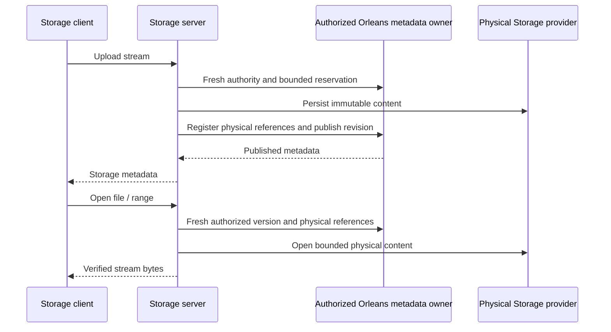

# BlobStorage

Status: ManagedCode.Storage replacement in progress; runtime qualification open.
Decision: [ADR-038](../ADR/ADR-038-chunked-blob-storage.md).
Work: [implementation checklist](../implementation/blob-storage-replacement.md).
Authority: [root policy](../../AGENTS.md).

## Contract and ownership

The approved file-storage capability uses the existing ManagedCode.Storage
`IStorage` implementation and server API. VFS can compose over that
contract. No KeyLoad IStorage adapter, custom transfer stream or multipart engine
is introduced. Reuse the
library's upload/download, streaming, range and chunk-transfer behavior. A
separate public KeyLoad raw-part API is removed by the replacement.

ZoneTree is authoritative for file metadata, access policy, quota reservations,
version publication, integrity hashes and physical-storage references. Binary
content lives in a selected ManagedCode.Storage physical provider outside
ZoneTree. Database commands, outcomes and replica journals contain metadata only.
Provider support, including S3, belongs to ManagedCode.Storage.

## Requirements and acceptance

| Requirement | Observable acceptance |
|---|---|
| REQ-BLOB-001: storage contract | Real Storage server/client upload, metadata, listing, streaming and deletion use the same file resource. |
| REQ-BLOB-002: physical content separation | Original payload bytes are present in the configured provider and absent from ZoneTree records, persisted command envelopes and replica journals. |
| REQ-BLOB-003: fresh authorization | Cross-tenant/resource requests, revoked credentials and denied rows cannot publish or read physical content. Chunk session identities are isolated by verified caller and resource. |
| REQ-BLOB-004: explicit publication | Failed provider writes do not publish; revision conflicts and unknown outcomes preserve recoverable physical content and do not delete a published version. |
| REQ-BLOB-005: bounded work | Reservations, concurrent uploads, stream buffers, metadata pages, physical reads and joined cleanup remain bounded under rejection and cancellation. |
| REQ-BLOB-006: exact physical reads | First/last/interior/cross-boundary/empty ranges match the original bytes; missing or damaged provider content fails closed. |
| REQ-BLOB-007: explicit recovery | Reopen, file retirement, physical reclamation and metadata-plus-object restore preserve published references; metadata replication alone never claims payload copies. |

Every acceptance gate remains open until the replacement's actual tests and
original delivered-source artifacts establish it. Existing raw-part evidence
cannot be carried over as a passing result.

## Composition and current source

Compose ManagedCode.Storage.Server, its selected physical provider and VFS
where applicable. KeyLoad integrates persisted resource/row authorization and
ZoneTree metadata without reimplementing the library storage/transport layer.
Every participating silo must see the same configured physical object namespace;
independent local directories do not implement shared file storage.

The old engine, raw-part contracts, HTTP/SDK/MCP routes, raw-part restore processing
and exclusive serializers are removed. The rejected consumer IStorage adapter is
also removed. Module composition, metadata integration and its public
acceptance tests remain in progress; no new working KeyLoad file route is claimed.
The combined chunk-server repair is published as ManagedCode.Storage 10.1.5. Its
Linux release, all-package public-feed verification and consumer package source
commits are verified. KeyLoad centrally references the published Server and
FileSystem packages; this does not establish module integration or acceptance.

The HTTP surface inherits ManagedCode.Storage.Server operations. Physical
provider paths are private metadata and are not returned as public download
locations. SQL/MCP binary-transfer parity is not claimed from the removed custom
endpoints. Storage transport, authorization, physical durability,
metadata replication and complete cluster qualification are separate gates.
