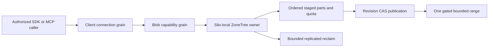

# BlobStorage

Status: contract Accepted; canonical engine/server/MCP and typed SDK source present, exact-SHA runtime qualification pending. Decision: [ADR-038](../ADR/ADR-038-chunked-blob-storage.md). Authority: [root policy](../../AGENTS.md).

## Purpose, actors and boundaries

A user or an agent stores a large binary payload in parts and reads the needed range without loading the whole object. The mandatory server-side identity and row/resource authority do not change; files and the atomic store belong to the silo-local ZoneTree owner.

The accepted contract defines ten typed operations: begin, write part, complete, abort, delete, reclaim, metadata, upload info, range, list. They pass through the client's connection grain and the grains that call the ZoneTree owner through Orleans; only the silo-local ZoneTree owner owns the atomic store. Parts are stored as raw canonical values; manifests and counters are versioned records. The private snapshot `ReadChunk` and backup pieces have their own authority and lifecycle. Cartograph may serve regenerated backup archives through the ManagedCode provider; transactional user blobs use the existing atomic store.

A raw part and a range are bounded to 65536 bytes; the maximum object is 1 GiB and the default resource object limit is 64 MiB. A full object is never materialized for a range. Complete publishes the manifest through a revision CAS; a partial upload is not a visible complete object. SHA256 verifies every part; `sha256-chain-v1` binds scope/layout/order and is not called a whole-file SHA256. Bounds, quota, identity, retention, error and format semantics are the exact contract of ADR-038, not passing evidence.

## Requirements and measurable acceptance

| Requirement | Behavior criterion | Automated verification |
|---|---|---|
| REQ-BLOB-001: a chunked upload has a bounded persisted lifecycle and a complete visible object | AC-BLOB-001: ordered/retried parts, complete CAS and a stable command ID; invalid order/bytes/hash/chain and an incomplete upload publish no partial data | Pending genuine TUnit provider lifecycle/CAS/retry and cluster .NET/MCP tests |
| REQ-BLOB-002: a partial read returns the exact authorized range with bounded retained memory | AC-BLOB-002: exact first/last/interior/cross-boundary/zero range at the expected revision; validation, corruption, cancellation and a healthy follow-up; <=2 visited parts | Pending real-store and public SDK/official MCP range tests |
| REQ-BLOB-003: the persisted principal/resource scope decides all upload/read/delete rights | AC-BLOB-003: tenant/resource mismatch, revoked key, forged roles and unauthorized metadata/range requests are rejected without effects or leakage; .NET and MCP give the same authority | PLANNED real persisted-policy unit and Docker/Aspire cluster SDK/official MCP adversarial flows |
| REQ-BLOB-004: publish/delete/recovery have an explicit revision, integrity and retention contract | AC-BLOB-004: a verified complete object survives the declared process-recovery cut; a missing/corrupt part fails closed; a concurrent overwrite/read sees a defined revision; orphan cleanup does not delete a live leased version | PLANNED real-process RecoveryProcess/recovery and cluster retry/rejoin tests once the storage/manifest/cleanup contract is agreed |
| REQ-BLOB-005: quotas cover all resources and active/retired versions | AC-BLOB-005: persisted resource/store counters atomically reject overflow; abort/expiry/reclaim release the right bytes/slots exactly once; malformed counters/format fail closed | Pending real-provider quota/reopen/adversarial tests |
| REQ-BLOB-006: agent discovery and bounded listing share one typed API | AC-BLOB-006: metadata/upload info/list without full bytes; authorized bounded listing; all 10 .NET/MCP operations have the same identity/error semantics | Pending DTO goldens, provider listing, official cluster discovery and operation parity |
| REQ-BLOB-007: integrity/format/compatibility is an explicit contract | AC-BLOB-007: byte/JSON golden vectors, chain binding, unchanged old enum values/nonblob JSON; unknown format and downgrade boundary | Pending contract goldens/provider checks and documented rollback evidence |

Every AC is still pending. Acceptance does not mean a ready endpoint or a qualified durability profile. The global blob quota is a logical payload reservation, not a physical disk quota. Provider/replica snapshot limits cover the whole store, including other resources and outcome metadata; the 1 GiB blob ceiling does not promise an unbounded database/snapshot.

## Canonical slice map

| Surface | Ownership / state |
|---|---|
| Public contracts | `src/KeyLoad.Abstractions/BlobStorage/`; the integrator owns DTO/enums/identity/error semantics under ADR-038 |
| Engine/storage | Source `src/KeyLoad.Core/BlobStorage/` + node-local provider building blocks; files/locks/apply belong to the silo-local ZoneTree owner, not to grains |
| Server/.NET SDK | Source matching `Features/BlobStorage/`; feature-owned BlobClientExtensions use shared [ClientApi](ClientApi.md) transport |
| MCP/agent | Source owning-operation mapping through [ADR-039](../ADR/ADR-039-official-mcp-agent-api.md), the same grants and semantics; qualification pending |
| Tests | Source unit/recovery/blob fixtures and SQL cluster differential cases; real stores/processes/cluster, no doubles; exact-SHA execution remains required |
| Frontend | N/A: the required capability is a programmatic storage API; no separate UI is requested |
| Durable spec | This file, ADR-038, root policy; no new KL-ID is invented |

## Unified SQL and typed SDK join

ADR-054/AC-AISQL-006 extends the existing canonical blob operations into SQL CALL; no lifecycle/atomicity/authorization/integrity change. Abstractions `Features/BlobStorage/BlobOperationProtocol.cs` owns the route constants and Client `Features/BlobStorage/BlobClient.cs` mirrors all ten HTTP/MCP operations through the existing bounded SDK transport. cluster SQL/.NET/official MCP published-partial-read differential proof is required; this source is not a passing outcome.

REQ-BLOB-006 also maps to AC-AISQL-012: feature-owned
BlobClientExtensions retain SDK source call syntax, validate missing client/request
before HTTP effects and call the same internal Send transport. New public argument
tests and existing genuine cluster lifecycle/range/retry cases qualify the pre-delivery
refactor; source spelling changes do not establish published binary compatibility.

## Current first-release BlobStorage format operation proof

REQ-BLOB-001/002/005/007 and AC-BLOB-001/002/005/007 also map to native default BlobStore configuration → oversized declared length rejects Validation and leaves target metadata/upload absent (first logged rejection may retain outcome/clock once under ADR-002) → exact same-ID failure bytes plus stable full post-failure image/position → small real upload/write/publish with complete independent metadata and partial bytes → same command-ID publication replay/no extra effect → joined native store close/reopen with full canonical image/position and identical complete metadata/range → healthy full read.

### Implementation contract

AC-MCP-001/003/006/007 and AC-BLOB-006 preserve all ten blob tools and the independent complete public catalog. [ClientApi](ClientApi.md) owns the exact76 tuple/schema/effect and negative→healthy decode contract. Initial gateway discovery remains three tools. No product API, dependency or authorization change; rollback is fixture/docs only.

### Blob current literal

REQ/AC-BLOB-001/002/005/007 and ADR-038: keep both original complete real-store operation cases, exact original resource/public JSON, native record image and position, stable success/refusal replay, default limit rejection, genuine upload/publish/full and partial bytes, healthy document, joined close/reopen and full receipts. The literal current default resource image includes accepted queue DLQ sublimits null, CompetingConsumers ordering, Continue parked-head behavior, None jitter and factor2; all original default limits and other resource bytes remain exact. Null InboxPolicy remains omitted by the existing explicit JsonIgnore contract. This updates the independent first-release golden for current approved additions, never a legacy reader/migration/fallback. Preserve original numeric identities; explicitly add QueueCancel bit38 and InboxWrite bit39 and exact All bits0..39. No production-derived expected value/count, authorization/payload/receipt weakening or standalone getter test.

### Cold multipart integrity refusal and owned-row repair

REQ-BLOB-RANGE-INTEGRITY-001 refines existing REQ-BLOB-001/002/004/005/007:
one published current-format multipart version must preserve its exact independent
manifest, raw bytes, resource/global counters and original command receipts across
joined cold owners. A bounded range validates every visited complete part before
returning a result, including a damaged byte outside the requested subrange.
Unvisited parts do not cause an unrelated healthy range to fail. This is the
existing ADR-038 scoped integrity contract, not a complete-file rescan promise.

AC-BLOB-RANGE-INTEGRITY-001 maps to
`BlobRangeIntegrityWholeFlowTests.AcBlob002ColdSecondPartIntegrityRefusalRepairAndSecondColdKeepExactVersion`:
publish65536+17 independently generated bytes with literal two-part metadata and
an independent SHA256 chain oracle; retain original Begin/Part0/Part1/Complete
requests/results; inject only the second owned raw or part-metadata row as missing,
truncated, changed at the final unrequested byte, or unsupported metadata format.
Join close/reopen; read the unaffected first part exactly; require a65536-byte
range at offset1 crossing into the damaged part to reject Corruption or
FormatUnsupported without a returned prefix, store-image change or position change.
Repeat the identical read and verify exact refusal and no effects. Restore only
the originally captured faulty row bytes; require exact full bounded range,
manifest, all raw/meta/state/quota records and original receipt replay. The repaired
full record image must equal the pre-fault image; only the two owned native
fault/repair commits advance the cut. Join a
second cold owner and verify the complete payload through bounded first/tail
reads, the original cross-boundary request and metadata, plus no read/replay effects.

## Current state ownership through deletion and reuse

REQ-BLOB-PUBLISHED-LIFETIME-001 and AC-BLOB-PUBLISHED-LIFETIME-001 refine
REQ/AC-BLOB-001/004/005/007 and ADR-038. A published two-part head whose current
state is absent or marked retired must refuse metadata, delete, reclaim and the
original cached completion before any effects. Repeat unchanged operation IDs
and compare complete native key/value image and physical position; a joined cold
owner must preserve the same refusal. Restore exactly the owned state row and
require the complete original image, original completion receipt replay and
full independent first/tail payload bytes.

### Blob prior publication process

REQ-BLOB-001/002/004/005/007 and AC-BLOB-001/002/004/005/007 and ADR-038: two native Recovery cases (missing current completed BlobState; current completed BlobState with Retired=true) preserve a previously acknowledged four-byte publication across an independent queue-lifecycle HeaderWritten process kill in the same physical ZoneTree store. This is prior-publication survival across an unrelated same-store commit cut, not a Blob Complete commit-cut or complete Blob recovery qualification. The parent first creates the resource catalog; the unchanged child validates that same catalog/tenant and does not reset the store.

### Native Complete and Delete publication cuts

AC-BLOB-COMMIT-CUT-001 maps to four Complete native wholeflows: HeaderWritten stops after only the frame header, JournalFlushed stops after the entire frame synchronous flush but before materialized apply, a deterministic IOException injected through the existing public native FaultObserver at the selected JournalFlushed stage must yield the actual engine UnknownWriteOutcome, and an explicit ACK path observes the actual returned native receipt before stopping. AC-BLOB-COMMIT-CUT-002 maps the same four flows to Delete. Both require exact prior ACK, command/content/scope authority, same catalog/node incarnation and principal across genuine process stop/reopen. HeaderWritten must preserve the complete pre-command raw image/cut, reject ResolveOutcome with the existing RecoveryRequired missing-durable-outcome result and retain original metadata/chunks/digest/quotas. JournalFlushed and ACK must recover the complete atomic effect and identical durable receipt. A caller whose child stops before ACK has an unobserved write outcome; this is not an assertion that process termination returned an engine UnknownWriteOutcome error. Fabricated domain exceptions/results and relabelled queue cuts are forbidden. The deterministic native-hook IOException is scoped I/O fault injection, not a physical disk or power-loss claim.

AC-BLOB-COMMIT-CUT-003 requires same-original-command retry, exact result and durable receipt replay, full independently expected metadata/state/head/raw chunks/manifests/digests/counters and no replay image/cut effects; persisted unauthorized principal refusal must not reveal bytes or change state. Complete preserves old retained version bytes while publishing the exact new multipart version; Delete publishes the exact revision2 tombstone and retained old version until bounded reclaim. Healthy new work and second joined cold owner preserve exact scoped authority, receipts and independent bytes. All selected child/pipe/native handles settle and owned roots are removed under existing process90s/cleanup30s bounds.

## Complete refusal continuation

REQ-BLOB-002 / AC-BLOB-002 and REQ-BLOB-004 / AC-BLOB-004 require the existing four-argument BlobRangeIntegrityWholeFlowTests.AcBlob002ColdSecondPartIntegrityRefusalRepairAndSecondColdKeepExactVersion to retain its complete original native publication receipts, raw parts, generated metadata, quota rows, fault/repair image, applied cuts and two same-root reopen assertions. At every existing healthy warm, repaired-cold and second-cold stage, the same genuine two-part published version must additionally reject zero revision, negative offset/count, count above the original 65,536-byte range bound, offset past end, nonempty range at end, maximum-long offset and stale revision. Validation and revision failures retain their original exact error code/detail; each refusal preserves the complete raw image and applied cut.

## Original failed chunks remain immutable

REQ/AC-BLOB-001 and REQ/AC-BLOB-004 extend the original BlobStorageRejectedCommandTests.AcBlob001InvalidHashChangedDuplicateAndWrongChainNeverPublishPartialData, preserving every original invalid-hash, changed-duplicate, wrong-chain, hidden-publication and healthy byte assertion. Each original rejected typed command is retained with its actual command ID, original typed request under the same canonical JSON serializer/options used by TestDatabase.Submit and complete native OperationResult. Compare the complete blob head/state/raw-part/part-metadata/resource-quota/global-quota bytes before and after each refusal. Actual failed StoredOutcome commits remain genuine; domain no-effects must not be misreported as whole-store no-effects.

## Absence is proved, never presumed

REQ/AC-BLOB-001,004,005 preserve both original BlobReclaimWholeFlowTests declarations and all original abort/reservation release, partial cursor, corrupt-second-part rollback/repair, exact quota/parts/receipt/replay and reuse-lifetime assertions. In the original corrupt-part whole operation, after actual successful final reclaim proves the old state and parts absent, introduce exactly one original raw-part row as a scoped native storage fault. Genuine new Reclaim and same-upload Begin must throw the original Corruption/detail through ProveEmpty and ProveNoParts, respectively; both preserve the complete original damaged raw image/applied cut and cannot delete unknown ownership.

## Native published record refusal and repair

REQ-BLOB-PUBLISHED-INTEGRITY-001 refines REQ-BLOB-002/004/007: a genuine two-part publication must fail closed when its actual head or complete state is a scoped malformed committed record. This is a controlled native storage fault, not an authenticated RPC corruption or cluster claim.

AC-BLOB-PUBLISHED-INTEGRITY-001 maps to BlobPublishedRecordIntegrityTests.AcBlobPublishedRecordsRefuseThenExactRepairSurvivesTwoColdOwners Arguments0..3: unsupported head format, inconsistent head part count, unsupported complete-state format, and mismatched complete-state integrity hash. Original successful upload receipts, independently expected multipart bytes and full native image precede the fault. Warm and first same-root cold reads repeat exact FormatUnsupported/Corruption code and safe detail, including zero-length reads at the published end; each preserves the complete damaged image and applied position.

AC-BLOB-PUBLISHED-INTEGRITY-002 requires exact original raw-row repair, complete original image equality at the actual repair cut, healthy first/last/cross-part/zero and boundary/cancellation reads, all original successful command/result replay, second same-root cold image/cut parity and literal byte continuation. Body and both store/fixture disposal failures retain their ordered original ledger. Existing scope, revision, quota, checksum and read limits remain unchanged.

## Current persisted principal across partial reads

REQ-BLOB-RANGE-POLICY-COLD-001 refines REQ-BLOB-002/003/004: every native range, including a zero-length range at the exact published end, resolves the current persisted principal inside its own Store.Read. Original BlobAuthorizationTests warm metadata/row/creator checks remain unchanged. This additional native ZoneTree kernel flow does not qualify public authentication, native replica admission, process kill or cluster.

AC-BLOB-RANGE-POLICY-COLD-001 maps to BlobRangePolicyColdTests.AcBlob003RevokedRangeRemainsDeniedColdThenRestoredPolicyReadsExactVersion: publish the genuine existing two-part object and original receipts, persist a separate authorized BlobRead principal at epoch1, prove literal cross-part/zero ranges and full image invariance, then authorized ConfigurePrincipal epoch2 Revoked. Repeated exact Unauthenticated/safe-detail refusals preserve the complete image and cut AFTER that actual policy commit. Join the store and reopen the same root; repeat exact refusal and complete damaged-policy image/cut equality. A denied read creates no StoredOutcome; it is not a retained issued command failure.

AC-BLOB-RANGE-POLICY-COLD-002 requires a genuine authorized ConfigurePrincipal restore at epoch3 with exact returned principal and actual +1 commit position, literal original range/metadata and no-effect parity, original root publication receipts/result replay, and a second joined same-root cold owner with complete raw image/cut equality and exact healthy byte continuation. All body and owner disposal failures retain their ordered original ledger. No old successful reader command outcome is expected to replay across changed policy epochs; publication belongs to the unchanged original root principal.
