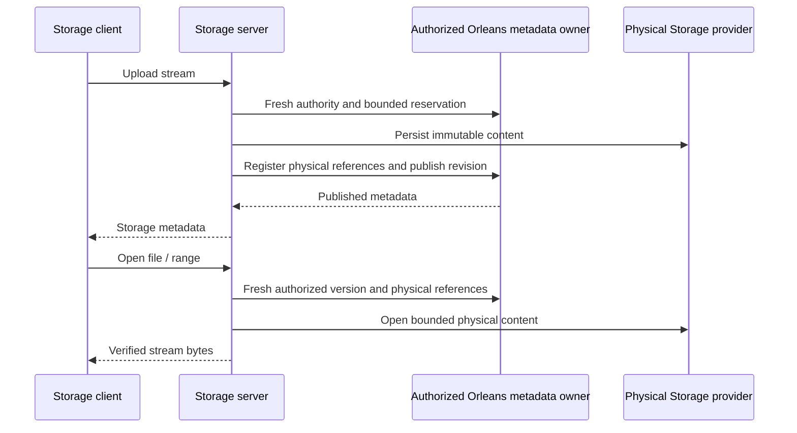

# BlobStorage

Status: ManagedCode.Storage replacement in progress; runtime qualification open.
Decision: [ADR-038](../ADR/ADR-038-chunked-blob-storage.md).
Work: [implementation checklist](../implementation/blob-storage-replacement.md).
Authority: [root policy](../../AGENTS.md).

## Contract and ownership

The approved file-storage capability uses the existing ManagedCode.Storage
`IStorage` implementation and server API. VFS can compose over that
contract. No KeyLoad IStorage adapter, custom transfer stream or multipart engine
is introduced. Reuse the
library's upload/download, streaming, range and chunk-transfer behavior. A
separate public KeyLoad raw-part API is removed by the replacement.

ZoneTree is authoritative for file metadata, access policy, quota reservations,
version publication, integrity hashes and physical-storage references. Binary
content lives in a selected ManagedCode.Storage physical provider outside
ZoneTree. Database commands, outcomes and replica journals contain metadata only.
Provider support, including S3, belongs to ManagedCode.Storage.

## Requirements and acceptance

| Requirement | Observable acceptance |
|---|---|
| REQ-BLOB-001: storage contract | AC-BLOB-001: Real Storage server/client upload, metadata, listing, streaming and deletion use the same file resource. |
| REQ-BLOB-002: physical content separation | AC-BLOB-002: Original payload bytes are present in the configured provider and absent from ZoneTree records, persisted command envelopes and replica journals. |
| REQ-BLOB-003: fresh authorization | AC-BLOB-003: Cross-tenant/resource requests, revoked credentials and denied rows cannot publish or read physical content. Chunk session identities are isolated by verified caller and resource. |
| REQ-BLOB-004: explicit publication | AC-BLOB-004: Failed provider writes do not publish; revision conflicts and unknown outcomes preserve recoverable physical content and do not delete a published version. |
| REQ-BLOB-005: bounded work | AC-BLOB-005: Reservations, concurrent uploads, stream buffers, metadata pages, physical reads and joined cleanup remain bounded under rejection and cancellation. |
| REQ-BLOB-006: exact physical reads | AC-BLOB-006: First/last/interior/cross-boundary/empty ranges match the original bytes; missing or damaged provider content fails closed. |
| REQ-BLOB-007: explicit recovery | AC-BLOB-007: Reopen, file retirement, physical reclamation and metadata-plus-object restore preserve published references; metadata replication alone never claims payload copies. |

Every acceptance gate remains open until the replacement's actual tests and
original delivered-source artifacts establish it. Existing raw-part evidence
cannot be carried over as a passing result.

## Composition and current source

Compose ManagedCode.Storage.Server, its selected physical provider and VFS
where applicable. KeyLoad integrates persisted resource/row authorization and
ZoneTree metadata without reimplementing the library storage/transport layer.
Every participating silo must see the same configured physical object namespace;
independent local directories do not implement shared file storage.

The server composes the published ManagedCode.Storage.Server and FileSystem
10.1.5 packages. `FileStorageController` inherits the native server controller
and delegates form, stream and chunk transfers to the library. The selected
filesystem provider is scoped to the complete partition, resource and incarnation.
The physical key is a server-created immutable identifier; public metadata keeps
the original logical name and excludes provider paths.

`FileStoragePolicy` bounds file bytes, allocated bytes, files, active reservations
and physical objects. Private metadata commands reserve capacity, stage one object,
publish with a revision condition, abort joined writes, retire visibility and
reclaim retired objects. A failed or ambiguous publication retains its physical
reference. Read responses use the library's verified file-backed snapshot and
ASP.NET Core range handling, with another metadata/authorization check before
returning the response.

The authenticated MVC resource filter checks persisted scope before provider
creation and model binding. Every metadata operation reloads credentials, grants,
row policy and resource lifetime through the existing connection-grain path.
Metadata/list/delete/cleanup use those same checks. Paging cursors are encrypted
and bound to the principal, policy epoch and physical resource namespace.
Each metadata call retains its own signed operation identity. Native Storage HTTP
responses do not publish one metadata step's request ID as the identity of the
whole transfer; SDK and MCP operation response identities remain unchanged.

Routes start at `/api/storage/{tenant}/{database}/{domain}/{partition}/{resource}`.
Native transfer suffixes are `upload`, `upload/stream`, `download/{path}`,
`stream/{path}`, `download-bytes/{path}`, `upload-chunks/upload`,
`upload-chunks/complete` and `upload-chunks/{uploadId}` (DELETE).
KeyLoad metadata suffixes are `metadata/{path}`, `list`, `files/{path}` (DELETE)
and `cleanup` (POST). Lists and cleanup return bounded pages; the next encrypted
cursor is in `X-KeyLoad-Next-File`. Stream uploads may declare length through
`X-File-Length` when Content-Length is unavailable.

Single-silo storage defaults to `DataDirectory/files`. Multi-silo file access
requires an explicit shared `KeyLoad:FileStorage:RootDirectory` and
`SharedDirectory=true`. The native development AppHost configures one common
file directory. Chunk sessions remain on their accepting HTTP node and are
fenced by persisted transfer ownership; they are not durable cluster sessions.
Complete replacement acceptance, physical restore and deployed shared-filesystem
qualification remain open.

The HTTP surface inherits ManagedCode.Storage.Server operations. Physical
provider paths are private metadata and are not returned as public download
locations. SQL/MCP binary-transfer parity is not claimed from the removed custom
endpoints. Storage transport, authorization, physical durability,
metadata replication and complete cluster qualification are separate gates.
