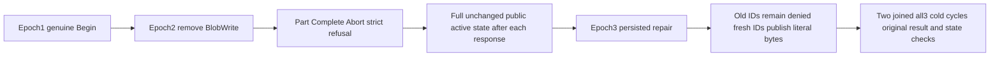

# Persisted active-upload write policy

Canonical slice: BlobStorage. Refines REQ-BLOB-001/003/005 and AC-BLOB-001/003/005 in docs/Features/BlobStorage.md and ADR-038. No public API, quota limit, serializer, or topology change.

REQ-BLOB-ACTIVE-POLICY-001: Begin, Part, Complete and Abort use fresh persisted BlobWrite authority while an original upload remains active. Removing only BlobWrite preserves BlobRead inspection.
AC-BLOB-ACTIVE-POLICY-001: Begin exact four-byte upload at epoch1; epoch2 removes only BlobWrite. Both real SDK and official MCP reject Part, Complete and Abort with dispatched PermissionDenied. After EACH response, both genuine administrator clients observe the complete unchanged active upload while creator metadata/list remain empty. Creator upload-info itself requires BlobWrite and remains strictly denied. No partial bytes become published. This is public domain-state no-effects, not a canonical/journal or failed-outcome absence claim.

REQ-BLOB-ACTIVE-POLICY-002: Restoring grants at a higher epoch does not revive prior command authority.
AC-BLOB-ACTIVE-POLICY-002: Epoch3 restores the original grants. Original epoch1 successful Begin and all original epoch2 denied mutation IDs remain PermissionDenied through both clients. Immediately observe full current state after EACH result. Fresh Part and Complete IDs then publish exact literal bytes [11,23,37,53], length4, one part, revision1, observed authentic chain seed with independent SHA256 chain calculation, original placement incarnation/epoch, and full original success receipts.

REQ-BLOB-ACTIVE-POLICY-003: Joined restart retains current policy, lifetime and original result identity.
AC-BLOB-ACTIVE-POLICY-003: Join original SDK/MCP callers before two genuine all-three-container kill/restart cycles using existing ClusterFixture APIs. Reopen new callers with original persisted credential each time. Repeat original policy refusals and exact current metadata/upload/full bytes/EOF, then replay every epoch3 success result through each client with immediate full current observation before later replay. No old epoch1 receipt success is claimed after policy advance.

Automated mapping: BlobActivePolicyPublicTests.ActiveUploadWriteRevocationHigherEpochRepairFencesOriginalIdsAndPreservesFreshPublicationAcrossTwoRf3ColdCycles, no Arguments, one declared case. New Cases/Models/Assertions/Helpers under tests/KeyLoad.IntegrationTests/Features/BlobStorage; docs/Features/BlobStorage/ActiveUploadPersistedPolicy.md. Frontend N/A; native SDK/official MCP and existing Aspire fixture own execution. SOURCE-N preparation only; compiler, native UID, runtime and Linux RF3 qualification OPEN. No scale, performance or power-loss claim.
