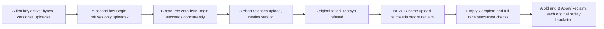

# Zero-byte active-upload slot isolation

REQ-BLOB-UPLOAD-SLOT-001 refines canonical [BlobStorage](../BlobStorage.md) REQ/AC-BLOB-001,004,005. A real zero-byte Begin reserves one active upload independently of bytes, object keys and retained versions. The resource quota aggregates partition keys within the same tenant/database/transaction-domain/resource; another resource has its own resource cap. Original global quotas remain unchanged. Abort releases the active upload but retains its version until bounded Reclaim. No product contract or API is added.

AC-BLOB-UPLOAD-SLOT-001 maps to BlobActiveUploadSlotPublicTests.ZeroByteActiveUploadLimitAggregatesPartitionKeysSeparatesResourcesAndOriginalFailureSurvivesRepair. Configure two NEW resources A/B using actual public persisted administration: MaxBlobBytes=1, MaxReservedBytes=1, MaxObjectKeys=3, MaxVersions=3, MaxUploads=1. First A zero-byte upload on partition key first succeeds. A second distinct blob on key second refuses ResourceExhausted through both SDK and official MCP. Independently, its proposed resource totals are reserved bytes0<=1, keys2<=3, versions2<=3, uploads2>1: only MaxUploads exceeds its limit. A genuine zero-byte upload in B on key second succeeds while A remains active, proving resource isolation. All expected arithmetic is literal source-contract arithmetic, never derived from a quota reply or private record.

AC-BLOB-UPLOAD-SLOT-002 requires each actual SDK/MCP refusal to retain exact ErrorCode ResourceExhausted, SDK domain capacity detail, official fixed safe capacity detail and authentic dispatched request identity. AFTER EACH call, independently verify every original/current upload, attempted absent upload, metadata and any published exact-EOF empty range through BOTH clients. Failed native outcomes may legitimately persist; this is a public upload/head lifetime oracle, not a full canonical/journal no-effects claim. Public reads are separately authorized cuts and are not cross-call atomic snapshots.

AC-BLOB-UPLOAD-SLOT-003 requires real Abort of first A to yield original full upload with literal Aborted/ordinal0/bytes0. A's original refused command ID must remain refused after Abort; a NEW command ID for that SAME previously refused UploadId/blob succeeds before old A version is reclaimed. Literal versions2<=3 and keys2<=3 permit the repair, demonstrating active-upload release rather than version release. Complete through the opposite client publishes revision1/length0/partcount0/deletedfalse and independent exact EOF bytes[]. Validate the actual original Begin/Complete receipts, and server-authored full metadata. No caller timestamp or recomputed chain is an independent expected timestamp/hash.

AC-BLOB-UPLOAD-SLOT-004 requires immediate current-state brackets AFTER EACH successful original Begin/Abort/Complete result replay and original failed command replay. Abort then MaxParts1 Reclaim both retained first A and active B empty lifetimes: literal DeletedParts0/RemainingParts0/ReleasedBytes0/Complete true; completed Reclaim replay stays equal, removed Begin/Abort receipt replay is fenced TokenInvalidated. Keep healthy A head unchanged through each cleanup/replay. The original RequestCqrsClusterCallers.RunOwnedAsync lifetime joins original SDK/official MCP sessions and ordered primary/cleanup failures, and original Aspire fixture owns its cluster resources and disposal. No separate fixture/transport/clock/provider or synthetic quota record is introduced.

Canonical owned slice: IntegrationTests Features/BlobStorage Cases/Models/Assertions/Helpers and this subdoc. Existing production/SDK/MCP/AppHost/shared fixture/serializer roles are N/A: unchanged native APIs. Distinct from EmptyVersionSlotLifetime: that flow's first refusal jointly exceeds versions/uploads and post-Abort isolates versions; this flow isolates uploads with key/version headroom and checks same-resource partition aggregation versus a separate resource. One no-argument method, one planned case; current UID/census/compiler/runtime and exact-source Linux cluster qualification remain OPEN. No cold, raw counter, power-loss, performance or production claim follows from source preview.
