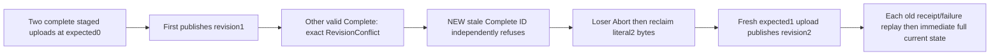

# Competing staged blob publication CAS

REQ-BLOB-STAGED-CAS-001 refines [BlobStorage](../BlobStorage.md) REQ/AC-BLOB-001,004,006: two genuine complete staged uploads may share the same expected head revision, but only one can publish at that revision. Complete validates actual length/parts/hash before revision CAS; a valid competing upload must yield RevisionConflict rather than a malformed-content error. Preserve persisted authorization, original Orleans execution and durable command identity. No product/API/serializer change is proposed.

AC-BLOB-STAGED-CAS-001 maps to BlobCompleteCasPublicTests.TwoStagedUploadsAtSameRevisionHaveOnePublicationAndOriginalConflictSurvivesRepairAndReplay. Use the real Aspire-owned RF3 ClusterFixture and owned actual SDK/official MCP clients. Stage two distinct UploadIds on the SAME blob with ExpectedRevision0 and independent literal bytes [11,13,17] and [19,23]. Their literal SHA256 part digests are independently pinned. Both stages succeed before either Complete. First Complete publishes full metadata revision1/length3/parts1/deletedfalse, full original receipt and literal first bytes. The second valid Complete refuses RevisionConflict through both clients with original SDK head-revision detail and closed official MCP generic safe detail/authentic dispatched identity. Independently inspect full head, exact bytes and each original upload state AFTER EACH failure. There is no parallel task/timing claim: this deterministically exercises the actual staged-state CAS boundary.

AC-BLOB-STAGED-CAS-002 requires a NEW Complete command ID on the same stale second upload to independently refuse the same actual head CAS, not only return the original cached failure. Original successful Begin/Part results for both uploads replay through both clients with immediate current head/upload checks. Abort the losing upload through official MCP; compare the original full written upload with Status Aborted. Bounded MaxParts1 Reclaim returns literal DeletedParts1/RemainingParts0/ReleasedBytes2/Complete true, and the full original reclaim receipt replays through both clients while current winner bytes remain unchanged. Removed Begin/Part/Abort success lifetimes are TokenInvalidated; original two failed Complete IDs retain their original RevisionConflict after removal. Failed outcomes legitimately persist; public data controls are not full-store no-effects or one atomic cross-call cut.

AC-BLOB-STAGED-CAS-003 requires a fresh genuine third upload with ExpectedRevision1 and independent bytes [29,31,37,41], complete through the opposite client to publish revision2/length4/parts1 and full original receipt. Every original successful winner and fresh healthy Begin/Part/Complete receipt replay is immediately followed by the current full revision2 metadata, literal healthy range/EOF and all retained upload states. BEFORE replaying a newer receipt, check current head after each older receipt so an old result cannot conceal head regression. Both original stale Complete failures and completed Reclaim replays remain bracketed by full current state. Preserve native server-authored timestamp and observed authentic Begin seed; literal part SHA is independent, but no independent initial-seed/chain claim is made.

Canonical slice: IntegrationTests Features/BlobStorage Cases/Models/Assertions/Helpers and this subdoc. Production, SDK, MCP, AppHost/shared fixtures and serializer roles are N/A because native APIs are unchanged. This supplements the existing kernel-only BlobStorageCompareAndSwapTests and is distinct from sequential supersession/stale Begin, live-version Reclaim retirement, malformed-content, cancellation and slot quotas. One no-argument method/one planned case; UID/current census/compiler/runtime/exact-source Linux qualification remain OPEN. Original RequestCqrsRf3Callers.RunOwnedAsync joins actual caller/session cleanup in its ordered failure ledger; fixture owns original RF3 startup/disposal. No cold, raw canonical, power-loss, performance or production credit follows from source preview.
