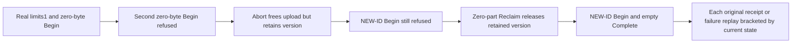

# Empty upload version-slot lifetime

REQ-BLOB-EMPTY-SLOT-001 refines REQ/AC-BLOB-001,004,005: zero payload bytes do not mean zero retained lifetime. Actual Begin adds one version and one active-upload slot even for Length=0. Actual Abort releases the active-upload slot and unused byte reservation, but keeps the version/state; only completed bounded Reclaim removes that retained version. Use original public SDK and official MCP through the existing Aspire-owned cluster fixture, fresh persisted administrator authorization and ordinary signed native command routing.

AC-BLOB-EMPTY-SLOT-001 maps to BlobEmptySlotPublicTests.EmptyUploadConsumesVersionUntilAbortAndZeroPartReclaimThenFreshPublicationPreservesOriginalFailures. Configure a NEW genuine resource with MaxBlobBytes=1, MaxReservedBytes=1, MaxObjectKeys=1, MaxVersions=1 and MaxUploads=1. First zero-byte Begin succeeds. Another zero-byte Begin on the SAME blob refuses ResourceExhausted through both clients despite zero reserved bytes. Abort has literal zero stored bytes/ordinal, Aborted status, and does not permit a fresh-ID Begin while its version remains. Each individual refusal is immediately followed by both-client full original upload/metadata and attempted-upload-absence assertions. Use a distinct post-Abort command ID to exercise actual version-slot admission rather than cached initial refusal.

AC-BLOB-EMPTY-SLOT-002 requires actual Reclaim MaxParts=1 on that Aborted zero-part lifetime to return literal DeletedParts=0, RemainingParts=0, ReleasedBytes=0, Complete=true and remove its upload. Replay its complete result through BOTH clients with immediate current-state checks. Same original successful Begin and Abort now refuse TokenInvalidated; their removal is never inferred from only a reply. Original two failed Begin commands continue to return their original Capacity refusal even after capacity is released. A NEW command ID for the same formerly refused upload now succeeds with Length=0 and the actual original Begin chain seed, then Complete publishes revision1, length0, partcount0, Deleted=false and independently empty exact-EOF bytes. Both clients compare the full original metadata and complete receipt, including server-authored UpdatedAt. No caller clock is an expected publication timestamp; no hash computation is claimed independently validated.

AC-BLOB-EMPTY-SLOT-003 requires full Begin/Complete result replay with the current empty published head verified AFTER EACH call, plus original failed Begin and completed Reclaim replay and original removed-lifetime fences. The actual source arithmetic independently identifies the limiting counter: byte delta=0, same key delta=0, uploads is freed by Abort, while versions remains1 until final Reclaim subtracts1. Do not decode private quota records or widen friend access. Current metadata/upload and exact empty bytes are public storage-lifetime oracles; durable failed outcomes can legitimately append logs. No whole-store no-effects, physical cold, cluster restart, raw counters, process kill, power-loss or performance acceptance follows from this warm public flow.

Canonical slice: IntegrationTests Features/BlobStorage Cases/Models/Helpers/Assertions and this owned subdoc. Production/SDK/MCP/AppHost/shared fixture/serialization surfaces are N/A because existing APIs are unchanged. This is distinct from byte quota, nonempty restored reclaim, listing, row ownership, retirement and producer cancellation. One no-argument method; UID and actual execution must come from Main census. Source preview, compiler, current-image runtime and exact-source Linux qualification remain OPEN. Original caller owner disposes SDK/official sessions and retains ordered body/cleanup failures; no private provider, clock override or synthetic counter is introduced.
