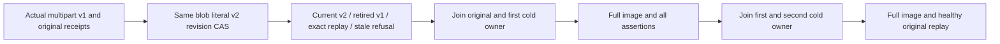

# Blob immutable-version supersession

REQ-BLOB-SUPERSESSION-001 refines REQ-BLOB-001/002/004/005 and ADR-038. A genuine second completed upload for the SAME BlobRef replaces the current head by revision CAS. The unreclaimed original upload state becomes Retired=true; its original parts and part metadata are preserved until the existing explicit reclamation lifecycle. This is not an indefinite retention or historical public-read promise.

AC-BLOB-SUPERSESSION-001 maps to BlobSupersessionTests.AcBlob004SupersessionRetainsOriginalReceiptsAndCurrentBytesThroughTwoColdOwners (one Test, no Arguments). Publish the actual existing multipart v1 fixture and a distinct literal eight-byte v2 under expected revision1. Require independently constructed full v2 metadata/revision2/current range/zero-at-end, exact original v1 state with ONLY Retired=true, exact original v1 parts/metadata and all seven original native OperationResult/receipt replays. Reads and cached replay preserve the full canonical image and position.

REQ-BLOB-SUPERSESSION-002 preserves the current public API: BlobReadRequest.ExpectedRevision is a precondition on CURRENT head, not a historical version selector. AC-BLOB-SUPERSESSION-002 repeats exact RevisionConflict/detail for stale revision1 (including zero-length), proves full-image/cut invariance, then reads exact healthy v2. No new client protocol, alias, generated persistence type, serialization, fallback or storage behavior is introduced.

REQ-BLOB-SUPERSESSION-003 requires joined native owners. AC-BLOB-SUPERSESSION-003 closes the original real ZoneTree store, opens the SAME root with original configured database/catalog identity, repeats the entire assertion set, closes it and opens a second owner with complete image/position parity and healthy/replay continuation. Body and owner disposal failures remain ordered through the existing ServerFailureObserver. The existing persisted root principal is reloaded by each actual BlobReads.Cut; dedicated policy-revocation coverage remains BlobRangePolicyColdTests, not newly qualified here.

Canonical roles: Unit BlobStorage Cases/BlobSupersessionTests; Helpers/BlobSupersessionTrial and BlobSupersessionPublication; Assertions/BlobSupersessionAssertions; Models/BlobSupersessionVersion. Product implementation is unchanged. Server/SDK/MCP/frontend: N/A to this additional native kernel case; existing public cluster qualification remains required.

Source implementation requires current-image verification; compiler/current-image TUnit/native runtime/Linux/process/cluster/SDK/MCP and endurance gates OPEN. No native replica journal/ACK, process-kill, cross-store atomicity, public historical read or performance claim follows from same-root kernel reopen.
