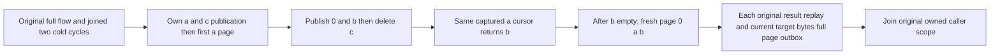

# Current identifier continuation across real blob head mutations

Canonical BlobStorage REQ/AC-BLOB-002/003/006, REQ-BLOB-LIST-LIFETIME-001. Requirements frozen before implementation. Strengthen the SAME BlobTombstoneListingPublicTests.RetiredAndUnpublishedHeadsAdvanceEmptyCursorWhileCurrentRevisionAndOriginalResultsSurviveTwoClusterColdCycles; original Trial and its two joined cold cycles stay FIRST. New continuation is warm only, adds no Test/Arguments/UID/fixture/deadline/API/library.

REQ-BLOB-LIVE-CURSOR-001 / AC-BLOB-LIVE-CURSOR-001: genuine own resource/partition publishes independently literal a-boundary and c-deleted. Capture SDK and official MCP Limit1 first pages, independently full a metadata and NextAfterId=a-boundary. Between first page and continuation publish 0-before and b-inserted then Delete c-deleted at revision1. SAME actual captured identifiers must return independently full b-inserted metadata/cursor; continuation after b returns empty/null. Newly inserted lower 0 is excluded by the exclusive boundary; c is excluded by its real tombstone. Fresh full page returns exactly 0,a,b. This is current authorized identifier pagination, not snapshot isolation.

REQ-BLOB-LIVE-CURSOR-002 / AC-BLOB-LIVE-CURSOR-002: every original receipt independently binds command/partition/quorum/positive position/EMPTY mutation vector. Independent four literal byte corpora, raw SHA256 and 72-byte chain from authentic initial Begin seed bind full publication metadata; time retained from original server result, not predicted. Delete independently requires revision2/null version/zero length/parts/null hash/deleted=true and same access/full ref. Native Delete retires the published state; original creator-matched publication results replay while that state remains retained. Final Reclaim lifetime removal is not part of this continuation.

REQ-BLOB-LIVE-CURSOR-003 / AC-BLOB-LIVE-CURSOR-003: after EACH SDK/MCP page and EACH full original Begin/Part/Complete/Delete replay, compact nonrecursive Current compares the FULL current visible metadata page plus affected object's independently literal bytes or full tombstone and full outbox through BOTH routes. Exhaustive all-object byte matrix runs at legitimate phase cuts. Original typed receipt/results remain exact on each replay; no raw image/atomic cross-call/no-append claim. Baseline captured AFTER actual mutations. No added cold claim, deadline increase or speed claim; complete source call census and real runtime remain OPEN.

Canonical map IntegrationTests Features/BlobStorage responsibility folders, own feature subdoc. Backend/client/contracts/UI/benchmark N/A acceptance-only. Acceptance code is authored; compiler, runtime and Linux cluster qualification remain pending.

