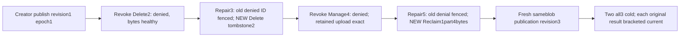

# Persisted blob deletion and maintenance capability lifecycle

REQ-BLOB-MAINTENANCE-POLICY-001 refines canonical [BlobStorage](../BlobStorage.md) REQ/AC-BLOB-003/004/005/006 and ADR-038. Delete requires current persisted BlobDelete, bounded Reclaim current BlobManage; neither substitutes BlobRead/BlobWrite or creator identity. Policy epochs fence cached outcomes, independently of retained upload lifetime. No product/SDK/protocol change. The existing administrator captures the actual placement through SDK and official MCP, comparing full generated results before creator publication; full receipt incarnation/ownership epoch assertions use this independent retained tuple. The nonadmin creator never invokes administrator-only placement reads or gains trusted roles.

AC-BLOB-MAINTENANCE-POLICY-001 maps to BlobMaintenancePolicyPublicTests.PersistedDeleteAndManageRevocationRepairPreservesRetiredBytesOriginalFailuresAndHealthyReceiptsAcrossTwoRf3ColdCycles, one no-argument case. Actual persisted nonadmin creator has four scoped blob grants/key. Publish independently literal11/23/37/53 as revision1, full metadata/positive quorum receipts/upload/EOF and original Begin/Part/Complete replay; after EACH receipt/client observe full current literal state. Revoke ONLY BlobDelete at epoch2 while Read/Write/Manage remain. SDK and dispatched official MCP Delete both PermissionDenied, null SDK result; full published bytes/metadata/upload immediately healthy after EACH. Repair epoch3; original denied command remains PermissionDenied from old policy; NEW Delete ID yields literal revision2 tombstone, full server timestamp preserved, original full Delete receipt matches through both clients with immediate retired upload/head check.

AC-BLOB-MAINTENANCE-POLICY-002 revokes ONLY BlobManage at epoch4 while Read/Write/Delete remain. Both-client bounded Reclaim original ID refuses PermissionDenied with retained complete original UploadInfo length4/bytes4/ordinal1/statusComplete, exact tombstone and NotFound public range. Repair epoch5 does not revive original denied Reclaim. NEW Reclaim ID yields independently literal DeletedParts1/RemainingParts0/ReleasedBytes4/Complete true; old UploadInfo absent, tombstone unchanged. NEW sameblob expectedRevision2 upload publishes literal71/73/79/83 revision3. Full original final Reclaim and healthy publication receipts replay with current read immediately after EACH result, never following-result concealment.

AC-BLOB-MAINTENANCE-POLICY-003 distinguishes policy from lifetime: successful Delete epoch3 now PermissionDenied at epoch5, not assumed replayable or rewritten; original denied Delete epoch2 and Reclaim epoch4 remain PermissionDenied. Full successful healthy publication and complete Reclaim at epoch5 remain exact. Cached policy equality is native existing requirement. Metadata timestamps/hash seeds are authentic retained server fields, not caller-clock/independent cryptographic claims. No omitted metadata fields, output-derived expected bytes, raw canonical/journal no-effects or reclaimed raw-read promise.

AC-BLOB-MAINTENANCE-POLICY-004 joins both actual caller owners BEFORE TWO genuine all-three container cold cycles using original Kill/BeginRestart/Restart health+source cohort seams. Reconnect original persisted creator credential at epoch5; repeat exact healthy bytes/metadata/upload/EOF, original denied IDs, stale-policy Delete refusal, full final receipt replay after each cold. Existing Aspire ClusterFixture owns all resources; original RunOwned and ordered ServerFailureObserver cleanup remain. Compiler/current UID/census/Linux RF3/runtime OPEN. No restart retry relabelled fullcold, fake roles/clock/provider/shared fixture edit, endurance or production claim.

Canonical slice IntegrationTests Features/BlobStorage Cases/Models/Assertions/Helpers and this subdoc. Product/SDK/serializer/shared topology surfaces N/A unchanged. Distinct from reader-policy revoke, row-owner/creator repair and administrator-only retirement/counter flows. Public separately authorized reads are not an atomic multi-call cut. Source preview does not qualify any gate.
