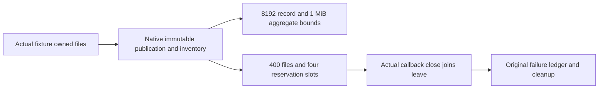

# Native Blob owner file regression contract

REQ-001: The original strict NativeBlobWireFiles API preserves one immutable winner under genuine filesystem publication contention. Its short exclusive handle is never retained across await.
AC-001: Two real concurrent publishers target the same owner-file claim; exactly one succeeds, the other receives actual contention/refusal, and complete winner bytes remain unchanged after a duplicate attempt.

REQ-002: Every final and retained temporary file charges unchanged record8192, aggregate1048576 and file400 limits.
AC-002: Exact8192 publication succeeds;8193 refuses with no new file. Actual temporary records reach exactly aggregate cap then one extra byte refuses. Actual zero-length temporary entries reach400 then a further record refuses. No cap is lowered, reset or replaced.

REQ-003: Four reservation slots are exclusive and immutable, and release validates exact original record; callback shutdown joins actual active callback exit.
AC-003: Actual Enter writes slots0..3, fifth refuses; changed CallbackId Leave refuses and retains original bytes; original Leave frees that exact slot. Actual CloseAsync remains incomplete until actual Leave and rejects new Enter after close.

ABI: complete Source51 successor Files.WithPublication(Action) / WithPublication<T>(Func<T>), WriteLocked, Read and original Reservations.Enter/Leave; original CallbackLifetime.Enter/Leave/CloseAsync. All operations use genuine fixture-owned0700directory and0600regular files, actual production Codec/Inventory/options. Owner-file metadata test records are not authenticated native request evidence, RPC contexts, ACKs or RF3 qualification. No locks cross await; no retries. Dispose/primary failures aggregate using original ServerFailureObserver.

Source map: Unit Features/BlobStorage/Cases/NativeBlobWireFileCases.cs, NativeBlobWireReservationCases.cs; Fixtures/NativeBlobWireFileFixture.cs. Compiler/runtime/Linux contention/RF3 remain OPEN.

Selected owner implementation is complete Source52r2, including the original primary/disposal failure ledger. Unit metadata remains an independent filesystem regression fixture; it is not authenticated RF3 evidence.

