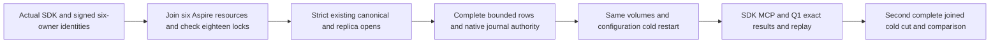

# Genuine native Blob wholeflow and complete cold evidence

The complete native successor is joined in current source. Its actual compiler, metadata, lifecycle, client and Linux RF3 qualification remain open.

| Requirement | Acceptance | Exact API |
|---|---|---|
| REQ-BLOB-WHOLE-001 retain original eight-byte/document/moved-parent public behavior and all ten native first-winner catalogs | AC-BLOB-WHOLE-001 actual SDK MovePartitionAsync Retired plus original RequireAsync SDK/official MCP/Q1, secondary abort/reclaim/publish/delete/tombstone, independent Source51 all-ten signed native evidence | NativeBlobWireWaveStartup, RemoteTransferNativeAdministrator/ParentSeed, Source51 ArmAsync and EvidenceReader, native Blob effects |
| REQ-BLOB-WHOLE-002 full six original stopped-store authority | AC-BLOB-WHOLE-002 independently recapture actual SDK Status canonical GUIDs and signed native generations before EACH stop; stop/join actual six Aspire resources and check all18 locks before strict existing canonical+replica reads | READY115 RemoteTransferNativeColdIdentities, TwoRf3MembershipWave.StopForDirectoryReadAsync, AssertAllNodeLocksReleased, ZoneTreeExistingStore.Open |
| REQ-BLOB-WHOLE-003 complete native rows and original journal authority | AC-BLOB-WHOLE-003 empty-prefix complete native VisitRange for canonical AND replica, before-copy shared 8192-record/32768-whole-owner budget, no prefix-only images; original hardstate/fixed group and all retained committed entries verified using native codecs/authority against canonical DB | IKeyValueView.VisitRange, Root C1SubmissionJournalInspectionReadBudget/Database, ReplicaPersistence/ReplicaLogValidation/ReplicaBenchmarkMembership/ReplicaAdmittedEntryRead |
| REQ-BLOB-WHOLE-004 membership-only replay deltas | AC-BLOB-WHOLE-004 full native canonical rows/store position/applied compared by existing original membership mutation oracle; unrelated rows and original acknowledged entries exact; missing/compacted required entry is genuine RecoveryRequired, never expected-ACK reconstruction | PartitionMovementBlobWireNativeCut.RequireEntriesAsync, PartitionMovementNativeMembershipRf3Cut |
| REQ-BLOB-WHOLE-005 two genuine cold reopen phases | AC-BLOB-WHOLE-005 same owned volumes/configuration reopened by RestartJoinedAsync, current signed six generations differ but incarnations/tuples identical, callers recreated, SDK+official MCP exact Move receipt replay, second complete cold image equality, fresh SDK terminal and original outputs | READY115 native membership/admin lifecycle, actual original Move request/result |

The selected READY115 scoped queue reader cannot satisfy this complete Blob oracle. Only its exact authority/lifecycle primitives are reused; no second identity algorithm, diagnostic endpoint or weaker queue cut is introduced. Replica node GUID is actual persisted existing identity, independently distinct from canonical GUID and fixed-time same signing authority/incarnation. Files are opened only after genuine original process/resource join and all eighteen lock checks. Complete raw rows and native journal bytes remain private evidence, with redacted ToString and no payload logs.

Catalog completion is provisional until actual original task success and Source7 joined close. First callback claims remain immutable through both cold stops and are never reset/reassigned. Missing, compacted, oversize, wrong term/owner/membership or malformed bytes fail the original scope. No skip/fake ACK or fabricated native generation. Full canonical directory bytes are retained in complete rows; original inherited pre-arm persisted-directory gate remains.

Whole comparison permits only genuinely decoded native membership entries with exact original authority/outcomes. Required original journal history must actually be retained; snapshots covering any required interval are refused rather than guessed. This does not certify power-loss durability.

Existing shared fixtures/observers remain while actual callers remain. Mandatory Linux/compiler/analyzer/actual RF3 gates remain open.

## Concrete return and dependency contract

NativeBlobWholeCold.CaptureAsync(wave, signedOwners6, token) returns a dictionary keyed by all six existing resource names and LEAVES the original wave STOPPED. It independently obtains current real SDK Status GUIDs, joins all resources, proves18locks, then opens/disposes each genuine existing canonical/replica pair. NativeBlobWholeOwnerCut retains complete ordered raw canonical/replica rows, both actual GUIDs/positions, Applied, original native hardstate and authenticated full retained entries. ToString is redacted.

NativeBlobWholeCold.RestartAsync(wave, administrator, priorOwners6, token) performs actual RestartJoinedAsync, recreates SDK/MCP caller owners and authenticates six changed full native addresses with identical cluster/incarnation/voter identities. NativeBlobWholeColdAssertions.RequireUnchangedAsync(before6,after6,token) applies existing original full membership oracle, requires original raw journal entries immutable, and permits only independently decoded membership/no-op new entries plus actual native hardstate elections. No SDKStatus/voter conversion is used as native generation.

The current native replay, fixed fault catalog, borrowed capability and protected first-ten file owner precede the complete cold helpers and public Blob flow. The native journal helpers supply the read-only scoped inspection engine, purpose-closed authority and one cumulative8192/32768 observer. Canonical project references and the scoped CrashHost/Replication friend declarations admit IntegrationTests without exposing a public API.

C1's single-entry request DTO is deliberately not populated with invented entry index/term for a whole-owner scan. Feature-local path validation therefore accepts only the real six resource names and actual stopped node root; underlying strict existing-store and original native identity/read/authority helpers remain unchanged.

## Record/byte bound clarification

Root froze 8192 observed KEY+VALUE BYTES per record and32768 cumulative across SAME owner, not8192 records. The independent record-count ceiling is original native DatabaseLimits.MaxScanRecords=10000 from fresh source; full VisitRange passes that limit BEFORE copying, charges required lookahead and refuses HasMore/StoppedByVisitor. Every repeated canonical constructor/native authority read uses the same Root budget; no resets/provider RAM claim.

