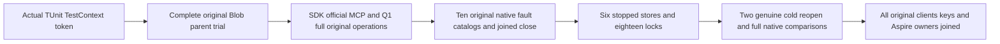

# Complete native Blob development qualification case

REQ-BLOB-WHOLE-CASE-001: One real TUnit entry invokes the complete native Blob parent trial with the actual TestContext cancellation token. The fixture owns genuine Aspire source/destination RF3 resources, persisted authentication, original SDK/official MCP/Q1 operations, ten native same-lease fault catalogs, complete stopped evidence for all six native stores and two genuine cold reopen cycles. AC-BLOB-WHOLE-CASE-001: NativeBlobWholeParentQualificationCases executes NativeBlobWholeParentTrial.RunAsync; every original parent/cold/native owner assertion must pass against the exact integrated source and image. A private entrypoint, unit kernel or patched source cannot satisfy this acceptance.

REQ-BLOB-WHOLE-CASE-002: Preserve the existing Blob case UID, legacy/shared callers and canonical qualification inventory until the complete successor is actually discovered, executed and reviewed. AC-BLOB-WHOLE-CASE-002: This additive development case edits no existing case, selector, inventory, status count or shared observer. Main may select it explicitly for actual development execution; no new qualified UID/count or old-case retirement is reported before genuine results.

REQ-BLOB-WHOLE-CASE-003: Cancellation and every original operation/client/file/Aspire owner must join with original failure preservation. AC-BLOB-WHOLE-CASE-003: The wrapper passes the original native TestContext token without creating a transport, topology, credential, fake trusted role, detached task or secondary deadline; the selected actual trial remains the single owner of all work.

Canonical source map: Integration Features/BlobStorage/Cases/NativeBlobWholeParentQualificationCases.cs; shared cluster-routing NativeBlobWholeParentTrial/Owner/Flow/Assertions and NativeBlobWholeCold complete readers. Select complete Source52r2, Source6 catalog, Source7 borrow, Cold8r1 plus actual-owner1r2, Parent5 and all guarded READY115 prerequisites. Compilation, actual TUnit discovery/execution, Linux RF3, native record-budget fit, complete original ten catalogs and TWOcold gates remain OPEN. Existing qualification and historical results are unchanged.
