# Complete native proof after the second cold reopen

REQ-BLOB-SECOND-COLD-001: Both actual cold reopens preserve complete canonical and replica stores for all six owners, with only the existing native membership mutation oracle permitting changes. AC-BLOB-SECOND-COLD-001: After the second actual RestartAsync, retain its genuine signed six-owner membership, complete the original SDK/official MCP/Q1 receipt and content oracles, close clients, capture all six complete stopped stores and compare the second and final cuts using NativeBlobWholeColdAssertions.RequireUnchangedAsync. The original first comparison remains unchanged.

REQ-BLOB-SECOND-COLD-002: Exactly two original cold restarts occur, without additional effects, rewritten command identities or a third reopen. AC-BLOB-SECOND-COLD-002: The final capture leaves the original wave stopped; NativeBlobWholeParentOwner.DisposeCoreAsync joins that same wave and releases borrowed keys only after application disposal and all node locks are proven released. Every failure uses the original retained failure ledger.

Canonical source map: Integration ClusterRouting/Scenarios/BlobTransfers/NativeBlobWholeParentFlow.cs, selected original WholeParentOwner and WholeCold readers/assertions; real TUnit entry Features/BlobStorage/Cases/NativeBlobWholeParentQualificationCases.cs. This narrow successor supplements AC-BLOB-WHOLE-PARENT-004 and AC-BLOB-WHOLE-005; it does not edit a UID, selector, status count or qualification result. Source52r2, whole cold8 plus actual-owner1r2, Parent5, READY115 and Source90 remain dependencies.

```mermaid
flowchart LR
    A[Original effects and six stopped stores] --> B[First actual cold reopen]
    B --> C[Original public replay and second full six cut]
    C --> D[Original native comparison]
    D --> E[Second actual cold reopen]
    E --> F[Original public replay and final full six cut]
    F --> G[Second original native comparison]
    G --> H[Joined stopped wave and borrowed key cleanup]
```

Actual analyzer/build, Linux RF3, native read-budget fit and both original cold comparisons remain OPEN. Private patch equality is source evidence only.
