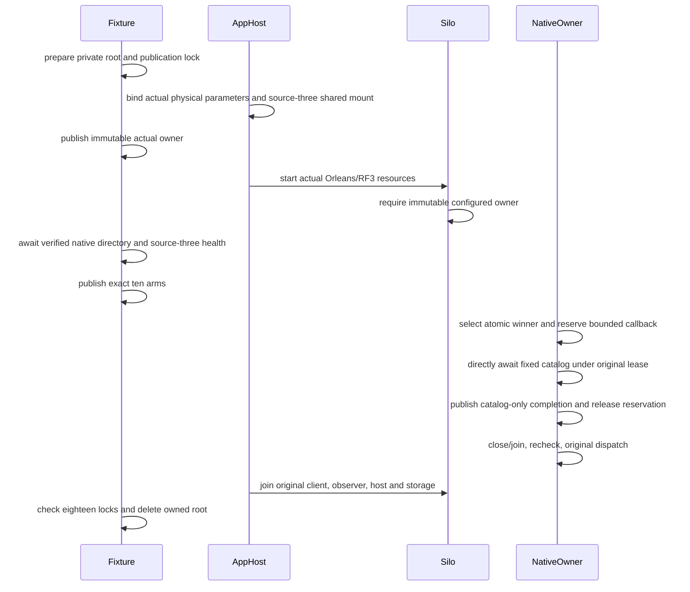

# Native Blob wire first-ten diagnostic ownership

This supplemental BlobStorage acceptance contract implements the approved private RF3 diagnostic scope. It does not activate or replace the original BlobWire case UID. Existing legacy shared observers remain while their genuine callers remain.

## Requirements and acceptance

| Requirement | Acceptance | Source/test mapping |
|---|---|---|
| REQ-BLOB-NATIVE-TEN-001: one immutable wave owner binds actual control/source/destination tuples, session and ten fixed native identities. | AC-BLOB-NATIVE-TEN-001: actual bound AppHost parameters publish before application startup; source-three factories reject missing/mutated owner; pre-arm inherited RF3 registration verifies the persisted native directory. | NativeBlobWireProbeFixture, NativeBlobWireProbeProfile, NativeBlobWireState; genuine RF3 execution OPEN. |
| REQ-BLOB-NATIVE-TEN-002: each original identity has one no-overwrite winner and immutable complete catalog evidence. | AC-BLOB-NATIVE-TEN-002: duplicates validate the winner; claim failure is never reassigned; unknown/mismatched scope is unselected without authorizing effects. | NativeBlobWireSelection, NativeBlobWireScope, NativeBlobWireClaims; actual shared-file contention/crash gates OPEN. |
| REQ-BLOB-NATIVE-TEN-003: catalog dispatch uses the same original native lease, key, deadline and generation. | AC-BLOB-NATIVE-TEN-003: lazy sequential 11 common mutations plus two conditional Outcome mutations preserve the original inner signature; every real refusal is independently verified; original dispatch follows joined close and original rechecks. | Selected Source7 borrowed capability, NativeBlobWireProbeObserver, NativeBlobWireEvidenceReader; actual RF3 gate OPEN. |
| REQ-BLOB-NATIVE-TEN-004: original bounded admission and joined cleanup are mandatory. | AC-BLOB-NATIVE-TEN-004: four callback reservation records under short publication lock, no handle across await; 8192 record/1MiB aggregate/400 files/32 arms/8 markers remain unchanged; contention/exhaustion fails, crash records are not recycled; original client and observer directly join before host/MAC teardown. | NativeBlobWireReservations, NativeBlobWireFiles, NativeBlobWireCallbackLifetime, OrleansNode guarded composition; Linux/runtime gates OPEN. |
| REQ-BLOB-NATIVE-TEN-005: retain complete positive public behavior and independent durability oracles. | AC-BLOB-NATIVE-TEN-005: original eight-byte blob, document, moved parent, SDK/official MCP/Q1 output and abort/reclaim/publish/delete/tombstone sequence remain; all six full canonical stores/native raw journals and TWO cold restarts remain separate required gates. | Original BlobWire case remains unchanged; seed/effect supplement only captures genuine commands and applies preallocated command IDs; full native owner/cut integration OPEN. |

## Fixed identity and correlation

Outcomes are BeginUpload, WritePart, CompleteUpload, AbortUpload, Delete and Reclaim. Four reads are Metadata, UploadInfo, Range and List. Six outcomes bind actual original command IDs and blob/upload scope; Delete revision comes from actual returned metadata, never a future invented revision. Four reads bind native bytes of the original typed requests. Files contain no keys, roles or credentials. Selection is diagnostic only, after original proof validation.

Catalog completion proves only catalog publication. It occurs before Source7 closes and rechecks the original operation. Qualification additionally requires actual successful original results, native joined closure, six resource shutdown and all eighteen storage-lock checks. No marker or digest substitutes for full canonical/journal bytes.

## Startup and lifetime

The pre-arm registration gate is inherited original native persisted-directory verification: PhysicalOwnerRegistrationController checks the actual Register reply, awaits the coordinator read barrier and compares Database.ReadPhysicalOwnerDirectory for the authenticated administrator before reporting verified. ExpectedAsync alone is configuration expectation, not independent persisted observation. Final stopped-store native directory evidence remains mandatory.

Backend roles are colocated in Server/Features/BlobStorage/{Contracts,Diagnostics,Hosting,Models,Serialization,Validation}; selected Aspire mount is AppHost/Features/BlobStorage/Topology; fixture/readers live in IntegrationTests/Features/ClusterRouting. Frontend N/A: private fixture diagnostic only. Public API N/A: no new peer/public dispatch endpoint. SDK/MCP contracts remain original.
