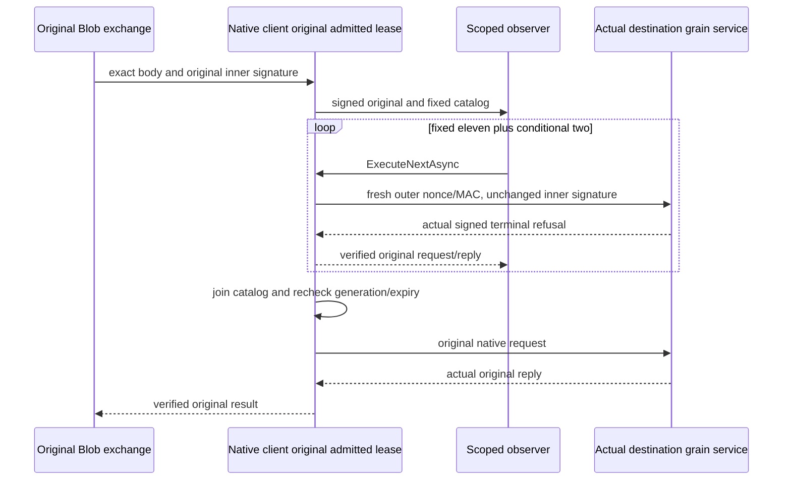

# Native Blob borrowed fault catalog

The current source implements this internal qualification seam. Its compiler, actual native caller, complete owner-cut, lifecycle and Linux RF3 acceptance gates remain open until original current-source reports pass. The original public Blob operation, persisted authority and RF3 acknowledgement contract stay unchanged.

The feature-local INativeControlledBlobBorrowObserver selects an actual decoded original call and observes it with the original signed native request, scoped NativeControlledBlobBorrowedCatalog and original linked cancellation token. RemoteModelNativeClient resolves this optional observer only when the existing RequestCqrsProbe.Enabled profile is selected. Ordinary calls retain the same native admission and dispatch.

## Admission and dispatch

Observation runs inside the original ReplicaDiscoveryLifetime.Operation after original source/destination authority and generation checks, original inner signature verification and outer native signing, before the original dispatch. The original operation, source MAC, addresses, payload and expiry remain owned by the native client. The observer receives neither a key nor an independently admitted operation.

ExecuteNextAsync takes no arguments. It lazily enumerates the fixed eleven plus up to two conditional faults for each of the original ten purpose/kind identities, with one actual send in flight. There is no rewind, repeated ordinal, arbitrary payload, supplied address, replacement signature, result injection or use after closure. Each fault preserves the original signed inner bytes/expiry and obtains only its fresh outer nonce/MAC from the same native owner. Native dispatch and existing reply verification produce the actual signed terminal refusal with every success leaf absent.

The client awaits the observer and closes the catalog under its original caller/shutdown/deadline token. Catalog closure joins its actual running task and retains every original dispatch and cleanup failure, including a dispatch failure caught by the observer. It requires the complete fixed catalog, then revalidates original generations, MAC and expiry before continuing the original request. The original lifetime drain and resource owner govern shutdown throughout this flow.

## Complete owner evidence

The native Blob whole-operation fixture retains all six original canonical and replica owners. It obtains their actual SDK Status canonical GUIDs and signed native discovery generations before each joined Aspire stop, checks all eighteen locks, and then opens only strict existing stores. One cumulative before-copy budget charges key and value bytes: 8192 bytes per record and 32768 bytes across the same owner, with the original validated MaxScanRecords ceiling. Constructor, canonical and journal authority reads share that budget.

Empty-prefix native VisitRange retains every canonical and replica row, both positions, applied index, original hardstate and authenticated retained entries. The original membership-only mutation oracle explains allowed deltas from actual original journal entries. Missing, compacted, malformed, wrong-owner or over-budget required evidence fails the scope. Rows, signatures, credentials and user payloads stay private; diagnostic displays remain redacted.

Two genuine cold phases use the same owned six volumes and configuration. Each stop joins the original resources and file owners; each restart recreates actual SDK/MCP callers and observes fresh signed generations with unchanged voter/incarnation tuples. Original SDK, official MCP and both SQL CALL routes verify the complete eight-byte Blob/document/moved-parent behavior, exact receipt replay, tombstone and bounded reclaim. Native generation evidence is never inferred from SDK status or a fabricated acknowledgement.

## Requirements and acceptance

REQ-W27-BLOB-BORROW-001 / AC-001: for each original ten identity, the selected callback consumes the fixed eleven plus conditional two faults, preserves the original inner signature, observes actual signed refusals with null success leaves, and continues the original healthy operation. NativeBlobWholeParentQualificationCases and the original catalog/file/reservation operation cases own these flows.

REQ-W27-BLOB-BORROW-002 / AC-002: retain the same admitted native lifetime/key/deadline/generations; directly join actual started calls on cancellation and shutdown, preserve original failures and cleanup errors, and drain the original owner before disposal. Actual lifecycle/RF3 qualification remains required.

REQ-W27-BLOB-BORROW-003 / AC-003: all six complete canonical/replica images and source-validated retained journal entries prove membership-only changes; both genuine cold cycles preserve independently expected SDK/MCP/Q1 results, receipts and model state. No partial prefix image or guessed compacted history qualifies.

REQ-W27-BLOB-BORROW-004 / AC-004: obtain actual metadata and source/PE/PDB binding before enrolling the successor case; preserve every unrelated existing caller until its complete replacement is joined. No caller role, fake context, peer HTTP, arbitrary dispatcher, payload log or credential log is admitted.

Canonical map: Server BlobStorage Diagnostics owns the observer/catalog/fault declarations; Execution owns direct native dispatch and joined observation; DocumentStorage's existing native client retains its physical lifetime. AppHost BlobStorage owns the selected validated profile. Integration ClusterRouting owns genuine six-resource cuts and the complete public flow; Unit BlobStorage owns actual protected-file and reservation operations. Public SDK/MCP schemas and product UI are N/A because this internal seam does not change them.

The required normal solution build, native TUnit operations with configured concurrency50, genuine Aspire Docker SDK/official MCP RF3, exact-source Linux, functional coverage and fault/endurance gates remain mandatory. Source closure or process termination does not establish power-loss durability or a performance result.
