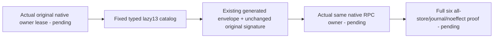

# W27 fixed native ControlledBlob fault catalog

Root approved this exact narrow contract before code. Server/Features/BlobStorage/Diagnostics owns an unactivated pure helper. It owns no profile/client/network/observer/lease/credential/key and logs no body, signature, credential or token. Root retains actual observer/Aspire/all-store/journal owner composition and whole original case activation.

REQ-W27-BLOB-CATALOG-001 → AC-W27-BLOB-CATALOG-001: accept only the original TEN identities: Outcome paired with BeginBlobUpload, WriteBlobPart, CompleteBlobUpload, AbortBlobUpload, DeleteBlob, ReclaimBlob; Metadata/UploadInfo/Range/List paired with Original?.Kind null. Unknown purpose or mismatched operation kind refuses before any payload is yielded.

REQ-W27-BLOB-CATALOG-002 → AC-W27-BLOB-CATALOG-002: NativeControlledBlobFaultCatalog.Create(actualRemoteControlledBlobCall, ORIGINAL innerSignature, originalCT) yields a finite lazy catalog in exact old Create order. NativeControlledBlobFaultPayload is a LOCAL immutable (Variation, Payload, Signature) diagnostic value, not a new transport/persistence DTO. NativeControlledBlobFaultVariation fixed0..12 names follow this table; no caller-selected arbitrary mutation.

| Original ordinal / field fault | Native variation | Exact original mutation |
|---|---|---|
| 1 Nonce | Nonce=0 | call.Nonce="wire-fault-nonce" |
| 2 RequestId | RequestId=1 | Guid.NewGuid() |
| 3 Source.PhysicalShardId | SourcePhysicalShard=2 | Guid.NewGuid() |
| 4 Destination.Owner.Incarnation | DestinationIncarnation=3 | Guid.NewGuid() |
| 5 Missing envelope call | MissingEnvelope=4 | new RemoteDocumentTransportEnvelope(null,null,null) |
| 6 Principal.PolicyEpoch | PrincipalPolicyEpoch=5 | checked(old+1) |
| 7 Frame.QueryId | QueryId=6 | Guid.NewGuid() |
| 8 Frame.Resource.Name | Resource=7 | "wire-fault-resource" |
| 9 Frame.ExpiresAt | ExpiresAt=8 | DateTimeOffset.MinValue |
| 10 Frame.Purpose | Purpose=9 | Outcome→Metadata; other supported→Outcome |
| 11 Frame.NativeRequest | NativeRequest=10 | empty→byte[0x01]; nonempty→ReadOnlyMemory<byte>.Empty |
| conditional12 Frame.OriginalOutcome | OriginalOutcome=11 | null ONLY when original nonnull |
| conditional13 Frame.Original.Id | OriginalOperationId=12 | Guid.NewGuid() ONLY when Original nonnull |

REQ-W27-BLOB-CATALOG-003 → AC-W27-BLOB-CATALOG-003: each value is encoded only by the original generated RemoteDocumentWire.Encode envelope. Signature is the exact immutable ORIGINAL signature; there is no Sign/MAC or dispatch call. Original CT is checked before supported-shape validation and every yielded encode. Original requests, limits/caller voter/full address/control/publication/resource except selected field remain untouched. Maximum13 values and existing native serializer envelope byte bound; no cap increase, truncation or replay loop.

REQ-W27-BLOB-CATALOG-004 → AC-W27-BLOB-CATALOG-004: original actual same native lease owner must directly await every real dispatch/refusal, current full generation/expiry proof, no-effects all-store/journal cuts and original positive SDK/MCP/Q1 +two-cold workflow. These gates are OPEN; pure catalog/source checks cannot establish a native reply, ACK, refusal or complete migration. Old Case UID/Trial remain unchanged until those dependencies exist. Queue-only claim/replay plan and two-partition cut cannot substitute for the original Blob coverage.

Integration assertion supplement is source-only: genuine original/actual RemoteModelNativeRequest and actual authenticated RemoteModelNativeReply inputs, existing current signed discovery3+3 and actual configured group keys. Independent field oracle does NOT invoke production catalog; it compares complete expected generated envelope after ONLY the allowed original fixed field change. Require original inner MAC valid, mutated inner MAC invalid and unchanged original signature, actual fresh outer MAC/nonce/current generations/unchanged expiry, exact signed Unauthenticated with no success model leaves. It owns no dispatch/context/cut, and cannot establish all-store no-effects or whole original-case acceptance without Root's actual owner flow.
