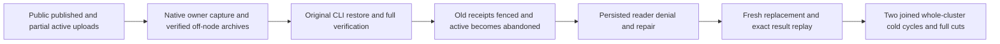

# Published multipart and abandoned active upload across cluster archive restore

REQ-BLOB-ARCHIVE-ACTIVE-001 refines REQ-BLOB-001/002/003/004/005 and REQ-BACKUP-CLUSTER-002/003/004: capture a genuine published four-part object and a separate three-part declared upload with two actual parts admitted but not completed. All calls use existing SDK and official MCP through the Aspire-owned replicated cluster. Capture each owner through the existing native authenticated backup operation, join source, pack and unpack its actual verified catalog archive, and restore through the existing CLI operator/fixture. Preserve every original linked-model, authority, paused dispatch, archive negative/repair, receipt and two-cold verification by invoking the original verification helpers unchanged.

AC-BLOB-ARCHIVE-ACTIVE-001 maps to BlobArchiveActivePublicTests.PublishedMultipartAndActiveReservationRestoreWithFencedReceiptsPolicyRepairAndTwoSixOwnerColdCuts. Independent deterministic bytes define each published part (three 65536-byte parts and a 17-byte tail, total196625) and the abandoned active two65536-byte parts; this is a bounded multipart correctness control, not a scale/performance claim. Original complete metadata and all native commit results are retained. Source current reads cover all individual parts, cross-part boundary and exact-end zero range through BOTH public clients. Full typed upload info proves actual Active state before capture. The missing tail/Complete cannot become published data.

AC-BLOB-ARCHIVE-ACTIVE-002: restored new incarnation must retain complete published metadata/bytes, while original Active state becomes Aborted with exact unchanged stored-byte count, ordinal, expiry and integrity chain. Original immutable part bytes remain in each corresponding restored replica under the actual original sortable key, using existing configured ReadExecutionBudget inside stopped native stores; no32768-byte private journal inspection budget is relabelled to support a65536-byte part. Original successful source command IDs and a new write into the abandoned lifetime return literal TokenInvalidated through both clients, with full public published/upload state immediately after EACH refusal. Archive receipts/cuts remain immutable. No resumption of an old lifetime, fabricated archive/provider or owner lookup is permitted.

AC-BLOB-ARCHIVE-ACTIVE-003: the genuinely persisted nonadmin reader is restored with the same credential. Actual ConfigurePrincipal epoch2 removes BlobRead, metadata/nonempty/end-zero reads refuse PermissionDenied via both clients and admin literal state remains healthy after EACH call. Actual epoch3 restoration admits all literal ranges again. Policy baselines follow the actual policy commits; no cross-call/public atomic no-effects or canonical unchanged claim is made across policy effects.

AC-BLOB-ARCHIVE-ACTIVE-004: a NEW upload ID and commands publish a healthy replacement on the restored owner with exact revision2/part metadata and authentic partition/quorum receipt. Every original new successful receipt replay is immediately followed by exact current public state. Join all actual target nodes, inspect complete canonical family cut and abandoned raw part bytes, restart the SAME fixture twice, repeat full current metadata/ranges, old-source fences and new full-result replay; stop/join before each native cut and prove exact family cut equality. No endpoint retry or single-host reopen is called a whole-cluster cold cycle. Preserve original caller/fixture failure ledgers and archive immutability.

Canonical owning spec: docs/Features/BlobStorage/NativeMultipartArchiveRestore.md. Canonical paths: IntegrationTests Features/BlobStorage Cases, Helpers, Models and Assertions own this whole flow; existing BackupRestore/ClusterRouting source/fixture/API are borrowed unchanged. Product/server/client/serializer/AppHost modifications are N/A: no confirmed product defect is claimed. This packet is source N only; actual UID/census, compiler, Linux cluster and execution remain OPEN.

The genuine original `after-backup` post-capture document remains absent under the unchanged original four-route restore oracle. The original parent-duration bound remains asserted.
