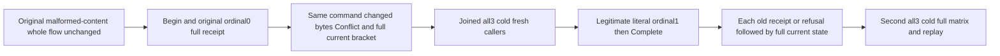

# Original part identity through multipart continuation and two RF3 cold cycles

This accepted existing-contract strengthening maps REQ/AC-BLOB-001,002,004,006,007 and ADR-038. Existing `BlobRejectedContentPublicTests.InvalidHashChangedDuplicateAndWrongChainRefuseThroughSdkAndOfficialMcpThenOriginalFailuresRemainAfterPublication` keeps its Test/name/no arguments and original `BlobRejectedContentPublicTrial.RunAsync(fixture, TestContext.Current!.Execution.CancellationToken)` invocation. Its complete prior invalid-hash/new-ID changed-ordinal/wrong-chain/publication/replay assertions run first unchanged. No new test declaration, dependency, protocol, persisted format, clock or quota is introduced.

REQ-BLOB-PART-IDENTITY-R40-001 / AC-BLOB-PART-IDENTITY-R40-001: a real 65540-byte upload admits ordinal0 containing 65536 independent deterministic bytes `(index*29+7)%251`, SHA256 `473ace3a4940d727fc122fb4fe8282356d26d01d046acdf892e72710e25acb49`. Reusing that SAME successful command ID with changed byte17 XOR1 and correct independent SHA `600674ec4a2fe41a1aa20bde7690dab4ddcea63b3819ab0becb7ff839ac771cd` returns literal Conflict with the existing command-content detail through SDK and official MCP. This is a conflicting payload against an original successful outcome, not an independently retained failed outcome. Fresh persisted authentication/policy, original incarnation/fingerprint/scope and upload authority remain strict.

REQ-BLOB-PART-IDENTITY-R40-002 / AC-BLOB-PART-IDENTITY-R40-002: every individual changed-content refusal and original successful receipt replay is immediately followed by complete current upload, metadata, bounded list, range and outbox observations through both clients. While active, upload reports exact next ordinal1/stored65536/declared65540/Active/unchanged original expiry and independent72-byte chain; metadata is null/list empty/range NotFound. Original Begin and ordinal0 receipts remain byte-exact snapshots, separately from advanced current upload state. No raw store/journal invariance is asserted: legitimate operation/outcome/clock metadata may persist.

REQ-BLOB-PART-IDENTITY-R40-003 / AC-BLOB-PART-IDENTITY-R40-003: close owned clients and join all three existing Aspire RF3 nodes before first cold. Reopen fresh SDK/official MCP callers, preserve active state and original receipts, repeat same-ID changed-content refusal, then genuinely admit ordinal1 literal `[16,32,48,64]` with SHA `f4e3f0b04771c047e227c9ecaba65d3fe2fd0e1eee0a7552b956d1a7c535a7cf`. Current upload becomes next2/stored65540 while replay of original ordinal0 still returns its exact original next1/stored65536 receipt. Native72-byte SHA256-chain is independently calculated from authentic initial seed; no independent initial-seed or whole-file-SHA claim.

REQ-BLOB-PART-IDENTITY-R40-004 / AC-BLOB-PART-IDENTITY-R40-004: genuine Complete publishes revision1/version originalUpload/length65540/parts2/exact chain/empty RowAccess/deletedfalse. Preserve full server-authored UpdatedAt, original ExpiresAt/seed and full original receipts; independently bind every token to administrator SDK+MCP prewrite placement/partition/positive position/QuorumProcessDurable/empty mutations. Full first-part, literal tail, cross-boundary six-byte range and exact EOF0 results match independently generated bytes. Replay every original success and changed same-ID refusal with immediate full current brackets. Join a second all-three cold, reopen fresh callers and preserve the same complete matrix. No removal/purge/epoch change is introduced: native cached validation requires still-present matching upload lifetime and current policy; no success after reclaim is inferred.

Canonical owning slice is BlobStorage. New feature-local Models/Helpers/Assertions and docs/Features/BlobStorage/OriginalPartIdentityPublic.md strengthen the existing exact case. Original malformed-content flow remains untouched. SDK, official MCP, Orleans and existing Aspire fixture own execution; no transport/provider fixture copy. Existing RunOwnedAsync joins the initiating failure and disposal ledger before cold. UI/new public API/new packages N/A. Source-N only: Main integration, fresh native Ready/compiler/census/whole-flow exact-source Linux RF3/recovery/fault/endurance gates OPEN; no performance or power-loss claim.

