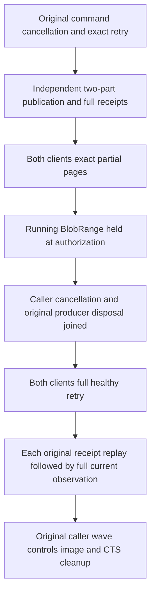

# Partial range query cancellation and original producer lifetime

REQ-BLOB-002 / AC-BLOB-002 requires exact bounded cross-boundary reads, cancellation and a healthy follow-up. This acceptance extension preserves the existing BlobPublicCancellationTests.BeforeSubmitPartAndCompleteCancellationJoinsOriginalProducerThenExactRetryPublishesHealthyBlob declarations, Arguments(false/true), original Case identity, complete command-cancellation Trial first, parent/wave deadlines and genuine Aspire-owned probed RF3/local-image lifecycle. REQ/AC-BLOB-004 and006 support full publication receipts and public current observations. No new Test or fixture.

REQ-BLOB-PARTIAL-CANCEL-001 / AC-BLOB-PARTIAL-CANCEL-001: genuinely publish a separate two-part version65536+17 with deterministic byte(position)=(position*23+11)%239. Independently literal SHA256 per part and standard72-byte chain from original Begin seed establish all bytes. The actual prepublication SDK/official MCP placement independently binds original receipts' command/atomic partition/incarnation/ownership epoch/quorum/empty mutation vector; full original DTOs retain genuine opaque expiry/time/position fields. Positive range matrix0/4,65534/6,65536/17,65553/0 requires full typed metadata and independently literal bytes through both original callers.

REQ-BLOB-PARTIAL-CANCEL-002 / AC-BLOB-PARTIAL-CANCEL-002: arm only an existing source-proven query authority phase using the exact native blob-range read kind and empty command ID. Await original native observed marker/request identity, then cancel only the selected original SDK or official MCP call. Await that original task and native ProducerDisposed settlement before retiring the arm and issuing a healthy retry. The exact SDK query failure and official MCP interruption predicates must follow verified owning source; no command UnknownWriteOutcome oracle is reused for a read. No timer, synthetic transport, alternate dispatcher, callback or unbounded materialization is added.

REQ-BLOB-PARTIAL-CANCEL-003 / AC-BLOB-PARTIAL-CANCEL-003: each original cancellation/refusal, healthy result and publication receipt replay is individually followed by nonrecursive administrator full current metadata, legal complete bytes, exposed upload/list/placement and complete outbox equality. The baseline follows actual publication. Repeating the cross-boundary request without cancellation must return the complete independent literal six bytes and full metadata, then full original Begin/Part0/Part1/Complete replay DTOs remain equal. These are bounded sequential public observations, not a single raw canonical cut, no-append proof, power-loss claim or partial-payload streaming assertion.

REQ-BLOB-PARTIAL-CANCEL-004 / AC-BLOB-PARTIAL-CANCEL-004: reuse original owner cleanup: stop admission/release open arms, join original SDK/MCP calls and producer disposal, dispose original callers, stop the genuine RF3 wave, join original controls/local image session and only then delete the owned root. Original body failure remains first; cleanup failures remain joined. Preserve original token and deadlines. New cold/recovery, memory/performance, visited-part counts and Linux qualification are not inferred from this query-lifetime extension.

Canonical map: existing BlobStorage Case and Helpers/BlobPublicCancellationTrial; new BlobStorage Models/partial-range state, Helpers/corpus,seed,held-query,trial; Assertions/publication,pages; borrowed native two-part replay. Product/contracts/UI/benchmarks N/A acceptance-only composition of original API. All new roles internal, method64/type200, cancellation token last. Full native byte-oracles in existing flows remain unchanged.

```mermaid
flowchart LR
 Original[Original write cancellation flow] --> Publish[Real two-part version and full original receipts]
 Publish --> Positive[Both-route literal cross-boundary and EOF controls]
 Positive --> Hold[Source-proven query phase and original marker]
 Hold --> Cancel[Cancel selected original public caller]
 Cancel --> Join[Original task and producer disposal joined]
 Join --> Retry[Same uncancelled range exact full result]
 Retry --> Replay[Each full original receipt replay and current observation]
 Replay --> Cleanup[Original callers RF3 controls and image cleanup joined]
```

Coverage distinction: native BlobRangeIntegrityWholeFlow pre-cancelled cross-chunk request is pre-admission cancellation; original public BlobPublicCancellation covers BeforeSubmit Part/Complete commands. This extension targets an actually executing public query and producer lifetime. The native phase/type/SDK cancellation and original cleanup contracts are verified by retained current source; fresh admission remains pending. No marker inside the raw part-copy loop is claimed. Compiler, exact current original-case admission and Linux RF3/runtime remain OPEN.

## Exact current read contract

The query uses GrainReadKind.BlobRange, Guid.Empty command identity and AuthorizationReload/Hold, following the native held-document READ precedent. This is a cross-boundary range query whose running producer is cancelled at authorization admission; it does not claim a mid-part storage callback or a streamed public payload API. SDK returns null value and the full Cancelled Problem with detail `The read response is unavailable.`. Official MCP has no ToolResult and its original cancelled transport exception is joined; no UnknownWriteOutcome/tool error is fabricated. The original marker RequestId is preserved through native settlement and ProducerDisposed.

The original Part/Complete command flow runs first unchanged, including healthy revision2 [83]. The suffix independently publishes65536+17 bytes under a distinct name in the SAME original resource. Current observation includes both published heads in ordinal order, old literal[83], new full65553 bytes in legal65536+17 reads, full upload/metadata/placement and original complete outbox. Every reader result and original publication replay is followed by a nonrecursive administrator observation before the next route. No new cold cycles are claimed; the original query/command ownership cleanup and image-session join remain authoritative.

Compiler/runtime/Linux and the unchanged original deadline remain OPEN. Native symbol absence and guarded checkOnly admission are pending coordinator execution; this authored code alone is not qualification.

Bounded added caller work: two partial matrices, one held query, one eight-response original publication replay; each current observer has18 public calls and does not recurse. Nominal suffix has519 public calls (including genuine publication and placement; original Trial104 calls; known combined623 calls, startup/discovery/cleanup excluded). There is no third duplicate matrix after replay. The unchanged original deadline remains an unqualified runtime gate.
