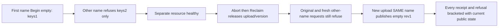

# Permanent blob object-key lifetime through empty reclaim

REQ-BLOB-KEY-SLOT-001 refines [BlobStorage](../BlobStorage.md) REQ/AC-BLOB-001/004/005 and ADR-038: canonical head identity consumes one permanent object-key slot even after Abort and complete Reclaim. Cleanup releases upload/version capacity, never resets head history. No product change is proposed.

AC-BLOB-KEY-SLOT-001 maps to BlobObjectKeyLifetimePublicTests.PermanentObjectKeySurvivesEmptyReclaimWhileSameNameAndSeparateResourceRemainHealthy. Real public configuration sets MaxObjectKeys1, MaxVersions3, MaxUploads3, byte limits1 in two NEW resources. Zero-byte first Begin succeeds. A distinct blob in the same resource across another partition key refuses through SDK and official MCP: independently proposed bytes0, keys2, versions2, uploads2 means ONLY keys exceed capacity. A distinct resource admits its own empty upload.

AC-BLOB-KEY-SLOT-002 requires Abort and zero-part MaxParts1 Reclaim of the first upload, literal DeletedParts0/RemainingParts0/ReleasedBytes0/Complete true. Original refused ID and a DISTINCT fresh attempted command/upload both still refuse after reclaim, with every attempted/current upload and nullable metadata observed through both clients after EACH call. Failed outcomes may legitimately persist; no full canonical/journal no-effects claim is made. Original removed Begin/Abort is fenced TokenInvalidated; complete Reclaim receipt replays exactly before lifetime reuse.

AC-BLOB-KEY-SLOT-003 requires a NEW upload under the SAME first blob name to publish empty revision1 after cleanup, with independent zero length/part count/deletedfalse/EOF bytes and full authentic server metadata/receipt binding. Original and fresh refused second-name IDs stay ResourceExhausted after that healthy publication. Every successful Begin/Complete original receipt replay is immediately followed by BOTH-client whole public states and literal current head/EOF, before another receipt could conceal mutation. Resource B Abort/Reclaim preserves resource A head.

AC-BLOB-KEY-SLOT-004 retains native RequestCqrsRf3Callers.RunOwnedAsync original SDK/official sessions and failure ledger and existing Aspire ClusterFixture ownership. One no-argument whole-flow case; no current UID inferred. Source/compiler/runtime/exact-source Linux RF3 remain OPEN. Existing native BlobConfigurationCounterTests covers repeated configuration while active, not this public post-reclaim key-only flow. Existing upload-only/version-only previews remain unchanged.

Canonical slice: IntegrationTests Features/BlobStorage Cases/Models/Assertions/Helpers and this subdoc. Product/SDK/MCP/serializer/shared fixture roles N/A: existing APIs unchanged. Public cuts are separate authorized observations, not an atomic snapshot. No cold, raw quota, endurance or performance claim.
