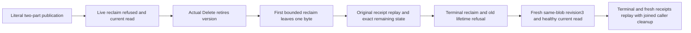

# Public multipart retirement and bounded reclaim

REQ-BLOB-PUBLIC-RETIRED-001 / AC-BLOB-PUBLIC-RETIRED-001 map existing AC-BLOB-004 to BlobBoundedRetirementPublicTests.TwoPartRetirementReclaimsOnePartPerCommandPreservesReplayAndPublishesNewLifetime, one Test/no Arguments. Dedicated original Aspire Docker cluster ClusterFixture and genuine SDK/official MCP sessions publish two parts, independently literal byte(i)=i modulo239 and length RawPartBytes+1. Current live reclaim refuses Conflict through both clients and full current metadata and two independently expected legal ranges (offset0/count65536, offset65536/count1; each includes full metadata) follow each refusal. No request exceeds native MaxRangeBytes. Real Delete revision1 produces independently expected structural tombstone revision2 (actual timestamp is shape/receipt equality only, not an independent timestamp oracle).

REQ-BLOB-PUBLIC-RETIRED-002 / AC-BLOB-PUBLIC-RETIRED-002 require two actual MaxParts1 reclaim commits: first DeletedParts1/RemainingParts1/ReleasedBytesRawPartBytes/Completefalse, then terminal DeletedParts1/RemainingParts0/ReleasedBytes1/Completetrue. After first commit, complete exposed UploadInfo equals original last-part state with StatusComplete and StoredBytes1 only; NextOrdinal2, original length, expiry and integrity stay exact. Both clients replay original first reclaim plus original four publication and delete full results. Both current tombstone and remaining upload are checked AFTER EACH individual replay before another operation can conceal mutation. This is public state evidence, not a raw remaining-part scan or canonical/journal/atomic no-effects proof.

REQ-BLOB-PUBLIC-RETIRED-003 / AC-BLOB-PUBLIC-RETIRED-003 require old upload absence after terminal reclaim, literal TokenInvalidated for original Begin/two Parts/Complete/nonterminal reclaim via both clients, unchanged terminal receipt replay, and healthy NEW upload for the SAME BlobRef expectedrevision2 publishing literal[83]/revision3. The original live-reclaim failed ID remains Conflict after cleanup, with exact fresh current metadata/range after EACH SDK or MCP refusal/replay. New publication complete typed results/receipts replay through both clients; original command GUIDs/quorum-process durability remain checked. No old terminal result is reclassified as a fresh effect.

Roles are BlobStorage Cases/BlobBoundedRetirementPublicTests, Helpers/BlobBoundedRetirementPublicPublication/Trial/Replay and Assertions/BlobBoundedRetirementPublicAssertions. Existing native RunOwnedAsync joins original body and SDK/MCP disposal failures; no shared fixture, transport, role, serializer, policy, clock or product API changes. Current controlled movement lifecycle already covers ONE part/terminal reclaim; Unit WholeFlow covers aborted multipart cursor/cold. This distinct schedule covers public retired COMPLETE multipart incremental reclaim, not expiry, cold, raw quota, cluster runtime pass, measured memory, endurance or power loss. Source Y/compiler/current census/Linux cluster execution remain OPEN.
