# Public Blob Part/Complete cancellation

REQ-BLOB-PUBLIC-CANCEL-001 refines REQ/AC-BLOB-001 and004: the existing current-image probed Aspire RF3 owner must hold actual Part and Complete at original BeforeSubmit, after real authority reload/barrier and before native submission. No cancellation timing is inferred from sleeps or a client wrapper.

AC-BLOB-PUBLIC-CANCEL-001 maps to BlobPublicCancellationTests.BeforeSubmitPartAndCompleteCancellationJoinsOriginalProducerThenExactRetryPublishesHealthyBlob Arguments(false),(true). Each flow uses the genuine persisted c1-probe key/principal and original signed discovery. Before cancellation and after original task/settlement/correlated ProducerDisposed join, compare complete exposed UploadInfo and absent metadata through SDK and official MCP. Preserve the actual SDK UnknownWriteOutcome or MCP tool/actual transport cancellation observation, including the original exception object. This observation is not a fabricated terminal receipt or an assertion of raw canonical/journal no-effects.

AC-BLOB-PUBLIC-CANCEL-002 requires original arm retirement, exact unchanged command/body retry through both clients, complete original result/receipt equality, independently literal four-byte publication, all original receipt replay, and new same-blob revision2 literal83 publication. Verify current metadata and literal ranges after each individual old replay so a later receipt cannot conceal head regression. Actual original tasks and every armed producer must join before clients, Aspire wave, controls and owned runtime directory are disposed, using existing PhaseFaultCleanup and ordered failure observation.

```mermaid
flowchart LR
  B[Actual Begin] --> P[Hold Part BeforeSubmit]
  P --> C[Cancel original caller]
  C --> J[Join original task and ProducerDisposed]
  J --> S[Full exposed upload/head unchanged]
  S --> R[Retire arm and exact Part retry]
  R --> Q[Hold Complete and repeat cancellation/join]
  Q --> H[Exact Complete retry and literal healthy reads]
  H --> N[New same-blob version and original receipt replay]
```

Canonical slice map: Cases/BlobPublicCancellationTests owns two client arguments; Helpers/Owner and Setup compose only original probed owner APIs and persisted authorization; Held owns original task/cancellation/marker settlement; Trial/Replay own typed Blob operations; Assertions own full exposed state and literal byte oracles. No product, shared fixture, protocol, serializer, clock or trust change. Source proposal only; compiled metrics, current-image discovery/execution, Linux RF3 and independent connection-activation lifecycle qualification remain OPEN. No cold, power-loss, scale, throughput or raw cross-owner atomic claim.
