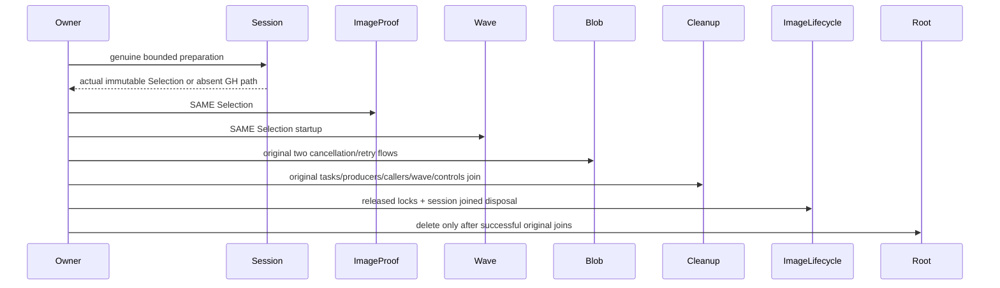

# Blob cancellation owned local RF3 image lifetime

REQ-BLOB-CANCEL-IMAGE-001 refines REQ-BLOB-004/006: the custom probed RF3 scenario owns genuine LocalRf3ImageTestSession.StartIfSelectedAsync before image verification and retains the SAME immutable Selection through RequestCqrsRf3ImageProof.ReadAsync and StartProbedAsync. When local selection is absent, retain the original authenticated GitHub receipt path. No proof synthesis, environment/selector widening or fallback authority is permitted.

AC-BLOB-CANCEL-IMAGE-001 maps to BOTH original Arguments(false/true) of BlobPublicCancellationTests.BeforeSubmitPartAndCompleteCancellationJoinsOriginalProducerThenExactRetryPublishesHealthyBlob. Keep original case/UID/body, authentic BeforeSubmit holds, original SDK/official MCP tasks, ProducerDisposed correlation, same-command retry, full original receipts and healthy revision2 literal state. Genuine image preparation uses the original bounded scenario token and preserves initiating failure plus its native cleanup.

AC-BLOB-CANCEL-IMAGE-002: existing RequestCqrsPhaseFaultCleanup releases admission/arms, joins original tasks and producer disposal, disposes clients, joins original wave and controls BEFORE local image cleanup. Defer owned root deletion when a session exists. Existing ClusterFixtureLocalImageLifecycle.JoinAsync verifies released node/ZoneTree/replica locks before joining preparation resources/output and removing the image. Unproven startup/shutdown or cleanup failure retains image/root and appends real cleanup failures after the original body failure. Cleanup does not use the cancelled scenario token. With no selected local session, original root cleanup remains unchanged. Native Wave.StopAsync already joins original admission/app/output/builder and locks. This flow adds no restart/cold claim; any future restart must reuse retained original selection.

The two original R34 failures stopped in FaultImages before any node/caller/arm admission. Their immutable failures do not prove a database command error. Corrective source N is not yet joined; compiler, current-image original two-case runtime and exact-source Linux RF3 remain OPEN. Root/Main owns other packed-wave session omission separately. Only Blob Owner/Setup and this spec are changed; no product guard, protocol, signer, shared fixture/session helper, replicated outcome or trusted role change.
