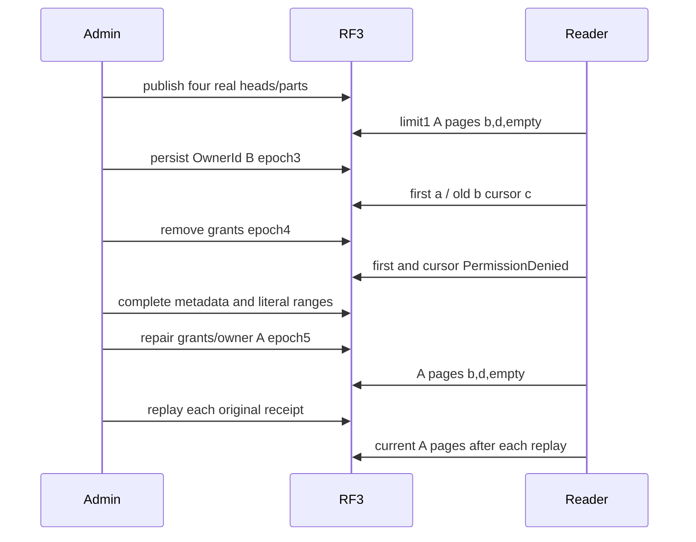

# Blob bounded listing and current row policy

REQ-BLOB-LIST-ROW-001 extends REQ-BLOB-003/006 and AC-BLOB-006: SDK and official MCP bounded listing must use current persisted row visibility on every request, including an exclusive cursor obtained under an earlier policy. A cursor is an identifier boundary, not retained authorization or a snapshot.

AC-BLOB-LIST-ROW-001: publish four real two-byte blobs in identifier order a-hidden/b-visible/c-hidden/d-visible with alternating owner B/A/B/A. Reader A limit1 pages must return b then d, then empty, with exact full metadata and exclusive cursors. After genuine persisted OwnerId B epoch3 on the same credential/session, fresh first page must return a and the old b cursor must return c; no old-policy visibility is retained.

AC-BLOB-LIST-ROW-002: persisted grants removal epoch4 must produce literal PermissionDenied/no SDK value and authentic dispatched official MCP error for both first and retained-cursor requests. After EACH client refusal, administrator must observe all four complete metadata values and exact literal ranges. Epoch5 grant/owner repair must restore A pages; replay EACH original Begin/Part/Complete through both clients must retain full original results and be immediately bracketed by current filtered pages and all literal bytes.

Source proposal only. One declared case, no Arguments, no inferred UID. Compiler, current-image census/runtime and exact-source Linux RF3 qualification remain OPEN. Public state observations are separate authorized reads, not an atomic canonical image, raw journal or cross-owner cut proof. Existing ClusterFixture and RunOwnedAsync own original Aspire resources and client failure/disposal joins. No shared fixture, protocol, policy implementation or product API change.
