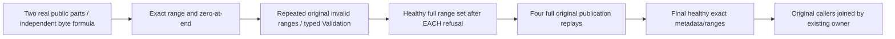

# Public Blob partial-read end and error boundaries

REQ-BLOB-PARTIAL-PUBLIC-001 supplements existing BlobStorage REQ002/AC002. One genuine SDK/official MCP upload publishes two canonical parts, length65553: independently fixed input byte(i)=i modulo239. AC-BLOB-PARTIAL-PUBLIC-001 requires full literal first/last/interior/cross-part and exactly-end zero-length ranges with complete original metadata through BOTH clients; this does not infer server visited-part counters or measured memory.

REQ-BLOB-PARTIAL-PUBLIC-002 / AC-BLOB-PARTIAL-PUBLIC-002 require repeatedly safe Validation for three structurally valid requests: exactly-end+count1, one-over-end+count0, and Int64.MaxValue offset+count1. Expectedrevision1/currentpublication is otherwise valid. SDK value must be null and official MCP records authentic dispatched request identity. After each refusal pair, require every exact healthy range/metadata. Replay all four complete original publication results through both clients and repeat healthy assertions. Public metadata/range parity is not raw canonical/physical-position no-effects or atomic cross-client cut; the kernel integrity cases retain those gates.

REQ-BLOB-PARTIAL-PUBLIC-003 / AC-BLOB-PARTIAL-PUBLIC-003 map one original complete Test/noArguments: BlobPartialReadBoundaryPublicTests.ExactEndZeroAndBeyondLengthRefusalsPreserveHealthyPublicRangesAndOriginalReceipts. A dedicated keyed instance of existing ClusterFixture owns actual Aspire Docker cluster; existing RequestCqrsClusterCallers.RunOwnedAsync joins SDK/officialMCP and preserves body+cleanup failure ordering. No new fixture, transport, roles, serializer, product code or config. Corruption/cancellation/cold qualification remains existing separate cases; this scenario has no injected canonical corruption or restart claim.

Canonical roles: Integration BlobStorage Cases/BlobPartialReadBoundaryPublicTests; Helpers/BlobPartialReadBoundaryPublicTrial; Assertions/BlobPartialReadBoundaryPublicAssertions. Product/sharedFixture/config changes N/A. Source proposal only; current compiled census/runtime/Linux/cluster/public partial-read qualification OPEN. Existing supersession runtime inputs remain unchanged.
