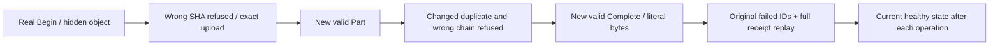

# BlobStorage public rejected content

REQ-BLOB-PUBLIC-CONTENT-001 refines REQ/AC-BLOB-001 and004: actual bounded Part SHA mismatch, changed duplicate bytes and wrong Complete chain must refuse via genuine SDK and official MCP, preserve the complete exposed upload state and hide incomplete metadata. This supplements the existing native BlobStorageRejectedCommandTests original operation; no product behavior change is claimed.

AC-BLOB-PUBLIC-CONTENT-001 maps to BlobRejectedContentPublicTests.InvalidHashChangedDuplicateAndWrongChainRefuseThroughSdkAndOfficialMcpThenOriginalFailuresRemainAfterPublication, one Test/no Arguments. Real four-byte input [16,32,48,64] is staged through existing keyed ClusterFixture/Aspire RF3 and RunOwned callers. A format-valid all-zero incorrect hash gives literal Validation/safe detail; new valid Part admits original bytes. Correct hash of changed bytes [16,32,48,65] at original ordinal0 gives literal Conflict. Wrong final chain gives Validation before a NEW valid Complete. After EACH individual SDK and authentic dispatched MCP refusal, full UploadInfo equals the corresponding real original state and metadata is absent. Native failed outcome/log commits are legitimate; public observations do not prove whole-store no-effects.

REQ-BLOB-PUBLIC-CONTENT-002 / AC-BLOB-PUBLIC-CONTENT-002 require exact original failed command IDs/body to retain their original code/detail after healthy publication. Each refusal is immediately followed by full current metadata/literal range before another operation could conceal mutation. Successful original Begin/Part/Complete full typed result replay through BOTH clients also has healthy observation after EACH. Raw part SHA values are independent fixed SHA256 literals of [16,32,48,64] and [16,32,48,65]. Expected next chain uses SHA256 over the actual frozen version-one 72-byte layout: observed real original Begin seed digest, ordinal0 and length4 big-endian int32, then original fixed32-byte part digest. It does not call production BlobIntegrity.NextHash/PartHash. This proves the advancement from the genuine observed seed, not independent initial KeyCodec scope hashing. Independent byte literal/revision1/length4/partcount1 plus original receipt command/partition/quorum-process durability are preserved; actual timestamps are full-result equality, not independent timestamp oracles.

Canonical roles: Integration BlobStorage Cases/BlobRejectedContentPublicTests, Helpers/BlobRejectedContentPublicTrial/Replay and Assertions/BlobRejectedContentPublicAssertions/State. Existing actual Client extensions, official MCP schemas and RunOwned disposal ledger are reused; no fake provider, quota, clock, transport, shared fixture or architecture change. Creator/row, scope grants, quota, range, cancellation, expiry, reclamation and cold tests remain distinct. This flow has no raw canonical/journal/cross-client atomic-cut/cold/physical power-loss claim. Source Y, compiler, native UID census and exact-source Linux RF3 execution remain OPEN.

## R35 original refusal safe-detail correction

REQ/AC-BLOB-PUBLIC-CONTENT-001/002 retain literal Validation for invalid SHA/wrong chain and Conflict for changed duplicate, complete hidden/published state and every original command/result replay. The .NET SDK keeps the original domain-owned literal detail (invalid request/policy or upload-state conflict). Official MCP uses its existing closed McpReplyProtocol.SafeDetail mapping: these Blob-owned Validation/Conflict details are not allowlisted and therefore yield the independently fixed literal "The database operation could not be completed.". Assert that exact sanitized detail with original code/status, authentic dispatched nonempty requestId and bounded structured problem. Do not expand the allowlist, reflect private details, derive expectations from output, or accept arbitrary strings. The original R35 case reached the first authentic MCP invalid-Part response and failed only this detail oracle, after original SDK refusal and hidden state passed. Remaining changed-duplicate/wrong-chain/replay continuation was not reached or qualified by that failure. Source-only correction and next exact original whole-flow runtime/Linux gates remain OPEN.
