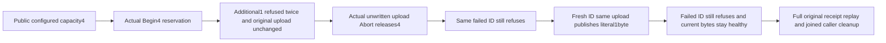

# Public reservation quota release and retained failure replay

REQ-BLOB-PUBLIC-QUOTA-001 refines REQ/AC-BLOB-005. AC-BLOB-PUBLIC-QUOTA-001 maps to BlobReservationQuotaPublicTests.ExactReservationQuotaRefusesThenAbortReleasesAndFreshPublicationPreservesOriginalFailureReplay, one Test/no Arguments. Actual public ConfigureResource returns the complete original policy (MaxBlobBytes4, MaxReservedBytes4; other defaults unchanged). Genuine root Begin reserves4 unwritten bytes. A distinct blob Begin1 through SDK and official MCP twice fails literal ResourceExhausted/detail, with null SDK value and authentic dispatched MCP request. Full original active UploadInfo remains exact; attempted upload and metadata remain absent after each refusal pair. Failed native outcome/log commits are legitimate: this does not require whole-store no-effects.

REQ-BLOB-PUBLIC-QUOTA-002 preserves real quota release and command identity. AC-BLOB-PUBLIC-QUOTA-002 requires actual original Abort of the unwritten4, full returned UploadInfo equal to original with Status=Aborted only. Same failed command ID/body still refuses after release. A NEW command ID, same originally attempted upload and unchanged resource policy, admits1byte; native Part then Complete publish independently literal [71] and exact metadata. The original failed ID again refuses after healthy publication, followed immediately by exact current metadata/range. No old failed ID becomes a fresh effect.

REQ-BLOB-PUBLIC-QUOTA-003 preserves full originals and ownership. AC-BLOB-PUBLIC-QUOTA-003 requires original root Begin/Abort and healthy Begin/Part/Complete complete typed results through both clients, exact receipt command IDs and ProcessDurable and the configured PersistedCopies, plus exact aborted upload through both readers immediately after EACH original Begin replay, before later Abort replay can conceal a change; healthy metadata/range through both clients follows replay. Existing RunOwnedAsync owns original HTTP/official MCP sessions and joins body/disposal failures; original keyed ClusterFixture owns Aspire Docker cluster and discovered endpoints. Existing Version/ReplayAsync helper is borrowed from the same BlobStorage slice. No fake provider, virtual clock, quota bump, public API, serializer, retry, network, shared fixture or global setting changes.

Canonical roles: Integration BlobStorage Cases/BlobReservationQuotaPublicTests, Helpers/BlobReservationQuotaPublicPublication and BlobReservationQuotaPublicTrial, Assertions/BlobReservationQuotaPublicAssertions. This closes a public operation acceptance gap; native BlobQuotaIsolationTests already cover kernel pressure and controlled lifecycle covers abort/reclaim without this reservation-pressure schedule. Current metadata/upload/range evidence does not expose rawquota rows, whole canonical/journal cut or atomic cross-call no-effects; public outbox is not inspected in this slice. No cold, expiry, global quota, concurrency, performance, endurance or power-loss claim. Source Y, compiler/current census and actual Linux Aspire cluster execution remain OPEN.

## Exact public refusal detail oracle

REQ-BLOB-PUBLIC-QUOTA-001 / AC-BLOB-PUBLIC-QUOTA-001 require the exact existing transport contracts: SDK Problem.Detail retains the owned literal "The blob reservation quota is exhausted."; official MCP returns the closed safe ResourceExhausted detail "The operation exceeds the available resource capacity.". The full closed error envelope/status/code/dispatched request identity and null SDK value remain asserted. The product safe mapping is unchanged. All original repeated refusals, actual Abort release, same failed ID replay, fresh healthy same-upload publication, literal bytes/full receipts and immediate aborted-upload observations remain unchanged. This slice has no cold or whole canonical/journal no-effects claim; those gates are not promoted by this contract. Fresh full-case compiler/runtime/Linux cluster qualification remains OPEN.
