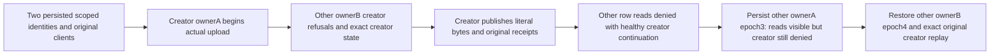

# Public Blob row and creator authority

REQ-BLOB-ROW-CREATOR-001 refines REQ/AC-BLOB-003: persisted row visibility and upload creator are independent gates. BlobRead/BlobWrite grants never make another nonadministrator principal the upload creator. A current persisted OwnerId repair can expose a published row while its upload identity remains owned by the original principal.

AC-BLOB-ROW-CREATOR-001 maps to BlobRowCreatorPublicTests.CurrentRowOwnerRepairExposesReadsWithoutTransferringUploadCreatorAcrossSdkAndOfficialMcp, one method without arguments. Use the real keyed ClusterFixture, two actual persisted principals/keys and original SDK/official MCP caller owners. Each principal receives identical scoped BlobRead/BlobWrite grants. Actual ConfigurePrincipal persists ownerA/ownerB and RestrictRows at epoch2 before their original sessions connect. Creator begins genuine RowAccess(ownerA) upload. Other principal's UploadInfo and valid Part are PermissionDenied; after creator's actual Part, other Complete is PermissionDenied. After EACH SDK and dispatched official MCP refusal, the creator reads complete exact UploadInfo and unpublished metadata. These exposed state checks are not a raw canonical/journal no-effects claim.

AC-BLOB-ROW-CREATOR-002 requires original creator's literal17/29/43/61 publication and full Begin/Part/Complete receipt replay. Other ownerB metadata/fullrange/exact-end-zero range each refuse with creator healthy after EACH client refusal. Persist other principal OwnerId=ownerA at epoch3, preserving its actual grants/key/nonadmin identity: same original sessions read full exact metadata/bytes/endzero, but UploadInfo and fresh Part/Complete still refuse creator authority with creator healthy each time. Actual epoch4 restores ownerB and repeated row refusal. Original creator's epoch2 remains unchanged; original receipt replay is full ordered payload equality and current read follows EACH individual replay. Both credentials are excluded from official errors.

Canonical slice roles: Cases owns single real case; Policy persists original identity records; Trial owns nested existing RunOwned caller composition; Publication owns actual typed commands; Assertions owns full public state/literal bytes and independent creator/row refusals; Replay owns complete original results. Existing Unit BlobAuthorizationTests and controlled root/admin lifecycle remain unchanged; scoped grant-removal, quota, retirement, cancellation and cold flows remain separate. No product/shared fixture/protocol/serializer/cache/network/trust changes. Source proposal only; compiler, canonical metrics, native census, current-image runtime and Linux cluster remain OPEN. No cold/process/power-loss/raw atomic qualification claimed.
