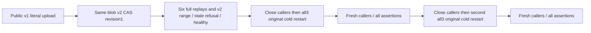

# Public immutable Blob supersession

REQ-BLOB-SUPERSESSION-PUBLIC-001 supplements ImmutableVersionSupersession REQ001 and BlobStorage AC004/006. Publish literal four-byte v1 and literal eight-byte v2 for the SAME BlobRef through actual SDK and official MCP calls. Current metadata/range resolves revision2; replay each of six original complete command receipts through both public clients without filtering any fields. Immediately after the original v1 replay, require the exact current v2 metadata/range through BOTH callers BEFORE any v2 replay can repair or conceal an incorrect head change. AC-BLOB-SUPERSESSION-PUBLIC-001 maps to BlobSupersessionPublicTests.SameBlobSupersessionPreservesFullReceiptsAndCurrentRangesAcrossTwoRf3ColdCycles (one Test, no Arguments).

REQ-BLOB-SUPERSESSION-PUBLIC-002 preserves ExpectedRevision as CURRENT-head precondition. AC-BLOB-SUPERSESSION-PUBLIC-002 requires literal RevisionConflict for revision1 range through SDK and dispatched official MCP, followed by full current v2 metadata/range parity. This asserts caller-visible state, not a raw canonical no-effects or one atomic cross-client cut. The kernel supersession test retains the full canonical no-effects proof. No public historical read is introduced.

REQ-BLOB-SUPERSESSION-PUBLIC-003 requires a dedicated keyed instance of the ORIGINAL ClusterFixture; actual Aspire Docker RF3 membership, discovered endpoints and persisted administrator credential. AC-BLOB-SUPERSESSION-PUBLIC-003 closes original caller sessions before each of TWO all-three-container cold cycles, invokes existing kill, begin-restart-all and joined restart/health/source-receipt seams, then establishes fresh original native SDK/MCP sessions and repeats every receipt/current/refusal/healthy assertion. Test cancellation and existing ordered ServerFailureObserver cleanup remain; no power-loss or endurance claim.

Canonical roles: Integration BlobStorage Cases/BlobSupersessionPublicTests, Helpers/BlobSupersessionPublicTrial, Assertions/BlobSupersessionPublicAssertions. Product/SDK/server/shared fixture/protocol/serializer changes: N/A; this qualifies existing behavior. Proposal source only; compiled census/runtime/Linux/RF3/public qualification and endurance remain OPEN. Original Unit6/R32 runtime cohort is unchanged.
