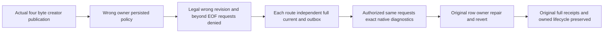

# Published Blob row read validation fence — public whole-flow source contract

Canonical BlobStorage REQ-BLOB-002/003/004 and AC-BLOB-002/003/004. Authored strengthening of the SAME BlobRowCreatorPublicTests.CurrentRowOwnerRepairExposesReadsWithoutTransferringUploadCreatorAcrossSdkAndOfficialMcp, not a new Test or topology. Current authentic native Case/Assertions/Trial/BlobAuthority bodies establish the missing matrix and authority order; no product defect is asserted.

REQ-BLOB-PUBLISHED-ROW-FENCE-001 / AC-BLOB-PUBLISHED-ROW-FENCE-001: persisted restricted wrong-owner with genuine BlobRead must be denied before revision/length-dependent range diagnostics. Legal-shaped requests for future expected revision2 and offset beyond the independently known four-byte published length must each return complete native PermissionDenied/no success value through SDK and official MCP, with fixed safe transport detail. Shape validation is unchanged and this criterion does not claim invalid-shaped requests defer their public validation.

REQ-BLOB-PUBLISHED-ROW-FENCE-002 / AC-BLOB-PUBLISHED-ROW-FENCE-002: the independently authorized creator must observe exact RevisionConflict for the same wrong-revision request and Validation for the same legal-shaped beyond-EOF request, proving these controls reach genuine server predicates. Each individual SDK/MCP negative response is immediately followed by full literal healthy metadata/full bytes/EOF and the unchanged public outbox baseline. Separate public observations do not establish raw canonical/journal atomic no-effects or no-append.

REQ-BLOB-PUBLISHED-ROW-FENCE-003 / AC-BLOB-PUBLISHED-ROW-FENCE-003: retain original creator authority, owner2→repair3→revert4, every original complete receipt replay and existing caller/lifecycle contract. Do not promote row visibility repair into immutable upload-creator authority. Existing complete independent four-byte publication/ranges remain; no additional Test, cold topology, timer, timeout, clock, library, API or protocol. The actual existing RowCreator Trial has no cold stage. This scope does not add or claim cold acceptance.

Current native nonduplication evidence: retained original RowCreator ReadDenied matrix contains only correct revision1 full bytes and EOF0. Existing metadata/range wrong-owner capability checks do not independently prove row authority precedes revision/length diagnostics. The already sealed unpublished zero-count packet concerns missing publication authority and remains separate. Existing MaximumUnalignedRange/PartialBoundary negative shape and published EOF tests remain unchanged. No expected field is derived from actual result; independent literal SDK Problems are native Denied/Revision/Invalid, with closed safe MCP PermissionDenied/GenericFailure details.

Canonical doc: docs/Features/BlobStorage/PublishedRowReadFencePublic.md. Existing Case/Assertions/Trial retain BlobStorage ownership; new role only if required by method/type bounds. UI N/A; compiler, Linux cluster and runtime qualification remain pending.

Canonical role map: existing BlobStorage Cases/BlobRowCreatorPublicTests remains byte-exact. Helpers/BlobRowCreatorPublicTrial changes only its three existing ReadDenied callsites to forward the already owned administrator. Existing Assertions/BlobRowCreatorPublicAssertions.ReadDeniedAsync captures a complete administrator public outbox baseline at each independently entered read-denial phase and preserves every original control. New Assertions/BlobPublishedRowReadFenceAssertions owns the dual legal-shaped requests and nonrecursive full current observer. Baseline is an authentic public OutboxStatus observed after legitimate publication/policy effects, not a fabricated position or atomic no-effects cut. The original four-byte literal JSON-free publication metadata/full bytes/EOF and original full receipt replay remain unchanged. The scoped creator keeps original BlobRead|BlobWrite grants: creator reads still validate complete healthy metadata/full bytes/EOF; the existing administrator independently reads OutboxStatus through both routes. No trusted role or new grant is introduced. Current observers issue no writes, reuse no cursor, and cannot recursively invoke denial controls.

Actual native authority: BlobReads.Range validates only public request shape first, loads/authenticates scope, published head and current row authority, then checks expected revision, current state and range bounds. Both probes are legal-shaped: expected revision2/offset0/count0 and expected revision1/offset5/count0. The unchanged creator sees literal RevisionConflict and Validation; wrong owner receives full PermissionDenied before either diagnostic. Independent creator content remains four bytes and revision1 from the frozen original publication, never derived from returned failure fields.

Automated identity unchanged: KeyLoad.IntegrationTests.Features.BlobStorage.BlobRowCreatorPublicTests.CurrentRowOwnerRepairExposesReadsWithoutTransferringUploadCreatorAcrossSdkAndOfficialMcp, noArgs, no new Test/native UID. UI N/A. Compiler/Linux cluster/runtime/image-bound qualification remain pending. No new library adoption, physical storage read, journal inventory, arbitrary user error reflection, provider fallback or response-derived expected field.
