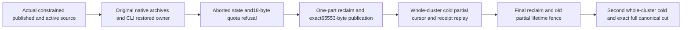

# Restored abandoned-upload bounded reclamation and exact capacity

REQ-BLOB-RESTORED-RECLAIM-001 refines REQ/AC-BLOB-004/005 and BACKUP-CLUSTER-004. The original archive/restore/public multipart flow remains unchanged. A separate whole case uses an actual newly configured BlobStore with MaxBlobBytes196625 and MaxReservedBytes327714, genuine published196625 bytes and partial active131072/declared131089. These are lower existing native limits, not new product knobs or scale evidence.

AC-BLOB-RESTORED-RECLAIM-001 maps to BlobRestoredReclaimPublicTests.RestoredAbortedMultipartReclaimsOnePartAtATimePreservesExactCapacityAndTwoSixOwnerColdCuts: original native backup/CLI restore aborts old active state and releases exactly17 unused reservation. A new declared18-byte upload must refuse ResourceExhausted through SDK/official MCP; preserve full published/aborted info after each refusal, with stopped native raw cursor proofs and complete quota-containing canonical cuts at the two cold stages. Quota refusal may retain a genuine failed outcome/log: do not claim whole-store no effects.

AC-BLOB-RESTORED-RECLAIM-002: a genuine MaxParts1 reclaim reports exactly1 deleted,1 remaining,65536 released and Complete=false, leaves exactly original second raw part and no first part/metadata, and keeps all current published bytes. Declared65554 refuses while declared65553 publishes exact65536+17 independently expected bytes at capacity. Same original partial receipt replay preserves full current state and full public current state. Do not decode internal Core quota records through a copied codec or widen friend visibility; raw quota bytes remain in original complete canonical family cuts and the exact-limit/one-over public operation is the independent accounting oracle.

AC-BLOB-RESTORED-RECLAIM-003: join/stop all actual nodes, retain complete canonical family cut, restart same actual target and repeat exact partial receipt/current byte/upload/raw-part proof. Final MaxParts1 reclaims last65536 bytes and removes old lifetime; first partial receipt now TokenInvalidated, final complete reclaim receipt replays exactly. Every individual public result/refusal is followed by full current published/upload state. A second genuine all-six cold cycle retains complete canonical cut, final original receipts and independent healthy bytes. Preserve source/archive originals, every original linked-model/authority/RPO verification and joined failure ledger. No source Y, runtime, UID, Linux, power-loss or performance claim follows from this preview.

Canonical ownership: IntegrationTests Features/BlobStorage Cases/Models/Helpers/Assertions and this BlobStorage subdoc. Original resource owners and production APIs are reused unchanged. This distinct restoration/counter/cursor gate is absent from kernel portable backup (which retains partial state) and warm public delete/retirement. BlobArchiveActivePublic is a source dependency only. Compiler, actual census UID and exact-source Linux cluster execution are OPEN.

Each original reclaim result is immediately followed by both public current-state oracles before any same-ID replay. Before fresh publication, both metadata routes must return null for the restored revision-zero active blob. The fresh healthy publication’s complete Begin/Part/Complete receipts replay through both clients with an immediate current-state bracket after each call, including both cold continuations. No caller timestamp is compared with the admitted server publication time.
