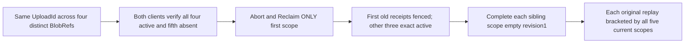

# Scoped upload identity through independent lifetime cleanup

REQ-BLOB-SCOPED-UPLOAD-001 refines canonical [BlobStorage](../BlobStorage.md) REQ/AC-BLOB-001/004/005/006 and ADR-038: UploadId is caller-generated scoped identity, not a bearer capability or globally unique storage key. Full BlobRef includes atomic partition, resource and blob name; current persisted administration remains the authority. No production change/API is proposed.

AC-BLOB-SCOPED-UPLOAD-001 maps to BlobScopedUploadIdentityPublicTests.SameUploadIdRemainsScopedAcrossPartitionResourceAndNameWhileSingleLifetimeCleanupPreservesOtherReceipts. Through actual SDK and official MCP, begin FOUR simultaneous empty uploads with exactly SAME UploadId and DISTINCT command IDs: original key/resource/name; another partition key; another configured resource; another name. Configure genuine public positive bounds bytes1/object keys4/versions4/uploads4: maximum resource totals bytes0/keys3/versions3/uploads3, so no quota refusal confounds identity. A fifth absent BlobRef uses same UploadId and remains absent. Original full UploadInfo Blob/UploadId/length0/ordinal0/bytes0/statusActive and authoritative token scope/durability are asserted after every Begin.

AC-BLOB-SCOPED-UPLOAD-002 requires original Abort then MaxParts1 Reclaim only FIRST scope; independent literal DeletedParts0/RemainingParts0/ReleasedBytes0/Complete true. Removed original Begin/Abort replays yield TokenInvalidated through EACH client; complete original Reclaim remains equal. AFTER EACH actual operation/result/refusal, BOTH clients read complete expected uploads and nullable metadata for ALL five scopes. The other three scopes stay exact active original objects despite identical UploadId; absent scope never resolves another upload. Error code/dispatched identity remain strict. Legitimately retained outcomes are allowed: this is public state isolation, not raw canonical/journal no-effects.

AC-BLOB-SCOPED-UPLOAD-003 requires actual Complete of EACH other scope using its own authentic observed Begin chain, full original Begin/Complete receipt replay and independently literal empty revision1/length0/parts0/deletedfalse/EOF bytes. After EACH individual replay BOTH-client current whole states immediately follow, before another result can conceal identity mutation. First scope remains absent after cleanup while siblings publish; original removed first Begin/Abort still refuse after all publications. Full server-authored metadata timestamps and seeds are retained, not caller-clock expectations or independently claimed cryptographic oracles.

AC-BLOB-SCOPED-UPLOAD-004 preserves original RequestCqrsClusterCallers.RunOwnedAsync SDK/official session failure ledger and existing Aspire keyed ClusterFixture lifecycle. One no-argument whole-flow case; UID/census/compiler/runtime/Linux cluster OPEN. No new transport/fixture/provider/clock/private quota access, concurrent scheduling/cold/global identity/performance claim. Existing BlobAgentCases only maps wire schemas; BlobOutcomeLifetimeTests reuses SAME BlobRef over successive lifetimes. EmptySlot/UploadOnly/CAS/ObjectKeyLifetime packets use distinct UploadIds and remain unchanged.

Canonical slice: IntegrationTests Features/BlobStorage Cases/Models/Assertions/Helpers and this subdoc. Product/SDK/serialization/shared fixture roles N/A unchanged. Separately authorized public observations are not one cross-call atomic cut. Native keys and current state validators already enforce full BlobRef scope; this is missing public qualification, not a confirmed product defect.
