# Selective persisted BlobRead resource isolation

Canonical BlobStorage REQ/AC-BLOB-003/006, ADR038/039/125. Acceptance code is authored; compiler, runtime and Linux RF3 qualification remain pending. Same existing BlobReadPolicyPublicTests.PersistedReadGrantRemovalAndRepairControlMetadataAndEveryRangeOnOriginalPublicSessions retains its complete original flow FIRST. No new Test/Arguments/UID/fixture/cold/deadline/library/API.

REQ-R43-BLOB-SELECTIVE-RESOURCE-001 / AC-R43-BLOB-SELECTIVE-RESOURCE-001: actual two publications have same atomic partition/textual name, distinct BlobStore resources and independent literal four/eight bytes. Genuine factory persists resource-A reader at1; actual administrator persists full A+B scope at2 BEFORE original sessions begin. Remove ONLY A at3 retaining the exact B grant, owner/key/field grants; full range A strict PermissionDenied and B independently healthy through SDK and official MCP. Repair original full grants at4, same sessions immediately read both complete typed records.

REQ-R43-BLOB-SELECTIVE-RESOURCE-002 / AC-R43-BLOB-SELECTIVE-RESOURCE-002: after EACH individual reader result/refusal and EACH original publisher Begin/Part/Complete replay, independent administrator observes BOTH complete original metadata plus independent bytes embedded in full BlobReadResult through BOTH routes, then complete OutboxStatus parity against the baseline AFTER legitimate policy writes. Observer never replays/writes/reenters reader matrix. No atomic cross-call/raw-store/journal/no-append claim.

REQ-R43-BLOB-SELECTIVE-RESOURCE-003 / AC-R43-BLOB-SELECTIVE-RESOURCE-003: genuine administrator SDK/MCP placement captured before either publication independently binds each original receipt command/partition/incarnation/ownership epoch/quorum and positive logical position. Native BlobStorageOperations.Result<T> constructs CommitReceipt(operation.Id, DatabaseEngine.Token(view, scope.Blob.Partition, position), [], database.Durability). Each original Begin/Part/Complete receipt therefore independently requires the exact EMPTY mutation vector; all three full result DTOs and complete receipts remain byte-exact on every replay. Initial metadata independently binds ref/revision1/upload/length/partcount1/chain/default access. UpdatedAt is preserved original producer time, not a predicted timestamp. Raw SHA literals independently verified; 72-byte chain uses original admitted Begin seed, never production PartHash/NextHash. Body/caller disposal uses existing nested RunOwned ownership, original test token. No new cold claim.

Canonical map IntegrationTests BlobStorage Models/State; Helpers/Integrity, Publication, Replay, Trial; Assertions/Reads; existing Trial appends continuation after original nested scopes dispose. UI/product/contracts/benchmarks N/A acceptance-only. Existing native original Trial proves no cold; original Case declaration/body unchanged. Max method64/type200, token-last.

Bounded public-call census after existing RelationalSqlRf3Scenario setup: sibling configure1+placement2+publication6+credential2+policy3+policy outbox6+reader matrix12 plus observer72+replays12 plus observer72 = 188. Scenario setup uses the existing bounded helper. No deadline increase or repeated full matrices after replay; each replay uses compact full two-range/outbox observer. Total deadline qualification OPEN. Old original one-resource flow remains additive and unchanged.

Exact SDK denial is full Errors.Problem(PermissionDenied, "The principal cannot perform this operation in this scope.") with null success, from native scope Require before row authority; official MCP closed OwnedScopeDenied mapping preserves this same safe literal. Payload/credentials are never logged. Compiler, Linux RF3 and runtime qualification remain pending.

```mermaid
flowchart LR
 Original[Original complete Case and joined callers] --> Publish[Two real scoped publications and original receipts]
 Publish --> Both[Persist A plus B epoch2]
 Both --> Healthy[Both full literal ranges per route]
 Healthy --> Remove[Remove only A epoch3]
 Remove --> Selective[A denied B healthy each response full public baseline]
 Selective --> Repair[Restore both epoch4 same sessions]
 Repair --> Replay[Each full original receipt replay then full two-resource baseline]
 Replay --> Join[Original nested caller disposal joined]
```

