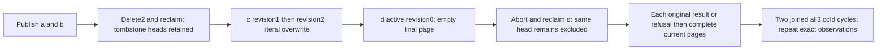

# Bounded blob listing across tombstones and current revisions

REQ-BLOB-LIST-LIFETIME-001 refines canonical REQ/AC-BLOB-002/004/006 and ADR-038. Each List is a fresh authorized bounded read, not a snapshot cursor. Candidate head records include tombstones and revision0 active-only heads; Limit1 examines at most2 heads. A stopped scan returns the actual last examined blob identifier even if no item was visible. Reclaim preserves the canonical blob head and cannot make its tombstone or unpublished head a listed object. No new product/API/format/clock/capability.

AC-BLOB-LIST-LIFETIME-001 maps to BlobTombstoneListingPublicTests.RetiredAndUnpublishedHeadsAdvanceEmptyCursorWhileCurrentRevisionAndOriginalResultsSurviveTwoClusterColdCycles, one no-argument case. Genuine SDK/official MCP publish a-retired and b-retired literal4-byte objects, actual Delete revision1 yields exact revision2 tombstones, final Reclaim yields literal1/0/4/true and upload absence. Publish c-current literal11/23/37/53 revision1, then sameblob literal71/73/79/83 revision2. Begin d-unpublished length0 remains revision0, then actual Abort and zero-part final Reclaim release its upload without publishing a head.

AC-BLOB-LIST-LIFETIME-002 independently expects full pages at Limit1: initial empty Items with NextAfterId=b-retired; after b-retired one full current c-current revision2 metadata with c-current cursor; after c-current empty/null, excluding d-unpublished in both active and removed-upload phases. Limit4 returns exactly c-current revision2 with null cursor after exhaustion of all4 heads. Full separately authorized metadata, literal range/EOF and old upload presence/absence are verified through both clients. A stale c-current revision1 range returns literal RevisionConflict/null SDK result/dispatched MCP error; current revision2 full pages and bytes immediately follow EACH refusal.

AC-BLOB-LIST-LIFETIME-003 preserves full original results and command IDs. Replay each retained Delete/finalReclaim receipt and both current c publications while observing the complete final page/head/range/EOF state after EACH SDK/MCP response. Original a/b publication successes and d Begin/Abort are TokenInvalidated after their actual upload removal; each refusal is immediately bracketed by that same full current state. Final d reclaim is replayable with missing upload. Authentic timestamps/hash seeds remain retained full server fields, not caller-clock claims. Receipt tokens independently bind the partition, positive position, QuorumProcessDurable and empty model mutations.

AC-BLOB-LIST-LIFETIME-004 joins the original caller owner before TWO genuine all3 Aspire container Kill/BeginRestart/Restart cycles; reconnect through discovered SDK/official MCP endpoints and repeat all full current pages, stale/lifetime refusals and original result replays. Existing ClusterFixture/RunOwned/ordered failure ledger owns resources. Compiler/current UID/native census/runtime/Linux cluster OPEN. No raw canonical/journal no-effects or cross-call atomic cut, retention-history API, racing write, timeout increase or performance claim.

Canonical slice IntegrationTests Features/BlobStorage Cases/Models/Assertions/Helpers plus this subdoc. Existing BlobListingTests and public BlobListRowPolicy cover row-denied published heads, not tombstones or revision0; Supersession covers stale range without list lifecycle. Product/SDK/MCP serializers/shared topology N/A unchanged. Source preview does not establish qualification.
