# Underfilled multipart completion and retained failed identity

TASK-BLOB-UNDERFILLED-COMPLETE-001 strengthens canonical REQ-BLOB-001 and AC-BLOB-001/004 in the existing BlobStorage public malformed-content Case. The original malformed-content flow executes first. The same R40 Part identity continuation retains its original corpus, receipt assertions, changed-Part conflict/replays, caller token, deadline and exactly two all-three RF3 cold cycles.

REQ-BLOB-UNDERFILLED-001 / AC-BLOB-UNDERFILLED-001: Begin declares 65,540 bytes. After the genuine 65,536-byte first part, Complete carries the independently calculated final two-part chain, while the four-byte tail is still absent. Native Complete checks stored length and part count before integrity and returns Conflict: “The blob upload conflicts with its current state.” SDK must expose the full canonical Problem and null success value; official MCP must expose its dispatched Conflict with the fixed safe detail “The database operation could not be completed.” After EACH response, check the complete current upload, absent published metadata/list/range, and full SDK/MCP outbox through the original nonrecursive observer. No partial head may be published. Persistence of a failed outcome/evaluation clock is not a whole-store no-effects claim.

REQ-BLOB-UNDERFILLED-002 / AC-BLOB-UNDERFILLED-002: retain the same failed request and GUID across the original ACTIVE cold cycle. Its identical failure remains required after the independent four-byte tail arrives, before a distinct new Complete GUID using the identical final chain. The new operation publishes exact original bytes/revision1/two-part metadata. Preserve every original full command receipt, placement incarnation/epoch, quorum durability, empty mutation vector, complete success DTO replay and healthy partial/EOF byte oracle.

REQ-BLOB-UNDERFILLED-003 / AC-BLOB-UNDERFILLED-003: repeat the old failed Complete after successful publication and after the original COMPLETE cold cycle. The full original Part changed-content refusal and each success replay remain current-bracketed on SDK and official MCP. Native cached-outcome validation returns early for errors; this test does not change current authorization or normalize actual results. All original caller tasks/disposal join before cold; no additional fixture, Test, cold cycle, deadline, clock control or production API is added.

Canonical map: tests/KeyLoad.IntegrationTests/BlobStorage/Models/BlobUnderfilledR47State.cs; Assertions/BlobUnderfilledR47Refusals.cs; Helpers/BlobUnderfilledR47Publication.cs and BlobUnderfilledR47Trial.cs; existing Cases/BlobRejectedContentPublicTests.cs. Reuse the original BlobPartIdentityR40 state/corpus/operations/replay/current assertions and existing Aspire-owned RF3 caller owner. SDK, official MCP and node-local ZoneTree are the actual operation path. Product API, UI, benchmarks and new architecture: N/A for this acceptance enhancement.

The underfilled Complete component has five failed pairs (ten requests) and ten original Current invocations. The final-part shape component adds twenty failed Part requests and twenty Current invocations; the combined enhancement has thirty failed requests and thirty Current invocations. The current native observer performs64 public calls while ACTIVE and18 after publication. The thirty added failure requests and their eighteen ACTIVE/twelve published observers total1,398 public calls. The strengthened continuation has3,313 known direct public calls plus its unchanged scenario setup; the first original malformed-content flow and caller/fixture setup add further operations. This is a source count, not a measured duration. Measured deadline fit, compiler, runtime, Linux qualification and coverage remain OPEN. No added timeout, retry, lease, power-loss or performance claim follows from authored code.

## Exact final-part byte shape

TASK-BLOB-TAIL-SHAPE-001 refines REQ-BLOB-001 / AC-BLOB-001 invalid bytes and ordered/retried parts, plus REQ/AC-BLOB-004 declared recovery. Canonical owner: BlobStorage; existing BlobRejectedContentPublicTests only, no new Test/UID/deadline/fixture/cold cycle. This is a coherent successor to the underfilled-completion continuation, preserving its complete original operations and exactly two existing all-three RF3 cold cuts.

REQ-BLOB-TAIL-SHAPE-001 / AC-BLOB-TAIL-SHAPE-001: after independent first part65,536 of declared65,540, ordinal1 with bytes[16,32,48] or[16,32,48,64,80] and their independent correct SHA256 must return full SDK Validation Problem and official MCP dispatched Validation/fixed safe detail. The native current Write expected length is min(65536,declared-stored)=4 and checks exact byte count before all part/state puts. After EACH response require full original active state, hidden published object and complete public outbox. A failed canonical outcome/clock record is not whole-store no-effects.

REQ-BLOB-TAIL-SHAPE-002 / AC-BLOB-TAIL-SHAPE-002: reuse the identical failed request IDs after the original ACTIVE cold, after correct independent four-byte tail, before NEW valid Complete, after healthy publication and after original COMPLETE cold. Original failed IDs remain original Validation, while original independent four-byte tail and NEW valid Complete succeed with complete original results/receipts. Never change an invalid request's payload to pretend same-ID recovery. The valid original corpus/chain and whole current metadata/ranges/EOF remain exact.

REQ-BLOB-TAIL-SHAPE-003 / AC-BLOB-TAIL-SHAPE-003: preserve all original malformed-content, successful-Part changed-content, premature-Complete, full success replay, incarnation/epoch/quorum/empty receipt mutation oracles, lexical caller joins and same existing execution token. Per-route response observers are nonrecursive. Compiler/runtime/cumulative deadline fit/exact-source Linux qualification remain OPEN; no timeout increase, product API/provider/library/permission/clock change or performance assertion.

```mermaid
flowchart LR
    First[Original first part65536] --> Wrong[Correct SHA but tail3 or5]
    Wrong --> Unchanged[Full Validation and current state after each route]
    Unchanged --> Cold1[Existing ACTIVE cold]
    Cold1 --> Replay[Original failed IDs]
    Replay --> Tail[Original valid tail4]
    Tail --> Cached[Failures remain original before fresh Complete]
    Cached --> Published[Exact65540 byte publication]
    Published --> Cold2[Existing COMPLETE cold and full continuation]
```

Evidence-first scope: retained native BlobUploadCommands.Write complete body and exact unchanged current owner guard; current malformed-content Trial is independently byte-equal to its retained whole snapshot and tests wrong SHA/duplicate/wrong Complete chain, not final-part structural length. Original R40 intended flow uses only correct65,536 and4-byte parts. The complete current observer body is retained and current-guarded. Fresh new-type/existing-Case/creation admission remains pending; no native response or runtime deadline qualification is fabricated.
