# Unpublished zero-count Blob read fence

The authored acceptance code extends the existing declared public whole-flow; compiler, runtime and Linux RF3 qualification remain pending. Canonical BlobStorage supplements REQ-BLOB-002/004 and AC-BLOB-002/004. Preserve the existing original PartIdentity public whole-flow, case declaration, deadline and cold topology. No new Test, API, transport, provider or dependency.

REQ-R43-BLOB-ZERO-UNPUBLISHED-001 / AC-R43-BLOB-ZERO-UNPUBLISHED-001: an authentic active upload with real persisted parts must remain unpublished for legal zero-count range requests at offset0 and at its declared EOF. Through the same genuine SDK and official MCP sessions, each request independently returns NotFound and no value; SDK full five-field Problem uses the native literal "The published blob is unavailable." Official MCP full canonical error envelope retains NotFound and dispatched=true, with the independently fixed safe detail "The database operation could not be completed." A zero-byte response may not disclose unpublished metadata.

REQ-R43-BLOB-ZERO-UNPUBLISHED-002 / AC-R43-BLOB-ZERO-UNPUBLISHED-002: after EACH individual SDK or MCP refusal, independently retain full expected active UploadInfo, absent metadata/list and the unchanged actual public outbox baseline. Split the existing canonical observer from range probes to prevent recursion. These are separate public observations, not a claimed atomic read cut, raw canonical/journal no-effects proof or no-append oracle.

REQ-R43-BLOB-ZERO-UNPUBLISHED-003 / AC-R43-BLOB-ZERO-UNPUBLISHED-003: preserve the original first cold while ACTIVE, original Part1/Complete publication, full original successful results and independent byte/range matrix, and the existing second cold while COMPLETE. Before publication repeat the empty-read refusals; after publication require the independently literal EOF0 BlobReadResult with complete published metadata. Every original receipt replay keeps the existing immediate current-state/outbox bracket. Original caller/body/disposal/restart failures remain joined in order.

```mermaid
flowchart LR
 A[Real active part plus original current state] --> Z[Offset0 and declared EOF with count0]
 Z --> N[Each public route NotFound with no value]
 N --> C[Immediate independent upload metadata list outbox]
 C --> K[Original active cold cycle]
 K --> P[Original Part1 and Complete]
 P --> H[Literal published ranges and EOF0 receipt brackets]
 H --> K2[Original completed cold cycle]
```

Source proof: authenticated current BlobReads.Range admits Count0 shape, then requires a Head with published VersionId before current revision or part copy. Native BlobErrors.Missing supplies the SDK detail. Existing R40 PartIdentity HiddenRange covers only offset0/count1 while ACTIVE; its published matrix already covers EOF0. PublicPartialReadBoundary/MaximumUnalignedRange likewise cover published EOF0, so this proposal extends unpublished publication authority rather than repeats a successful range or quota scenario.

Map: existing IntegrationTests BlobStorage Assertions/BlobPartIdentityR40Assertions and Helpers/BlobPartIdentityR40Trial/Replay; canonical doc docs/Features/BlobStorage/UnpublishedZeroCountPublic.md. The existing Assertions type hunk retains the count1 refusal and adds count0 at offsets0 and65540. CanonicalAsync observes full upload/metadata/list/outbox without invoking range probes; HiddenRangeAsync calls it immediately after each individual SDK or MCP refusal, avoiding recursion. The existing Case and Trial bodies remain unchanged. UI N/A. Compiler, Linux RF3 runtime and source/image-bound qualification remain pending. No expiry, performance, corruption or private-counter claim.

Automated mapping: `KeyLoad.IntegrationTests.Features.BlobStorage.BlobRejectedContentPublicTests.InvalidHashChangedDuplicateAndWrongChainRefuseThroughSdkAndOfficialMcpThenOriginalFailuresRemainAfterPublication` remains the sole existing noArgs Case. Its unchanged original rejected-content Trial runs first, followed by the unchanged PartIdentity Trial. The latter invokes current assertions while ACTIVE before and after its first owned all-three cold cycle, then publishes and validates full original receipts/ranges before its second owned cold cycle. No additional test declaration or native UID is introduced. Backend/contracts/public SDK/protocol topology changes: N/A; this package strengthens a missing publication-authority boundary using their original APIs. Libraries: no new adoption.
